# Compiler Design — Mid-Term & End-Sem Notes

| Part | Chapters | Status |
|---|---|---|
| **Mid-term** (NFA/DFA → predictive parsing) | [1–11](#mid-term-chapters) | ✅ Complete, checked against class notes |
| **After-mid** (bottom-up parsing → code generation) | [12–18](#after-mid-chapters) | ✅ Complete, from `Rati CD full.pdf` |

> ✅ **Class notes received:**
> - `source/Compiler notes.pdf` (22 pages): pages 1–20 are handwritten class notes and pages 21–22 are the **Jan–June 2026 mid-sem paper**.
> - `source/Rati CD full.pdf` (45 pages): the **full-semester** notes. Pages 1–25 repeat the mid-term topics, and chapters 1–11 were re-checked against them. The one example they add, a Thompson NFA for $(ab \mid a^*)^*$, is now in [Ch. 10 §12](notes/10-class-notes-worked-examples.md). Pages 26–45 are the **after-mid** topics and are covered in chapters 12–18.
>
> There is **no end-sem syllabus file**, so the after-mid scope is taken from what the full notes cover.

---

## Mid-term

> **Mid syllabus:** NFA, DFA, their conversion, their construction from given string, eliminating left recursion, predictive parsing, a lex program, eliminating ambiguity, FIRST & FOLLOW.

### Mid-term chapters

| # | Chapter | Syllabus topic |
|---|---|---|
| 1 | [Compiler Phases — Overview](notes/01-compiler-phases-overview.md) | *(context — orientation for the rest)* |
| 2 | [Finite Automata: DFA & NFA](notes/02-finite-automata-dfa-nfa.md) | **NFA, DFA** |
| 3 | [NFA → DFA Conversion](notes/03-nfa-to-dfa-conversion.md) | **their conversion** |
| 4 | [Constructing Automata from Strings & Regex](notes/04-automata-construction-from-strings.md) | **their construction from given string** |
| 5 | [Lexical Analysis & a Lex Program](notes/05-lexical-analysis-and-lex.md) | **a lex program** |
| 6 | [Grammars & Eliminating Ambiguity](notes/06-cfg-and-ambiguity-elimination.md) | **eliminating ambiguity** |
| 7 | [Eliminating Left Recursion & Left Factoring](notes/07-left-recursion-and-left-factoring.md) | **eliminating left recursion** |
| 8 | [FIRST & FOLLOW](notes/08-first-and-follow.md) | **FIRST & FOLLOW** |
| 9 | [Predictive Parsing (LL(1))](notes/09-predictive-parsing-ll1.md) | **predictive parsing** |
| 10 | [Class Notes — Worked Examples](notes/10-class-notes-worked-examples.md) ⭐ *the teacher's examples* | all of the above |
| 11 | [Mid-Sem Paper (Jan–June 2026) — Solved](notes/11-mid-sem-2026-paper-solved.md) ⭐ *the latest actual paper* | all of the above |

### Exam pattern (from the 2026 paper)

**30 marks · 1:30 hours.** Q1 has six 1-mark MCQs or short answers. Then come four 6-mark questions made of 1–4 mark parts: **Thompson + subset construction (4)**, left factoring, **a Lex program (3)**, left recursion, an ambiguity check, the lexer structure, phases/passes, and a **full FIRST/FOLLOW/LL(1) table (6)**. The Q1 one-liners also reach beyond the syllabus (optimisation, register allocation, three-address code, symbol table), and those are now covered in chapters 16–18. See Ch. 11.

---

## After-mid (end-semester)

### After-mid chapters

| # | Chapter | Source (`Rati CD full.pdf`) |
|---|---|---|
| 12 | [Bottom-Up Parsing: Reductions, Handles & Shift-Reduce](notes/12-bottom-up-parsing-and-handles.md) | pp. 26–27 |
| 13 | [LR Parsing: LR(0) Items, CLOSURE, GOTO & the Automaton](notes/13-lr0-items-closure-goto.md) | pp. 28–30 |
| 14 | [SLR(1) Parsing: Table Construction & Algorithm](notes/14-slr1-parsing.md) ⭐ | pp. 29–31, 34 |
| 15 | [YACC: the Parser Generator](notes/15-yacc.md) | pp. 32–33 |
| 16 | [Intermediate Code Generation & Three-Address Code](notes/16-intermediate-code-generation.md) ⭐ | pp. 35–38 |
| 17 | [Code Optimization, Basic Blocks & Flow Graphs](notes/17-code-optimization-basic-blocks.md) ⭐ | pp. 39–43 |
| 18 | [Code Generation](notes/18-code-generation.md) | pp. 44–45 |

> ⚠️ **Corrections to the handwritten notes** (flagged in the chapters):
> - In the CSE example (p. 39) the loop should be `i < 10` and line 6 should read `t3 = 4 * i`.
> - In the identity-matrix code (p. 42) line 3 should read `t1 = 10 * i`, and in block B6 (p. 43) `a[6] = 10` should read `a[t6] = 1.0`.
> - "SLR" stands for **Simple** LR (the notes write "symbol LR").
> - The class Lex program for YACC has no rule returning `NAME`.

## How the chapters connect

```mermaid
graph LR
    subgraph "LEXICAL ANALYSIS (mid)"
    A["Ch 2<br/>DFA & NFA"] --> B["Ch 3<br/>NFA→DFA"]
    B --> C["Ch 4<br/>build from strings"]
    C --> D["Ch 5<br/>Lex program"]
    end
    subgraph "TOP-DOWN PARSING (mid)"
    E["Ch 6<br/>Ambiguity"] --> F["Ch 7<br/>Left recursion"]
    F --> G["Ch 8<br/>FIRST & FOLLOW"]
    G --> H["Ch 9<br/>Predictive parsing"]
    end
    subgraph "BOTTOM-UP PARSING (end-sem)"
    I["Ch 12<br/>Handles,<br/>shift-reduce"] --> J["Ch 13<br/>LR(0) items"]
    J --> K["Ch 14<br/>SLR(1) table"]
    K --> L["Ch 15<br/>YACC"]
    end
    subgraph "BACK END (end-sem)"
    M["Ch 16<br/>Three-address code"] --> N["Ch 17<br/>Optimization,<br/>basic blocks"]
    N --> O["Ch 18<br/>Code generation"]
    end
    D -.->|"tokens"| E
    G -.->|"FOLLOW sets"| K
    H -.->|"LL vs LR"| I
    L -.->|"parse tree"| M
    style A fill:#e8eaf6,stroke:#3f51b5,color:#1a237e
    style O fill:#e0f2f1,stroke:#00897b,color:#004d40
```

> ⭐ **Chapters 6 → 7 → 8 → 9 are one continuous pipeline.** A grammar must be **unambiguous** and **free of left recursion** (and left-factored) before FIRST/FOLLOW can build a conflict-free **LL(1) parsing table**. Exam questions very often chain these: *"remove left recursion, compute FIRST and FOLLOW, construct the parsing table, and parse the string `id+id*id`."* Practise the whole chain as one exercise.
>
> ⭐ **Chapters 13 → 14 are the end-sem counterpart:** *"construct the LR(0) items, the SLR table, and parse `abb`."* FOLLOW sets (Ch. 8) are reused to place the reduce entries.

---

## Revision checklist

### Mid-term

- [ ] Formal 5-tuple definition of DFA and NFA
- [ ] Differentiate DFA and NFA
- [ ] Draw a DFA/NFA for a given language description
- [ ] Construct an automaton accepting a **given string**
- [ ] **Subset construction:** convert an NFA (with and without ε) to a DFA
- [ ] ε-closure computation
- [ ] Structure of a **Lex program** (3 sections) and write one
- [ ] Token, lexeme, pattern — the difference
- [ ] CFG, derivations (leftmost/rightmost), parse trees
- [ ] Prove a grammar is **ambiguous**; remove ambiguity using **precedence and associativity**
- [ ] The **dangling-else** problem and its fix
- [ ] Remove **direct** and **indirect** left recursion
- [ ] **Left factoring**
- [ ] Compute **FIRST** and **FOLLOW** sets
- [ ] Construct an **LL(1) parsing table**; detect conflicts
- [ ] **Trace a parse** using the stack
- [ ] Class examples: Thompson NFA for `a*b|b*`, `(a|b)*abb` and `(ab|a*)*`; the **A–E subset table** for `(a|b)*abb` ([Ch. 10](notes/10-class-notes-worked-examples.md))
- [ ] Structure of the generated lexical analyser (automaton simulator) + grouping phases into passes ($m \times n$ vs $m + n$)
- [ ] Dangling else → the **matched/open** grammar
- [ ] [2026 paper](notes/11-mid-sem-2026-paper-solved.md): redo Q2a and Q5 without looking. Q5 is **not LL(1)**; spot the conflict.

### After-mid

- [ ] Top-down vs bottom-up; **reduction**, **handle**, handle pruning; the handles of `id * id`
- [ ] Shift-reduce stack trace; S/R and R/R conflicts
- [ ] LR(k) meaning; SLR / CLR / LALR; **LR(0) items** of $A \to XYZ$
- [ ] Augmented grammar, **CLOSURE**, **GOTO**; canonical collection for $S \to AA$, $A \to aA \mid b$ (**I₀–I₆**)
- [ ] **SLR table** (FOLLOW-based reduces) and the **parse of `abb`**
- [ ] SLR table + trace for the expression grammar (`id * id + id`); why $S \to L{=}R \mid R$ is **not** SLR
- [ ] YACC structure, `$$`/`$1`, `yyparse()`; the class `+`/`−` program with its Lex file
- [ ] Need for ICG; **TAC instruction types**; quadruples / triples / indirect triples
- [ ] TAC for `if`, `if–else`, `do–while`, short-circuit `||`/`&&`, `c + a[i][j]`, `x = f(a[i])`
- [ ] CSE, copy propagation, dead code; CFG optimisation (redundant vs not redundant)
- [ ] **Leaders → basic blocks → flow graph** for the identity-matrix code (B1–B6)
- [ ] Code generator tasks; target machine `LD/ST/ADD/SUB/MUL/BR/BLTZ`; code for `x = y − z` and `if x < y goto L`

---

## The rules worth memorising

**FIRST**
1. If $X$ is a terminal, $FIRST(X) = \{X\}$.
2. If $X \to \varepsilon$, add $\varepsilon$ to $FIRST(X)$.
3. If $X \to Y_1Y_2\dots Y_k$, add $FIRST(Y_1) \setminus \{\varepsilon\}$; if $\varepsilon \in FIRST(Y_1)$, also add $FIRST(Y_2) \setminus \{\varepsilon\}$, and so on. If **all** $Y_i$ derive $\varepsilon$, add $\varepsilon$.

**FOLLOW**
1. Put **`$`** in $FOLLOW(S)$ for the start symbol $S$.
2. For $A \to \alpha B \beta$: add $FIRST(\beta) \setminus \{\varepsilon\}$ to $FOLLOW(B)$.
3. For $A \to \alpha B$, **or** $A \to \alpha B\beta$ where $\varepsilon \in FIRST(\beta)$: add $FOLLOW(A)$ to $FOLLOW(B)$.

> ⚠️ **$\varepsilon$ is never in a FOLLOW set.**

**Left recursion removal:** $A \to A\alpha \mid \beta$ becomes
$$A \to \beta A' \qquad A' \to \alpha A' \mid \varepsilon$$

**Left factoring:** $A \to \alpha\beta_1 \mid \alpha\beta_2$ becomes
$$A \to \alpha A' \qquad A' \to \beta_1 \mid \beta_2$$

**LL(1) table rule:** for each production $A \to \alpha$:
- For each $a \in FIRST(\alpha)$, put $A \to \alpha$ in $M[A, a]$.
- If $\varepsilon \in FIRST(\alpha)$, for each $b \in FOLLOW(A)$ put $A \to \alpha$ in $M[A, b]$.
- **More than one entry in a cell ⇒ the grammar is NOT LL(1).**

**LR(0) / SLR(1)**
- **CLOSURE:** if $A \to \alpha\cdot B\beta \in I$, add $B \to \cdot\gamma$ for every $B$-production, repeatedly.
- **GOTO(I, X)** = CLOSURE of the items with the dot moved over $X$.
- **Shift:** $I_i \xrightarrow{a} I_j$ ⇒ ACTION[$i$, $a$] = s$j$. **Reduce:** $A \to \alpha\cdot \in I_i$ ⇒ r($A \to \alpha$) in **FOLLOW($A$)** columns. **Accept:** $S' \to S\cdot$ on `$`.
- Parsing a reduce pops **$2|\beta|$** stack entries.

**Basic blocks:** leaders = ① the first instruction, ② any jump target, ③ any instruction right after a jump.

**Array address (row-major):** $\text{base} + (i \cdot n_2 + j) \cdot w$.

---

**Back to:** [5th Semester index](../README.md)
