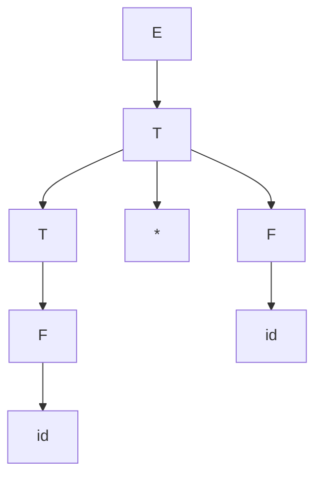

# 12. Bottom-Up Parsing: Reductions, Handles & Shift-Reduce

> ✅ **From the class notes** (`Rati CD full.pdf`, pp. 26–27; also `Compiler notes.pdf` pp. 17–18). The shift-reduce stack algorithm and conflicts (§4–§5) are standard material added to complete the topic.
> **Syllabus:** *After-mid: bottom-up parsing*

---

## 🎯 In one line

A bottom-up parser starts from the **input string (the leaves)** and repeatedly **reduces** a **handle** (the right side of a production) to its left-side non-terminal until only the **start symbol** remains. This traces a **rightmost derivation in reverse**.

---

## 1. Top-down vs bottom-up (class notes p. 15, p. 26)

| | Top-down ([Ch. 9](09-predictive-parsing-ll1.md)) | **Bottom-up** |
|---|---|---|
| Builds the parse tree from | **Root** → leaves | **Leaves** → root |
| Basic step | **Derivation**: expand a non-terminal | **Reduction**: replace a production body by its head |
| Derivation traced | Leftmost | **Rightmost, in reverse** |
| Typical parsers | Recursive descent, LL(1) | **Shift-reduce, LR(0), SLR(1), CLR(1), LALR(1)** |
| Handles left recursion? | ❌ No (must remove it) | ✅ Yes |
| Grammar class | Smaller | **Larger** (most programming languages) |

---

## 2. Bottom-up parse of `id * id` (class notes p. 26) ⭐

Grammar $G$:
$$E \to E + T \mid T \qquad T \to T * F \mid F \qquad F \to (E) \mid \texttt{id}$$

The tree grows **upwards** one reduction at a time:

$$\texttt{id} * \texttt{id} \;\to\; F * \texttt{id} \;\to\; T * \texttt{id} \;\to\; T * F \;\to\; T \;\to\; E$$

Each arrow adds one new interior node above existing nodes. The finished tree:

Built bottom-up: first `id → F` (left), then `F → T`, then the right `id → F`, then `T * F → T`, and finally `T → E`.

---

## 3. Reduction and handle (class notes pp. 26–27) ⭐⭐⭐

**Reduction**
- Bottom-up parsing is the process of **"reducing" a string $w$ to the start symbol**.
- At each reduction step, a substring matching the **body** (right side) of a production is replaced by the **non-terminal on its left side**.
- A reduction is the **reverse of a step in a derivation**.
- The goal of bottom-up parsing is to construct a **rightmost derivation in reverse**:

$$E \underset{rm}{\Rightarrow} T \underset{rm}{\Rightarrow} T * F \underset{rm}{\Rightarrow} T * \texttt{id} \underset{rm}{\Rightarrow} F * \texttt{id} \underset{rm}{\Rightarrow} \texttt{id} * \texttt{id}$$

Read **right to left**, this is exactly the sequence of reductions above.

**Handle**

> A **handle** is a substring that matches the body of a production **and** whose reduction is one step of the reverse rightmost derivation. Formally: if $S \overset{*}{\underset{rm}{\Rightarrow}} \alpha A w \underset{rm}{\Rightarrow} \alpha\beta w$, then $A \to \beta$ (at that position) is a handle of $\alpha\beta w$.

**Handles during the parse of `id₁ * id₂`** (class table, p. 27):

| Right-sentential form | Handle | Reducing production |
|---|---|---|
| $\texttt{id}_1 * \texttt{id}_2$ | $\texttt{id}_1$ | $F \to \texttt{id}$ |
| $F * \texttt{id}_2$ | $F$ | $T \to F$ |
| $T * \texttt{id}_2$ | $\texttt{id}_2$ | $F \to \texttt{id}$ |
| $T * F$ | $T * F$ | $T \to T * F$ |
| $T$ | $T$ | $E \to T$ |
| $E$ | (start symbol: done) | |

> ⚠️ **Not every matching substring is a handle.** In $T * \texttt{id}_2$, $T$ matches $E \to T$, but reducing it gives $E * \texttt{id}_2$, which can never reduce to $E$ (no production contains $E *$). The handle there is $\texttt{id}_2$.

**Handle pruning:** repeatedly finding the handle and reducing it is called handle pruning. A rightmost derivation in reverse is obtained by handle pruning.

---

## 4. Shift-reduce parsing (the stack machine) ⭐⭐

A bottom-up parser keeps a **stack** of grammar symbols and an **input buffer**. Initially the stack is `$` and the input is `w$`. The handle always appears at the **top of the stack**.

| Action | What it does |
|---|---|
| **Shift** | Move the next input symbol onto the stack |
| **Reduce** | The handle is on top of the stack: pop it and push the production's head |
| **Accept** | The stack holds `$ S` and the input is `$` |
| **Error** | No valid action |

**Trace for `id * id`:**

| Stack | Input | Action |
|---|---|---|
| `$` | `id₁ * id₂ $` | shift |
| `$ id₁` | `* id₂ $` | reduce $F \to \texttt{id}$ |
| `$ F` | `* id₂ $` | reduce $T \to F$ |
| `$ T` | `* id₂ $` | shift *(not reduce $E \to T$!)* |
| `$ T *` | `id₂ $` | shift |
| `$ T * id₂` | `$` | reduce $F \to \texttt{id}$ |
| `$ T * F` | `$` | reduce $T \to T * F$ |
| `$ T` | `$` | reduce $E \to T$ |
| `$ E` | `$` | **accept** |

The row marked *"not reduce"* is the hard decision. **LR parsers** ([Ch. 13](13-lr0-items-closure-goto.md)–[14](14-slr1-parsing.md)) make it mechanically using states and a parsing table.

---

## 5. Conflicts in shift-reduce parsing

| Conflict | Meaning | Classic cause |
|---|---|---|
| **Shift/reduce** | The parser can't decide whether to shift or reduce | Dangling-else: on `else`, shift (attach it to the inner `if`) or reduce `if E then S`? |
| **Reduce/reduce** | Two productions could reduce the top of the stack | Two productions with the same body, e.g. `id` as a procedure name vs an array name |

A grammar whose table has **no** conflicts for a given method is said to be in that class (LR(0), SLR(1), …). Ambiguous grammars are never LR.

---

## 6. Common exam questions

1. **Differentiate top-down and bottom-up parsing.** See the table in §1.
2. **Define reduction and handle. Give the handles while parsing `id * id`.** See §3.
3. **Show the bottom-up parse (tree) for `id * id`.** See §2.
4. **What is handle pruning?** See §3.
5. **Explain shift-reduce parsing with a stack trace.** See §4.
6. **What are shift/reduce and reduce/reduce conflicts?** See §5.

---

## ⚡ Quick revision

- Bottom-up = **leaves → root** = **reductions** = **rightmost derivation in reverse**.
- **Reduction:** replace a body by its head. **Handle:** the body whose reduction lies on the reverse RMD.
- `id * id` handles: $\texttt{id}_1$ → $F$ → $\texttt{id}_2$ → $T * F$ → $T$.
- Shift-reduce actions: **shift, reduce, accept, error**. The handle is always on top of the stack.
- Conflicts: **S/R** (dangling else) and **R/R**.

---

**Previous:** [← 11. Mid-Sem Paper 2026 — Solved](11-mid-sem-2026-paper-solved.md) · **Next:** [13. LR(0) Items, CLOSURE & GOTO →](13-lr0-items-closure-goto.md)
