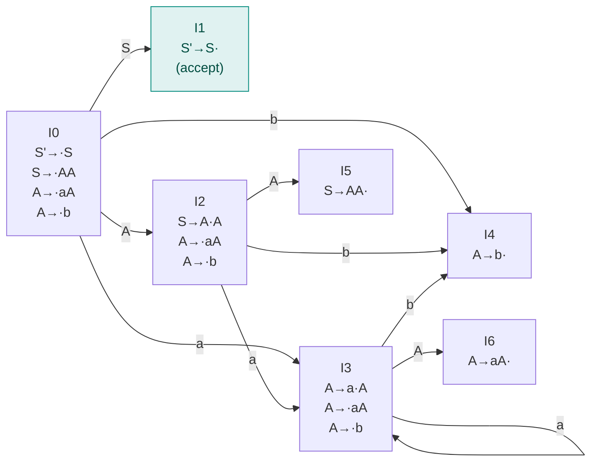

# 13. LR Parsing: LR(0) Items, CLOSURE, GOTO & the LR(0) Automaton

> ✅ **From the class notes** (`Rati CD full.pdf`, pp. 28–30). The canonical collection below was re-generated by computer and matches the class automaton state for state.
> **Syllabus:** *After-mid: LR parsing, LR(0) items, canonical LR(0) collection*

---

## 🎯 In one line

An **LR(0) item** is a production with a **dot** showing how much of it has been seen. **CLOSURE** adds the items we might start next, and **GOTO** moves the dot over a symbol. The resulting sets of items are the **states of a DFA** (the LR(0) automaton) that tells the shift-reduce parser what to do.

---

## 1. LR parsing (class notes p. 28)

LR parsing is the **most prevalent type of bottom-up parser**.

$$\text{LR}(k):\quad \underbrace{\text{L}}_{\text{left-to-right scan of the input}} \quad \underbrace{\text{R}}_{\text{rightmost derivation in reverse}} \quad \underbrace{(k)}_{\text{number of lookahead symbols}}$$

| Variant | Full name | Lookahead in reduce decisions |
|---|---|---|
| **LR(0)** | – | none (reduce on every symbol) |
| **SLR(1)** | **Simple LR** | FOLLOW sets |
| **CLR(1)** | **Canonical LR** | exact LR(1) lookaheads (largest tables) |
| **LALR(1)** | **Look-Ahead LR** | merged LR(1) states (used by YACC/Bison) |

*(The notes write "SLR: symbol LR". The standard name is **Simple LR**.)*

The parser makes shift-reduce decisions by maintaining **states** on the stack (§5). Power: $\text{LR}(0) \subset \text{SLR}(1) \subset \text{LALR}(1) \subset \text{CLR}(1)$.

**Why LR?** It recognises virtually all programming-language constructs, handles **left recursion**, detects errors as soon as possible, and is strictly more powerful than LL(1).

---

## 2. LR(0) items ⭐⭐

An **LR(0) item** of a grammar $G$ is a **production of $G$ with a dot at some position of the body**.

Production $A \to XYZ$ gives **four** items:

| Item | Meaning |
|---|---|
| $A \to \cdot XYZ$ | We hope to see a string derivable from $XYZ$ next |
| $A \to X \cdot YZ$ | We have seen a string derivable from $X$; we expect $YZ$ |
| $A \to XY \cdot Z$ | We have seen $XY$; we are **looking for $Z$** |
| $A \to XYZ \cdot$ | We have seen the whole body, so it is **time to reduce** to $A$ (a *complete* item) |

A production $A \to \varepsilon$ gives the single item $A \to \cdot$.

---

## 3. Constructing the canonical LR(0) collection ⭐⭐⭐

We need an **augmented grammar** and two functions, **CLOSURE** and **GOTO**.

### 3.1 Augmented grammar

If $G$ has start symbol $S$, then $G'$ is $G$ plus a new start symbol $S'$ and the production
$$S' \to S$$
Its only purpose is to signal **acceptance**: the parser accepts exactly when it is about to reduce $S' \to S$.

### 3.2 CLOSURE of an item set $I$

1. Initially, add **every item in $I$** to CLOSURE($I$).
2. If $A \to \alpha \cdot B\beta$ is in CLOSURE($I$) and $B \to \gamma$ is a production, add the item $B \to \cdot\gamma$ (if it is not already there).
3. Apply rule 2 **until no more items can be added**.

> **Intuition:** the dot before $B$ means we expect to see a $B$ next, so we must also be ready to start **any** production of $B$.

### 3.3 GOTO(I, X)

$\text{GOTO}(I, X)$ **specifies the transition from the state for $I$ under input $X$** (a terminal or non-terminal):
$$\text{GOTO}(I, X) = \text{CLOSURE}\big(\{A \to \alpha X \cdot \beta \;:\; A \to \alpha \cdot X\beta \in I\}\big)$$
That is, move the dot **over $X$** in every item where $X$ follows the dot, then take the closure.

### 3.4 The algorithm

```
C = { CLOSURE({ S' → ·S }) }
repeat
    for each set of items I in C
        for each grammar symbol X
            if GOTO(I, X) is non-empty and not already in C
                add GOTO(I, X) to C
until no new sets are added
```

---

## 4. Worked example: the class grammar (pp. 29–30) ⭐⭐⭐

$$S \to AA \qquad A \to aA \mid b$$

**Augmented and numbered:**

| # | Production |
|---|---|
| 0 | $S' \to S$ |
| 1 | $S \to AA$ |
| 2 | $A \to aA$ |
| 3 | $A \to b$ |

**$I_0 = \text{CLOSURE}(\{S' \to \cdot S\})$.**
- The dot is before $S$, so add $S \to \cdot AA$.
- The dot is before $A$, so add $A \to \cdot aA$ and $A \to \cdot b$.

$$I_0 = \{\, S' \to \cdot S,\;\; S \to \cdot AA,\;\; A \to \cdot aA,\;\; A \to \cdot b \,\}$$

**Transitions:**

| From | On | Kernel (dot moved) | + closure | New state |
|---|---|---|---|---|
| $I_0$ | $S$ | $S' \to S\cdot$ | – | $I_1$ ✱ accept |
| $I_0$ | $A$ | $S \to A\cdot A$ | $A \to \cdot aA$, $A \to \cdot b$ | $I_2$ |
| $I_0$ | $a$ | $A \to a\cdot A$ | $A \to \cdot aA$, $A \to \cdot b$ | $I_3$ |
| $I_0$ | $b$ | $A \to b\cdot$ | – | $I_4$ |
| $I_2$ | $A$ | $S \to AA\cdot$ | – | $I_5$ |
| $I_2$ | $a$ | $A \to a\cdot A$ | | $= I_3$ |
| $I_2$ | $b$ | $A \to b\cdot$ | | $= I_4$ |
| $I_3$ | $A$ | $A \to aA\cdot$ | – | $I_6$ |
| $I_3$ | $a$ | $A \to a\cdot A$ | | $= I_3$ (self-loop) |
| $I_3$ | $b$ | $A \to b\cdot$ | | $= I_4$ |

**Canonical LR(0) collection** (7 states):

| State | Items |
|---|---|
| $I_0$ | $S' \to \cdot S$, $S \to \cdot AA$, $A \to \cdot aA$, $A \to \cdot b$ |
| $I_1$ | $S' \to S\cdot$ |
| $I_2$ | $S \to A\cdot A$, $A \to \cdot aA$, $A \to \cdot b$ |
| $I_3$ | $A \to a\cdot A$, $A \to \cdot aA$, $A \to \cdot b$ |
| $I_4$ | $A \to b\cdot$ |
| $I_5$ | $S \to AA\cdot$ |
| $I_6$ | $A \to aA\cdot$ |

**LR(0) automaton** (class figure, p. 30):



The class notes describe two of the edges:
- $I_0$ goes to $I_2$ when the "·" of the 1st production $S \to \cdot AA$ is **shifted right** over $A$, giving $S \to A\cdot A$.
- $I_0$ goes to $I_3$ when the "·" of the 2nd production $A \to \cdot aA$ is shifted right over $a$, giving $A \to a\cdot A$.

**Reading the automaton:**
- States containing a **complete item** ($I_1, I_4, I_5, I_6$) are where a **reduce** happens.
- An edge on a **terminal** is a **shift**. An edge on a **non-terminal** is a **GOTO** (used after a reduce).

The parsing table built from this automaton is in [Ch. 14](14-slr1-parsing.md).

---

## 5. Why states on the stack?

A plain shift-reduce parser ([Ch. 12 §4](12-bottom-up-parsing-and-handles.md)) has to guess whether the top of the stack is a handle. The LR(0) automaton removes the guess: the **state on top of the stack summarises everything below it**. If that state contains a complete item $A \to \beta\cdot$, then $\beta$ is a handle candidate. If it has an edge on the next input symbol, a shift is possible. The table in Ch. 14 encodes exactly this.

---

## 6. Common exam questions

1. **What is LR parsing? Expand LR(k). Name the LR parsers.** See §1.
2. **What is an LR(0) item? List the items of $A \to XYZ$.** See §2.
3. **What is an augmented grammar and why is it needed?** See §3.1.
4. **Define CLOSURE and GOTO.** See §3.2–§3.3.
5. **Construct the canonical LR(0) collection / LR(0) automaton for $S \to AA$, $A \to aA \mid b$.** See §4 (7 states).

---

## ⚡ Quick revision

- **LR(k)** = **L**eft-to-right scan, **R**ightmost derivation in reverse, **k** lookahead.
- **SLR = Simple LR**, CLR = Canonical LR, LALR = Look-Ahead LR. LR(0) ⊂ SLR ⊂ LALR ⊂ CLR.
- **Item** = production + dot. $A \to XYZ$ has **4** items. $A \to \varepsilon$ has 1 ($A \to \cdot$).
- **Augment:** $S' \to S$.
- **CLOSURE:** a dot before $B$ ⇒ add $B \to \cdot\gamma$ for every $B$-production, repeatedly.
- **GOTO(I, X):** move the dot over $X$, then take the closure.
- Class grammar $S \to AA$, $A \to aA \mid b$ gives **$I_0$–$I_6$**. Complete items are in $I_1$ (accept), $I_4$, $I_5$, $I_6$.

---

**Previous:** [← 12. Bottom-Up Parsing & Handles](12-bottom-up-parsing-and-handles.md) · **Next:** [14. SLR(1) Parsing →](14-slr1-parsing.md)
