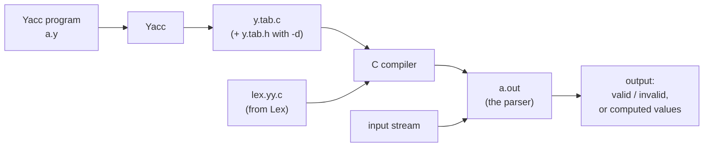

# 15. YACC: The Parser Generator

> ✅ **From the class notes** (`Rati CD full.pdf`, pp. 32–33). The class program is reproduced, then completed with the pieces a real build needs: a prologue, `yyerror` and a Lex rule for `NAME`. The additions are marked 🆕. *(Standard Lex/YACC; not compiled here, because no yacc/bison toolchain is installed on this machine.)*
> **Syllabus:** *After-mid: parser generator YACC*

---

## 🎯 In one line

**YACC** (*Yet Another Compiler-Compiler*) does for **syntax** what Lex does for **tokens**. You write grammar productions with C actions, and YACC generates an **LALR(1)** parser `y.tab.c` whose `yyparse()` calls Lex's `yylex()` for each token.

---

## 1. How YACC is used (p. 32) ⭐



| Step | Command | Produces |
|---|---|---|
| 1 | `yacc -d a.y` | `y.tab.c` (the parser) and `y.tab.h` (token codes for Lex) |
| 2 | `lex a.l` | `lex.yy.c` (the scanner) |
| 3 | `cc y.tab.c lex.yy.c -o a.out` | the executable |

| Lex ([Ch. 5](05-lexical-analysis-and-lex.md)) | YACC |
|---|---|
| Regular expressions → **tokens** | Grammar productions → **parse** |
| Generates a DFA, `yylex()` | Generates an **LALR(1)** table, `yyparse()` |
| `lex.yy.c` | `y.tab.c` |

---

## 2. Structure of a YACC program (p. 32) ⭐⭐

```
declarations
%%
translation rules
%%
supporting C functions
```

| Section | Contains |
|---|---|
| **Declarations** | `%{ … %}` C code (includes, prototypes), `%token` declarations, `%left`/`%right` precedence, `%start` |
| **Translation rules** | Grammar productions, each with a semantic action |
| **Supporting functions** | `main()`, `yyerror()`, and any helpers |

**Translation rules** consist of a **grammar production and an associated action**:

```
head : body1   { semantic action 1 }
     | body2   { semantic action 2 }
     ...
     | bodyn   { semantic action n }
     ;
```

- `head` is a non-terminal, and the bodies are sequences of tokens and non-terminals.
- Inside an action, **`$$`** is the value of the head and **`$1, $2, …`** are the values of the body symbols.
- If no action is given, the default is `$$ = $1`.

---

## 3. Class program: arithmetic with `+` and `−` (p. 32–33) ⭐⭐⭐

> **Q. Write a YACC program which recognises arithmetic expressions involving `+` and `−`.**
> $$\textit{stmt} \to \texttt{NAME} = \textit{exp} \mid \textit{exp}$$
> $$\textit{exp} \to \texttt{NUM} + \texttt{NUM} \mid \texttt{NUM} - \texttt{NUM} \mid \texttt{NUM} + \textit{exp} \mid \texttt{NUM} - \textit{exp}$$

**As written in class:**

```yacc
%token NAME NUMBER EQUAL PLUS MINUS
%%
stmt : NAME EQUAL exp
     | exp
     ;
exp  : NUMBER PLUS NUMBER
     | NUMBER MINUS NUMBER
     | NUMBER PLUS exp
     | NUMBER MINUS exp
     ;
%%
int main(void) {
    printf("enter arithmetic expressions:\n");
    if (yyparse() == 0)
        printf("valid exp\n");
    else
        printf("Invalid exp\n");
    return 0;
}
```

```lex
/* corresponding lex program */
[0-9]+   { return NUMBER; }
"+"      { return PLUS;   }
"-"      { return MINUS;  }
"="      { return EQUAL;  }
```

`yyparse()` returns **0** if the whole input matched the grammar and non-zero on a syntax error.

### 🆕 Complete version

**`expr.y`**
```yacc
%{
#include <stdio.h>
int yylex(void);
void yyerror(const char *s);
%}

%token NAME NUMBER EQUAL PLUS MINUS

%%
stmt : NAME EQUAL exp
     | exp
     ;
exp  : NUMBER PLUS NUMBER
     | NUMBER MINUS NUMBER
     | NUMBER PLUS exp
     | NUMBER MINUS exp
     ;
%%

void yyerror(const char *s) { /* called by yyparse on a syntax error */ }

int main(void) {
    printf("enter arithmetic expression:\n");
    if (yyparse() == 0) printf("valid exp\n");
    else                printf("Invalid exp\n");
    return 0;
}
```

**`expr.l`**
```lex
%{
#include "y.tab.h"          /* token codes generated by yacc -d */
%}
%%
[0-9]+                  { return NUMBER; }
[a-zA-Z][a-zA-Z0-9]*    { return NAME;   }   /* missing in the class version */
"+"                     { return PLUS;   }
"-"                     { return MINUS;  }
"="                     { return EQUAL;  }
[ \t]                   ;                      /* skip blanks */
\n                      { return 0; }          /* end of input */
.                       { return yytext[0]; }  /* anything else → syntax error */
%%
int yywrap(void) { return 1; }
```

**Build and run** (expected behaviour):
```
yacc -d expr.y
lex expr.l
cc y.tab.c lex.yy.c -o expr
./expr        input: x = 3 + 4 - 2   →  valid exp
              input: 3 + + 4         →  Invalid exp
```

> **Why the grammar is written right-recursively** ($\texttt{NUMBER}\ \texttt{PLUS}\ \textit{exp}$): every expression starts with a number, and the rest of the chain hangs off the right. YACC (being LR) handles left recursion too, and `exp : exp PLUS NUMBER | NUMBER` is the more usual style. It makes `+` and `−` **left-associative**.

---

## 4. 🆕 Evaluating with semantic values (`$$`, `$1`, `$3`)

A calculator version computes the value instead of only checking validity:

```yacc
%{
#include <stdio.h>
#include <stdlib.h>
int yylex(void);
void yyerror(const char *s) { printf("error\n"); }
%}
%token NUMBER
%left '+' '-'          /* lower precedence, left-associative */
%left '*' '/'          /* higher precedence */
%%
line : expr '\n'          { printf("= %d\n", $1); }
     ;
expr : expr '+' expr      { $$ = $1 + $3; }
     | expr '-' expr      { $$ = $1 - $3; }
     | expr '*' expr      { $$ = $1 * $3; }
     | expr '/' expr      { $$ = $1 / $3; }
     | '(' expr ')'       { $$ = $2; }
     | NUMBER             { $$ = $1; }
     ;
%%
int main(void) { return yyparse(); }
```

with the Lex rule `[0-9]+ { yylval = atoi(yytext); return NUMBER; }` (and returning `yytext[0]` for operators and `'\n'`).

> The grammar `expr : expr '+' expr | …` is **ambiguous**, so YACC reports shift/reduce conflicts. The `%left` lines **resolve them by precedence and associativity**, exactly as [Ch. 6](06-cfg-and-ambiguity-elimination.md) does by rewriting the grammar.

---

## 5. Common exam questions

1. **What is YACC? Draw the steps to create a parser with YACC.** See §1.
2. **Explain the structure of a YACC program.** See §2.
3. **Write a YACC program to recognise arithmetic expressions with `+` and `−`** (with the Lex program). See §3. *This is the class question.*
4. **What do `$$` and `$1` mean? What is `yylval`?** See §2 and §4.
5. **How does YACC handle an ambiguous grammar?** With `%left`, `%right` and `%nonassoc`, or its default rules: shift on S/R and the first rule on R/R.
6. **What kind of parser does YACC generate?** **LALR(1)**.

---

## ⚡ Quick revision

- YACC: `a.y` → **`y.tab.c`** → C compiler → `a.out`. Use `-d` to get `y.tab.h` for Lex.
- Three sections: **declarations `%%` translation rules `%%` functions**.
- Rule: `head : body { action } | … ;`. `$$` is the head's value and `$i` the $i$-th body symbol's.
- `yyparse()` calls `yylex()` and returns **0 = valid**.
- Lex returns the token names declared by `%token`. `yylval` carries the token's value.
- YACC builds an **LALR(1)** parser. `%left` and `%right` resolve conflicts.

---

**Previous:** [← 14. SLR(1) Parsing](14-slr1-parsing.md) · **Next:** [16. Intermediate Code Generation →](16-intermediate-code-generation.md)
