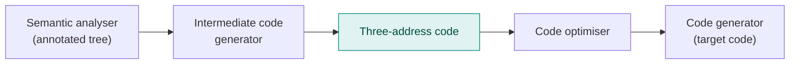

# 16. Intermediate Code Generation & Three-Address Code

> ✅ **From the class notes** (`Rati CD full.pdf`, pp. 35–38). Quadruples, triples and the `while` loop (§4, §5.4) are standard additions marked 🆕, included because they are common exam questions.
> **Syllabus:** *After-mid: intermediate code generation, three-address code, translation of control statements, arrays and procedure calls*

---

## 🎯 In one line

The front end turns the checked parse tree into **three-address code (TAC)**: simple instructions with **at most one operator** on the right, using temporaries $t_1, t_2, \dots$ and labels with `goto`. This machine-independent form is what the optimiser and the code generator work on.

---

## 1. What and why (p. 35)

- ICG **generates intermediate representations (IR)** of the source code.
- Its input is the **output of semantic analysis** (the modified, i.e. annotated, parse tree). Its output goes to the code optimiser.



**Need for the IC generation phase:**
1. **Without an IR it is very difficult to include a code-optimisation phase.** Optimisations are written once, on the IR, independent of the machine.
2. **IC simplifies the design of the compiler**, because the mapping of machine features (evaluation order of instructions, address allocation) is **partly completed in this phase**.
3. **Retargeting:** with $m$ languages and $n$ machines you need $m$ front ends and $n$ back ends, not $m \times n$ compilers ([Ch. 1](01-compiler-phases-overview.md)).

| IR form | Example for `a = b * c + d` |
|---|---|
| Syntax tree / DAG | a tree with `=`, `+`, `*` nodes |
| Postfix notation | `a b c * d + =` |
| **Three-address code** ⭐ | `t1 = b * c` · `t2 = t1 + d` · `a = t2` |

---

## 2. Three-address code (pp. 35–36) ⭐⭐⭐

TAC is **built from two concepts**:

**1. Addresses**, which are of three kinds:
- a **name** (a source variable such as `a`, `x`),
- a **constant** (`10`, `3.14`),
- a **compiler-generated temporary** (`t1`, `t2`, …).

**2. Instructions:**

| # | Form | TAC | Meaning |
|---|---|---|---|
| 1 | Assignment (binary) | `x = y op z` | `op` is an arithmetic or logical operator |
| 2 | Assignment (unary) | `x = op y` | unary minus, logical not, type conversion |
| 3 | Copy | `x = y` | |
| 4 | Unconditional jump | `goto L` | |
| 5 | Conditional jump | `if x goto L` / `ifFalse x goto L` | |
| 6 | Relational jump | `if x relop y goto L` | e.g. `if a > b goto L1` |
| 7 | Procedure call/return | `param x` · `call p, n` · `y = call p, n` · `return y` | `n` = the number of parameters |
| 8 | Indexed copy | `x = y[i]` · `x[i] = y` | |
| 9 | Address and pointer assignment | `x = &y` · `x = *p` · `*x = y` | |

> **"Three-address"** means at most three addresses per instruction: two operands and one result.

---

## 3. Translating expressions

**Example:** `a = b * -c + b * -c`

```
t1 = minus c
t2 = b * t1
t3 = minus c
t4 = b * t3
t5 = t2 + t4
a  = t5
```

*(After common-subexpression elimination in [Ch. 17](17-code-optimization-basic-blocks.md), `t3` and `t4` disappear.)*

---

## 4. 🆕 Representations of TAC: quadruples, triples, indirect triples ⭐⭐

Using the same example:

**Quadruples:** four fields `(op, arg1, arg2, result)`.

| # | op | arg1 | arg2 | result |
|---|---|---|---|---|
| 0 | minus | c | | t1 |
| 1 | * | b | t1 | t2 |
| 2 | minus | c | | t3 |
| 3 | * | b | t3 | t4 |
| 4 | + | t2 | t4 | t5 |
| 5 | = | t5 | | a |

**Triples:** three fields `(op, arg1, arg2)`. A result is referred to by its **position** `(i)`, so there are no temporaries.

| # | op | arg1 | arg2 |
|---|---|---|---|
| 0 | minus | c | |
| 1 | * | b | (0) |
| 2 | minus | c | |
| 3 | * | b | (2) |
| 4 | + | (1) | (3) |
| 5 | = | a | (4) |

**Indirect triples:** a separate **list of pointers to triples**, e.g. `35 → (0)`, `36 → (1)`, … An optimiser can **reorder the pointer list** without renumbering the triples.

| | Quadruples | Triples | Indirect triples |
|---|---|---|---|
| Temporaries | Explicit names | None (positions) | None |
| Moving code (optimisation) | Easy | **Hard** (references break) | Easy (reorder pointers) |
| Space | Most | Least | Medium |

---

## 5. Control statements ⭐⭐⭐

Each boolean expression $B$ gets two labels: **$B$.true** (where to go if it is true) and **$B$.false**.

### 5.1 `if–then` (p. 36)

**Source:** `if a > b then a = b + c`

```
      if a > b goto Ltrue
      goto Lfalse
Ltrue:  t1 = b + c
        a  = t1
Lfalse:
```

**Production:** $S \to \textbf{if}\ (B)\ S_1$. **Translation layout:**

```
        ┌──────────┐ ──► to B.true
        │  B.code  │ ──► to B.false
B.true: ├──────────┤
        │ S1.code  │
B.false:└──────────┘   (= S.next)
```

### 5.2 `if–then–else` (p. 37)

**Source:** `if a > b then a = b + c else a = b - c`

```
      if a > b goto Ltrue
      goto Lfalse
Ltrue:  t1 = b + c
        a  = t1
        goto Lnext          ← unconditional jump: the false part must NOT be executed
Lfalse: t2 = b - c
        a  = t2
Lnext:
```

**Production:** $S \to \textbf{if}\ (B)\ S_1\ \textbf{else}\ S_2$. **Translation layout:**

```
        ┌───────────────┐ ──► to B.true
        │    B.code     │ ──► to B.false
B.true: ├───────────────┤
        │   S1.code     │
        │ goto S.next   │
B.false:├───────────────┤
        │   S2.code     │
S.next: └───────────────┘
```

### 5.3 `do–while` (p. 38)

**Source:** `do i = i + 1; while (a[i] < b);` with integers of size 2.

```
L1: t1 = i + 1
    i  = t1
    t2 = i * 2          ← byte offset = i × width
    t3 = a[t2]
    if t3 < b goto L1
```

The body runs **at least once**, and the test is at the **bottom**.

### 5.4 🆕 `while`

**Source:** `while (a < b) a = a + 1;`

```
L1: if a < b goto L2
    goto L3
L2: t1 = a + 1
    a  = t1
    goto L1
L3:
```

### 5.5 Boolean expressions with short-circuit (p. 38) ⭐

**Source:** `if ((x < 100) || (x > 200 && x != y)) x = 0;`

```
    if x < 100 goto L1        ← || : first part true ⇒ whole condition true
    goto L3
L3: if x > 200 goto L4
    goto L2                   ← && : first part false ⇒ whole condition false
L4: if x != y goto L1
    goto L2
L1: x = 0                     ← true part
L2:                           ← false exit (next statement)
```

> **Short-circuit rule:** for `B1 || B2`, if B1 is true jump straight to the true label. For `B1 && B2`, if B1 is false jump straight to the false label. The second operand is evaluated **only if needed**.

---

## 6. Arrays (p. 38) ⭐⭐

**Address of an element** (row-major order, indices from 0):

$$\text{addr}(A[i]) = \text{base} + i \times w \qquad \text{addr}(A[i][j]) = \text{base} + (i \times n_2 + j) \times w$$

where $w$ is the element width and $n_2$ the number of columns.

**Example (class):** `c + a[i][j]`, where `a` is a $2 \times 3$ integer array and the size of an int is 2:

```
t1 = i * 6          ← i × (3 × 2): row offset (3 columns × 2 bytes)
t2 = j * 2          ← column offset
t3 = t1 + t2        ← total byte offset
t4 = a[t3]          ← indexed copy
t5 = c + t4         ← result
```

*(Make sure the last line adds the **fetched value** `t4`, not an offset such as `t1` or `t3`.)*

---

## 7. Procedure / function calls (p. 38)

**Source:** `x = f(a[i]);` with integers of size 2.

```
t1 = i * 2
t2 = a[t1]
param t2            ← pass the argument
t3 = call f, 1      ← call f with 1 parameter; returned value in t3
x  = t3
```

For `p(x1, x2, …, xn)`: `param x1` … `param xn`, then `call p, n`.

---

## 8. Common exam questions

1. **What is intermediate code? Why is an ICG phase needed?** See §1.
2. **List the types of three-address statements.** See §2.
3. **Write TAC for `a = b * -c + b * -c` and give its quadruple, triple and indirect-triple forms.** See §3–§4.
4. **Generate TAC for `if a > b then a = b + c else a = b - c`** and draw the translation layout. See §5.2.
5. **TAC for a do-while or while loop.** See §5.3–§5.4.
6. **TAC for `if ((x < 100) || (x > 200 && x != y)) x = 0`.** See §5.5.
7. **TAC for `c + a[i][j]` (2×3 array, int = 2 bytes).** See §6.
8. **TAC for the call `x = f(a[i])`.** See §7.

---

## ⚡ Quick revision

- TAC = **addresses** (name, constant, temporary) + **instructions** (`x = y op z`, `x = op y`, `x = y`, `goto`, `if … goto`, `param`/`call`, `x = y[i]`, `x = &y`, `x = *p`).
- **Quadruple** (op, a1, a2, res) · **triple** (op, a1, a2), referenced by position · **indirect triple** = a pointer list.
- `if–else`: B.code → S1.code + **`goto S.next`** → S2.code.
- Short-circuit: `||` true ⇒ jump to the true label. `&&` false ⇒ jump to the false label.
- `A[i][j]` offset = $(i \cdot n_2 + j) \cdot w$. For the 2×3 array with $w = 2$: `t1 = i*6`, `t2 = j*2`.
- Call: `param` each argument, then `t = call f, n`.

---

**Previous:** [← 15. YACC](15-yacc.md) · **Next:** [17. Code Optimization & Basic Blocks →](17-code-optimization-basic-blocks.md)
