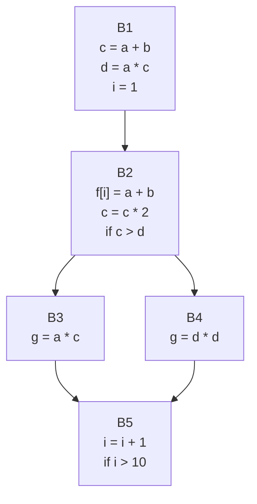
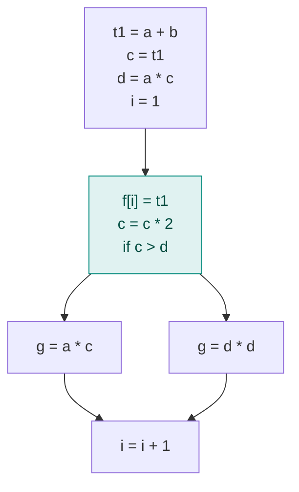
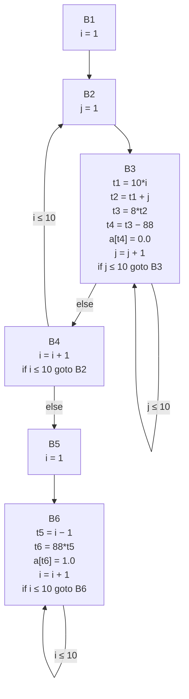

# 17. Code Optimization, Basic Blocks & Flow Graphs

> ✅ **From the class notes** (`Rati CD full.pdf`, pp. 39–43). A few slips in the handwritten examples are corrected and flagged ⚠️. Other standard optimisations (§5) are added and marked 🆕.
> **Syllabus:** *After-mid: code optimization, local and global optimization, basic blocks, flow graphs*

---

## 🎯 In one line

Optimisation rewrites the intermediate code to run **faster or in less space** **without changing its output or side effects**. To do it, split the code into **basic blocks** (straight-line runs starting at *leaders*), connect them into a **flow graph**, and apply transformations within a block (**local**) or across blocks (**global**).

---

## 1. What is code optimisation? (p. 39)

- It is the **process of transforming a piece of code (IC) to make it more efficient** in terms of **time and space**.
- There must be **no change in output or side effects**: the program's meaning is preserved.

| Type | Scope |
|---|---|
| **Local optimisation** | Transformation applied **within one basic block** |
| **Global optimisation** | Transformation applied **across all the basic blocks** (needs data-flow analysis on the flow graph) |

The three transformations in the class notes are **common subexpression elimination**, **copy propagation** and **dead-code elimination**.

---

## 2. Common Subexpression Elimination (CSE) (p. 39) ⭐⭐⭐

**Idea:** check for **redundancy**. If an expression was already computed and its operands have **not changed since**, reuse the earlier result instead of computing it again.

**Example:** `for (i = 0; i < 10; i++) b[i] = a[i];` (4-byte elements)

| Intermediate code | Optimised code |
|---|---|
| 1. `i = 0` | 1. `i = 0` |
| 2. `if i < 10 goto 4` | 2. `if i < 10 goto 4` |
| 3. `goto 10` | 3. `goto 9` |
| 4. **`t1 = 4 * i`** | 4. `t1 = 4 * i` |
| 5. `t2 = a[t1]` | 5. `t2 = a[t1]` |
| 6. **`t3 = 4 * i`** ← same as t1 | 6. `b[t1] = t2` |
| 7. `b[t3] = t2` | 7. `i = i + 1` |
| 8. `i = i + 1` | 8. `goto 2` |
| 9. `goto 2` | 9. `end` |
| 10. `end` | |

Instead of calculating `4 * i` **twice**, the optimised code calculates it **only once**. One instruction is saved per iteration, so 10 instructions in all.

> ⚠️ The handwritten loop header says `i < 9` and line 6 says `t3 = 4 * t1`. The intended code is `i < 10` and `t3 = 4 * i` (the same expression as line 4), which is what makes it a common subexpression.

---

## 3. Copy Propagation (p. 40) ⭐⭐

**Idea:** after a **copy statement** `u = v`, use `v` in place of `u` wherever possible. The copy often becomes **dead** and can then be removed.

| Intermediate code | After copy propagation | After dead-code removal |
|---|---|---|
| `x = t3` | `x = t3` | ~~`x = t3`~~ (if `x` is not used later) |
| `a[t2] = t5` | `a[t2] = t5` | `a[t2] = t5` |
| `a[t4] = x` | `a[t4] = t3` | `a[t4] = t3` |

---

## 4. Dead Code Elimination (p. 40) ⭐⭐

**Dead code** is the part of the code that **will never be executed** (unreachable), **or** whose result is **never used**.

```c
x = 15;
if (x == 15)
    printf("x is 15");
else
    printf("x is not 15");      /* the else branch is not reachable */
```

`x` is known to be 15 (constant propagation), so the test is always true. The `else` branch is **unreachable** and is removed, and so is the test itself.

---

## 5. 🆕 Other standard optimisations (for completeness)

| Optimisation | Before | After |
|---|---|---|
| **Constant folding** | `x = 3 * 4` | `x = 12` |
| **Constant propagation** | `x = 15; y = x + 1` | `y = 16` |
| **Strength reduction** | `t = i * 4` in a loop | `t = t + 4` each iteration |
| **Code motion** (loop-invariant) | `while (i < n) { x = y + z; … }` | `x = y + z;` hoisted **before** the loop |
| **Induction-variable elimination** | `i` used only to compute `t = 4 * i` | keep only `t` |
| **Algebraic simplification** | `x = x + 0`, `x = x * 1` | removed |

---

## 6. Optimisation on a control flow graph (CFG) (pp. 40–41) ⭐⭐⭐

### 6.1 Global CSE



- `a + b` in **B2** is **redundant**: it was computed in B1, and neither `a` nor `b` changes on the path B1 → B2.
- `a * c` in **B3** is **not redundant**: `c` changes in B2 (`c = c * 2`), so the value from B1 is out of date.

**Optimised graph (p. 41):**



### 6.2 Global copy propagation (p. 41)

```
   BEFORE (copy exists)                    AFTER (b = a removed)
  ┌──────────────┐                        ┌──────────────┐
  │ b = a        │                        │ c = 4 * a    │
  │ c = 4 * b    │                        │ if c > a     │
  │ if c > b     │                        └──┬────────┬──┘
  └──┬────────┬──┘                           │        │
     │        │                        ┌─────▼──┐ ┌───▼─────┐
 ┌───▼────┐ ┌─▼───────┐                │e = a+a │ │d = a + 2│
 │e = a+b │ │d = b + 2│                └────────┘ └─────────┘
 └────────┘ └─────────┘
```

Every use of `b` after the copy `b = a` is replaced by `a`. The copy `b = a` is then **dead** and is **removed**.

---

## 7. Basic blocks (p. 42) ⭐⭐⭐

A **basic block** is a maximal sequence of consecutive instructions with:
- **one entry**, the first instruction (no jumps into the middle), and
- **one exit**, the last instruction (no jumps out except at the end).

We use a **graph representation** for IC: partition the IC into basic blocks by finding **leaders**.

### Rules for finding leaders

1. The **first instruction** is a leader.
2. **Any instruction that is the target of a jump** (conditional or unconditional) is a leader.
3. **Any instruction that immediately follows a jump** is a leader.

**Each basic block consists of a leader and all instructions up to, but not including, the next leader.**

### Worked example: IC to set a 10 × 10 matrix to an identity matrix (pp. 42–43) ⭐⭐⭐

```
 1)  i = 1
 2)  j = 1
 3)  t1 = 10 * i
 4)  t2 = t1 + j
 5)  t3 = 8 * t2
 6)  t4 = t3 - 88
 7)  a[t4] = 0.0
 8)  j = j + 1
 9)  if j <= 10 goto (3)
10)  i = i + 1
11)  if i <= 10 goto (2)
12)  i = 1
13)  t5 = i - 1
14)  t6 = 88 * t5
15)  a[t6] = 1.0
16)  i = i + 1
17)  if i <= 10 goto (13)
```

*(Lines 1–11 set every element to 0.0 with 8-byte elements, and lines 12–17 put 1.0 on the diagonal.)*

> ⚠️ The handwritten listing on p. 42 has `t1 = 10 * j` at line 3. It should be `10 * i`, as on p. 43. Likewise B6's `a[6] = 10` on p. 43 means `a[t6] = 1.0`.

**Leaders:**

| Leader | Rule |
|---|---|
| **1** | first instruction |
| **2** | target of `goto (2)` in line 11 |
| **3** | target of `goto (3)` in line 9 |
| **13** | target of `goto (13)` in line 17 |
| **10** | immediately follows the jump in line 9 |
| **12** | immediately follows the jump in line 11 |

**Basic blocks:**

| Block | Instructions |
|---|---|
| **B1** | 1 |
| **B2** | 2 |
| **B3** | 3 – 9 |
| **B4** | 10 – 11 |
| **B5** | 12 |
| **B6** | 13 – 17 |

---

## 8. Flow graph (p. 43) ⭐⭐⭐

A **flow graph** is the graph representation of IC:
- its **nodes** are the **basic blocks**;
- there is an **edge from block A to block B** iff B can **immediately follow** A in execution. Either A ends in a jump to B's leader, or B comes right after A in the code and A does not end in an unconditional jump.



**Loops** in the flow graph: {B3} (inner `j` loop), {B2, B3, B4} (outer `i` loop) and {B6} (diagonal loop). Optimisations such as code motion target these loops.

---

## 9. Common exam questions

1. **What is code optimisation? Local vs global?** See §1.
2. **Explain CSE / copy propagation / dead-code elimination with examples.** See §2–§4.
3. **Apply CSE and copy propagation to the given flow graph.** See §6.
4. **Define basic block and leader. Give the rules for finding leaders.** See §7.
5. **Partition the given code into basic blocks and draw the flow graph** (the identity-matrix code). See §7–§8. ⭐ *A classic exam question.*
6. **List other machine-independent optimisations.** See §5.

---

## ⚡ Quick revision

- Optimise for **time and space**, with **no change in output or side effects**. **Local** = within a block. **Global** = across blocks.
- **CSE:** reuse an expression whose operands haven't changed (`4*i` computed once).
- **Copy propagation:** after `u = v`, use `v`, and the copy then dies.
- **Dead code:** unreachable or unused, so delete it.
- **Leaders:** ① the first instruction ② a jump target ③ the instruction after a jump. Block = leader … up to the next leader.
- Identity-matrix code: **leaders 1, 2, 3, 10, 12, 13** give **B1–B6**. Self-loops on B3 and B6, and back edge B4 → B2.

---

**Previous:** [← 16. Intermediate Code Generation](16-intermediate-code-generation.md) · **Next:** [18. Code Generation →](18-code-generation.md)
