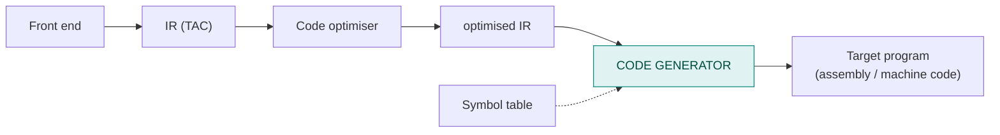

# 18. Code Generation

> ✅ **From the class notes** (`Rati CD full.pdf`, pp. 44–45). Addressing modes, the extra translations and the redundant-load example (§4–§6) are standard additions marked 🆕.
> **Syllabus:** *After-mid: code generation phase, simple target machine model*

---

## 🎯 In one line

The **final phase** takes the (optimised) IR from the front end and maps it to an **instruction sequence the target machine can execute**. It does three jobs: **instruction selection**, **register allocation/assignment** and **instruction ordering**.

---

## 1. The code-generation phase (p. 44)

- It is the **final phase** in the compiler model.
- It **takes as input the IR produced by the front end** (usually after optimisation).
- It **maps the IR into a code sequence that can be executed by the target machine**.
- Target architectures are **RISC, CISC and stack-based**. They differ in the **number of registers, the instructions and the addressing modes**, so the code generator is the most **machine-dependent** part of the compiler.



---

## 2. The three primary tasks (p. 44) ⭐⭐⭐

| # | Task | What it decides |
|---|---|---|
| 1 | **Instruction selection** | **Which instructions to choose** for each IR statement. This depends on the **instruction-set architecture**: a richer ISA allows fewer, more powerful instructions |
| 2 | **Register allocation and assignment** | **Allocation:** which **variables will reside in registers** ($x \to R_i$). **Assignment:** which **specific register** each one gets ($R_i \to x$). Registers are the fastest storage but few in number |
| 3 | **Instruction ordering** | The **order in which computations are performed** affects the **efficiency** of the target code (fewer registers or stalls needed) |

> 🆕 Other design issues usually listed with these: the **input** to the code generator (the IR form), the **target program** form (absolute, relocatable or assembly), and **memory management** (mapping names to addresses).

---

## 3. A simple target machine model (pp. 44–45) ⭐⭐⭐

Assume a register machine with registers $R_0, R_1, \dots$ and these instructions:

| # | Kind | Instruction | Effect |
|---|---|---|---|
| 1 | **Load** | `LD r, x` | Load the value of `x` (at location `x`) into register `r` |
| 2 | **Store** | `ST x, r` | Store the value in register `r` into location `x` |
| 3 | **Computation** | `ADD r1, r2, r3` | `r1 = r2 + r3` |
| | | `SUB r1, r2, r3` | `r1 = r2 - r3` |
| | | `MUL r1, r2, r3` | `r1 = r2 * r3` |
| 4 | **Unconditional jump** | `BR L` | Control jumps to label `L` |
| 5 | **Conditional jump** | `BLTZ r, L` | Jump to label `L` if the value in register `r` is **less than zero** |

---

## 4. Translating three-address statements (p. 45) ⭐⭐⭐

### Example 1: `x = y - z`

```
LD  R1, y          // R1 = y
LD  R2, z          // R2 = z
SUB R3, R1, R2     // R3 = y − z
ST  x, R3          // x = R3
```

### Example 2: `if x < y goto L`

```
LD   R1, x
LD   R2, y
SUB  R1, R1, R2    // R1 = x − y
BLTZ R1, L         // x − y < 0  ⇔  x < y  ⇒  jump
```

> The machine has only "branch if less than zero", so `x < y` is turned into `x − y < 0`.

### 🆕 Example 3: `x = y + z * w`

The TAC is `t1 = z * w` then `x = y + t1`:

```
LD  R1, z
LD  R2, w
MUL R1, R1, R2     // R1 = z * w
LD  R2, y
ADD R1, R2, R1     // R1 = y + z*w
ST  x, R1
```

### 🆕 Addressing modes

| Mode | Form | Meaning | Example |
|---|---|---|---|
| Variable (absolute) | `x` | the memory location of `x` | `LD R1, x` |
| Indexed | `a(r)` | location `a + contents(r)` | `LD R2, a(R1)` loads `a[i]` |
| Register-indirect | `0(r)` / `*r` | location held in `r` | `LD R2, 0(R1)` loads `*p` |
| Immediate | `#c` | the constant `c` | `LD R1, #100` |

### 🆕 Example 4: `b = a[i]` (8-byte elements)

```
LD  R1, i
MUL R1, R1, 8      // byte offset = i × 8
LD  R2, a(R1)      // R2 = contents(a + R1)
ST  b, R2
```

### 🆕 Example 5: `x = *p`

```
LD  R1, p          // R1 = address held in p
LD  R2, 0(R1)      // R2 = *p
ST  x, R2
```

---

## 5. 🆕 Why instruction ordering and register reuse matter

TAC: `a = b + c` then `d = a + e`.

| Naive (statement by statement) | Improved |
|---|---|
| `LD R1, b` | `LD R1, b` |
| `LD R2, c` | `LD R2, c` |
| `ADD R1, R1, R2` | `ADD R1, R1, R2` |
| `ST a, R1` | `ST a, R1` |
| **`LD R1, a`** ← redundant | *(a is already in R1)* |
| `LD R2, e` | `LD R2, e` |
| `ADD R1, R1, R2` | `ADD R1, R1, R2` |
| `ST d, R1` | `ST d, R1` |
| **8 instructions** | **7 instructions** (and `ST a` can go too if `a` is dead) |

A good code generator keeps track of **which register holds which variable** (register and address descriptors) to avoid such loads.

---

## 6. Common exam questions

1. **What is the role of the code generator? What are its inputs and outputs?** See §1.
2. **Explain the three primary tasks of code generation.** Instruction selection, register allocation/assignment, instruction ordering (§2).
3. **Describe a simple target machine model.** `LD`, `ST`, `ADD/SUB/MUL`, `BR`, `BLTZ` (§3).
4. **Generate machine code for `x = y − z` and for `if x < y goto L`.** See §4. *These are the class examples.*
5. **Generate code for `b = a[i]` / `x = *p`.** See §4, using indexed and indirect modes.
6. **Explain register allocation vs register assignment.** See §2.

---

## ⚡ Quick revision

- The code generator is the **last phase**: IR → **target machine code**. It is machine-dependent (RISC/CISC/stack).
- Three tasks: **instruction selection · register allocation & assignment · instruction ordering**.
- Machine: `LD r, x` · `ST x, r` · `ADD/SUB/MUL r1, r2, r3` · `BR L` · **`BLTZ r, L`** (jump if r < 0).
- `x = y − z` → `LD R1,y; LD R2,z; SUB R3,R1,R2; ST x,R3`.
- `if x < y goto L` → `LD R1,x; LD R2,y; SUB R1,R1,R2; BLTZ R1,L`.
- Avoid redundant loads by remembering register contents.

---

**Previous:** [← 17. Code Optimization & Basic Blocks](17-code-optimization-basic-blocks.md) · **Back to:** [Compiler Design index](../README.md)
