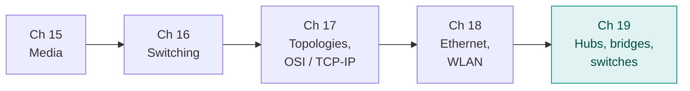

# Data Communication — Mid-Term & End-Term Notes

| Part | Chapters | Status |
|---|---|---|
| **Mid-term** (Units 1–3) | [1–14](#chapters) | ✅ Complete |
| **End-term additions** (media, switching, LANs, devices) | [15–19](#end-term-additions) | ✅ Complete. Ch. 18 (Ethernet / WLAN) ⚠️ is from standard theory: no class handout yet |

> **End-term syllabus** (`source/syllabus.txt`): signals and noise · Nyquist rate · Shannon capacity · analog transmission techniques · modulation techniques · fundamentals of AM and FM · PCM · line coding · error handling techniques · multiplexing (FDM, TDM), xDSL · spread spectrum · **transmission media: guided (twisted pair, coaxial, fibre optic), unguided** · **principles of switching** · **local area networks: Ethernet, Fast Ethernet, introduction to Gigabit Ethernet and WLAN** · **hubs, bridges and switches**.
>
> Everything up to spread spectrum is already covered by chapters 1–13. The **bold** topics are new and are covered in chapters 15–19.

> **Syllabus (Maam Bidyapati, NIT CSE, 13/09/2026):**
>
> **Unit 1: Fundamentals of Digital Communication** — Signals and noise · Nyquist rate · Shannon capacity
> **Unit 2: Analog Communication Techniques** — Analog transmission techniques · Modulation techniques · Fundamentals of AM and FM
> **Unit 3: Digital Transmission Techniques** — PCM, ADPCM · Line coding · Error handling techniques · TDM, xDSL · Spread spectrum
>
> *"Error detection is also included."*

## Chapters

### Unit 1 — Fundamentals of Digital Communication
| # | Chapter | Source |
|---|---|---|
| 1 | [Fundamentals of Data Communication](notes/01-fundamentals-of-data-communication.md) | `1. DataCommu.pdf` |
| 2 | [Signals and Noise](notes/02-signals-and-noise.md) | `Signals and Noise.docx` |
| 3 | [Nyquist Rate & Shannon Capacity](notes/03-nyquist-rate-and-shannon-capacity.md) | `Signals and Noise.docx`, `bit_baudRate.docx` |

### Unit 2 — Analog Communication Techniques
| # | Chapter | Source |
|---|---|---|
| 4 | [Analog Transmission & Modulation Overview](notes/04-analog-transmission-and-modulation-overview.md) | `4. Analog_Analog Transmission.pdf` |
| 5 | [AM & FM Fundamentals](notes/05-am-fm-fundamentals.md) | `4. Analog_Analog Transmission.pdf` |
| 6 | [Digital-to-Analog Modulation (ASK/FSK/PSK/QAM)](notes/06-digital-to-analog-modulation.md) | `4. Analog_Analog Transmission.pdf`, `bit_baudRate.docx` |

### Unit 3 — Digital Transmission Techniques
| # | Chapter | Source |
|---|---|---|
| 7 | [PCM & ADPCM](notes/07-pcm-and-adpcm.md) | `2. ModulationDemodulation.docx` |
| 8 | [Line Coding](notes/08-line-coding.md) | `3. DataEncoding.pptx`, `5. DataEncoding.pdf` |
| 9 | [Error Detection](notes/09-error-detection.md) | `6. Error_detection.pdf` |
| 10 | [Error Correction (Hamming Code)](notes/10-error-correction.md) | `7. Error_Correction.pdf` |
| 11 | [Multiplexing & TDM](notes/11-multiplexing-and-tdm.md) | `multiplexing.pdf` |
| 12 | [xDSL](notes/12-xdsl.md) | `DSL.pdf`, `DSL_notes.docx` |
| 13 | [Spread Spectrum](notes/13-spread-spectrum.md) | `Spread_Spectrum.pdf` |

### Practice
| # | Chapter | Source |
|---|---|---|
| 14 | [Unit Test 1 — Solved](notes/14-unit-test-1-solved.md) ⭐ *the teacher's question pattern* | `test 1.jpeg` |

## End-term additions

| # | Chapter | Syllabus topic | Source |
|---|---|---|---|
| 15 | [Transmission Media: Guided & Unguided](notes/15-transmission-media.md) ⭐ | Transmission media | `guided_unguided.pdf`, `topology.pdf` pp. 67–69 |
| 16 | [Principles of Switching](notes/16-switching.md) ⭐ | Principles of switching | `Switching.pdf` |
| 17 | [Networks, Topologies & Reference Models](notes/17-networks-topologies-and-reference-models.md) | Background for LANs and devices (LAN/MAN/WAN, topologies, OSI, TCP/IP) | `topology.pdf` |
| 18 | [LANs: Ethernet, Fast & Gigabit Ethernet, WLAN](notes/18-lan-ethernet-and-wlan.md) ⚠️ | Local area networks | *Standard theory*; no handout yet |
| 19 | [Connecting Devices: Hubs, Bridges & Switches](notes/19-connecting-devices-hubs-bridges-switches.md) ⭐ | Hubs, bridges and switches | `topology.pdf` pp. 29–34, `Switching.pdf` |

> ⚠️ **Handout typos flagged in the chapters:** fibre "uses electrical signals" (it uses **light**); radio waves "3 kHz to 1 kHz" (**3 kHz – 1 GHz**); the session layer as "layer 3" (it is **layer 5**); and "the data link layer is responsible for routing" (routing is the **network layer's** job). FDM was already covered in [Ch. 11](notes/11-multiplexing-and-tdm.md).

## Revision checklist

**Unit 1**
- [ ] Four characteristics of data communication (delivery, accuracy, timeliness, jitter)
- [ ] Five components of a communication system
- [ ] Analog vs digital signals; the four noise types + $N = kTB$
- [ ] SNR and decibel calculations
- [ ] Nyquist formula — **noiseless** channel
- [ ] Shannon formula — **noisy** channel
- [ ] Bit rate vs baud rate

**Unit 2**
- [ ] Why we modulate; the four conversion types
- [ ] AM: modulation index, sidebands, bandwidth $= 2f_m$
- [ ] FM: modulation index, Carson's rule
- [ ] AM vs FM comparison
- [ ] ASK, FSK, PSK, QAM + constellation diagrams

**Unit 3**
- [ ] PCM: sampling → quantization → encoding
- [ ] Quantization error / SNR; DPCM → ADPCM
- [ ] Draw all line-coding waveforms for a given bit stream
- [ ] Parity, 2D parity, checksum, **CRC** (polynomial division)
- [ ] Hamming code: find $r$, place bits, locate the error
- [ ] TDM (sync vs statistical), FDM, WDM
- [ ] xDSL types, ADSL frequency bands
- [ ] FHSS and DSSS, processing gain

**Practice**
- [ ] [Unit Test 1](notes/14-unit-test-1-solved.md): redo all 6 without looking. Q4 (Shannon, *per minute*) was marked wrong on the sheet.
- [ ] Performance formulas: period ↔ frequency, throughput, propagation time, transmission time

**End-term additions**
- [ ] Guided vs unguided; **twisted pair** (why twisted, UTP categories, STP), **coaxial** (structure, baseband vs broadband), **fibre** (core / cladding / jacket, advantages); comparison table
- [ ] **Radio vs microwave vs infrared**; terrestrial vs satellite microwave (advantages and disadvantages)
- [ ] Switching: **circuit** (3 phases), **message** (store-and-forward), **packet** (datagram vs virtual circuit); **circuit vs packet** table; STP
- [ ] PAN / LAN / MAN / WAN; **bus, ring, star, tree, mesh** ($n(n-1)/2$), hybrid; **CSMA/CD vs CSMA/CA**; token passing
- [ ] **OSI 7 layers** and functions; TCP/IP; OSI vs TCP/IP; IP / MAC / port / socket
- [ ] **Ethernet:** CSMA/CD + backoff, **64-byte minimum frame** ($2T_pB$), frame format, MAC unicast/multicast, 10Base5/2/T/F
- [ ] **Fast Ethernet** (TX / FX / T4, autonegotiation) · **Gigabit** (full-duplex, carrier extension, SX / LX / CX / T)
- [ ] **WLAN 802.11:** BSS / ESS, why not CSMA/CD, **CSMA/CA with RTS/CTS**, hidden station, NAV
- [ ] **Repeater, hub, bridge, switch, router, gateway**: layers, the **learning bridge**, **hub vs bridge vs switch**, collision and broadcast domains

## Formula sheet

| Formula | Name | Use |
|---|---|---|
| $C = 2B\log_2 L$ | **Nyquist** | Max bit rate, **noiseless** channel |
| $C = B\log_2(1+\text{SNR})$ | **Shannon** | Max capacity, **noisy** channel |
| $\text{Bit rate} = \text{Baud rate} \times \log_2 L$ | | Relates bps to symbols/s |
| $N = kTB$ | Thermal noise | $k = 1.38\times10^{-23}$ J/K |
| $\text{SNR}_{dB} = 10\log_{10}(\text{SNR})$ | Decibel | Power ratio |
| $f_s \ge 2f_{max}$ | **Nyquist sampling** | Sampling rate for PCM |
| $\text{Bits/sample} = \log_2 L$ | PCM | $L$ = quantization levels |
| $\text{SNR}_{dB} = 6.02n + 1.76$ | Quantization | $n$ = bits per sample |
| $\mu = \dfrac{A_m}{A_c}$ | AM modulation index | |
| $BW_{AM} = 2f_m$ | AM bandwidth | |
| $BW_{FM} = 2(\Delta f + f_m)$ | **Carson's rule** | |
| $2^r \ge d + r + 1$ | Hamming | Number of redundant bits |
| $G_p = B_{ss}/B$ | Processing gain | Spread spectrum |
| $s = d_{min}-1$, $\ t = \lfloor (d_{min}-1)/2 \rfloor$ | Hamming distance | Errors detectable / correctable |
| $f = 1/T$ | Frequency / period | Watch units: ms → s, Hz → kHz |
| $T_p = \text{distance}/\text{speed}$ | Propagation time | Unit Test Q6 |
| $T_t = \text{bits}/\text{bandwidth}$ | Transmission time | Unit Test Q6; MB × 8 → bits |
| $\text{Throughput} = \text{bits delivered}/\text{time}$ | Throughput | ≠ bandwidth (Unit Test Q5) |
| $\dfrac{n(n-1)}{2}$ | Full-mesh links | $n$ nodes; each needs $n-1$ ports |
| $L_{min} = 2\,T_p \times B$ | CSMA/CD minimum frame | 10 Mbps, 51.2 µs → **64 B** |
| $K \in [0,\ 2^{n}-1]$ | Binary exponential backoff | wait $K \times$ slot time; $n \le 10$; give up after 16 |
| $(k+n-1)\,\dfrac{L}{nR}$ | Packet-switching delay | $k$ hops, $n$ packets (vs $k\,L/R$ for message switching) |
