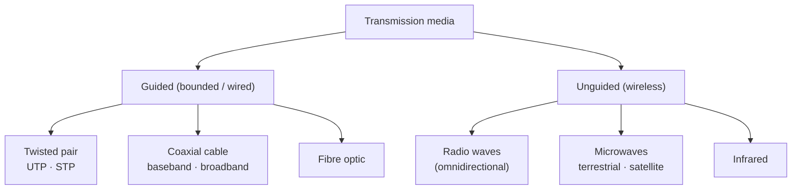

# 15. Transmission Media: Guided & Unguided

> **Syllabus:** End-term. *Transmission media: guided (twisted pair, coaxial, fiber optic), unguided media*
> **Source:** `guided_unguided.pdf` (12 pages) and `topology.pdf` pp. 67–69 (physical layer, impairments). A few figures in the class handout look like typos; they are flagged ⚠️ with the standard values.

---

## 🎯 In one line

**Guided (bounded)** media carry signals along a **physical path**: twisted pair, coaxial cable, optical fibre. **Unguided (wireless)** media radiate **electromagnetic waves through air**: radio (omnidirectional), microwave (line-of-sight, terrestrial or satellite), infrared (short range, can't pass walls).

---

## 1. Where transmission media sit (`topology.pdf` pp. 67–69)

The **physical layer** is the only OSI layer that deals with **actual physical connectivity**. It defines cabling, wiring, frequencies and the **pulses** that represent bits. It takes **frames** from the data-link layer and converts them into **electrical (or optical) signals**.



| Guided media | Unguided media |
|---|---|
| Sender and receiver are **directly connected**; the signal is *guided* along the cable | **No physical connection**; signals spread through air |
| UTP, coaxial, fibre | Radio, microwave, infrared |
| Only connected devices receive | **Anyone** in range, including the intended recipient, can pick up the signal |

**Channel capacity** (data rate) depends on **bandwidth** (the physical limit of the medium), **error rate** (noise) and **encoding** (the number of signal levels). For example, **8B/6T** encoding sends 8 bits as 6 ternary (3-level) symbols. *(See [Ch. 3](03-nyquist-rate-and-shannon-capacity.md) for Nyquist and Shannon.)*

### Transmission impairments

| Impairment | Meaning |
|---|---|
| **Attenuation** | The signal **weakens with distance** (energy lost as heat). **Repeaters / amplifiers** restore it |
| **Dispersion** | The signal **spreads out and overlaps** as it travels. The amount depends on frequency |
| **Delay distortion** | Different frequency components travel at **different speeds** and arrive at different times. Critical for digital data, where bits can arrive out of order |
| **Noise** | External currents and radio frequencies picked up by the cable (see [Ch. 2](02-signals-and-noise.md)) |

---

## 2. Twisted pair (pp. 1–3) ⭐⭐⭐

**Two insulated copper wires twisted in a regular spiral.** It is the **cheapest** medium, **lightweight** and **easy to install**.

> **Why twist?** Each twist swaps which wire is nearer an interference source, so the noise induced in the two wires is nearly equal. The receiver takes the **difference** between them, so the noise **cancels**. Twisting also reduces **crosstalk** between neighbouring pairs.

> ⚠️ The handout gives the twisted-pair frequency range as **0–3.5 kHz**. That is the **telephone voice band** carried on twisted pair. The cable itself supports much more: Cat 5 is rated to **100 MHz**.

### Unshielded twisted pair (UTP)

Widely used in **telecommunication and LANs**.

| Category | Supports (class handout) | Typical use |
|---|---|---|
| Cat 1 | Low-speed data | **Telephone lines** |
| Cat 2 | Up to **4 Mbps** | |
| Cat 3 | Up to **16 Mbps** | 10Base-T Ethernet |
| Cat 4 | Up to **20 Mbps** | Long-distance communication (token ring) |
| Cat 5 | Up to **200 Mbps** *(standard: 100 Mbps, 100 MHz)* | Fast Ethernet |

| UTP advantages | UTP disadvantages |
|---|---|
| **Cheap** | Only for **short distances**, because of **attenuation** |
| **Easy installation** | Susceptible to **noise and interference** |
| Can be used for **high-speed LANs** | |

### Shielded twisted pair (STP)

STP adds a **metal-foil or braided-mesh shield** around the pairs. *(The handout says "synthetic materials like polyester and nylon"; electrically, the shield is conductive foil or braid.)* The shield blocks **external interference (EMI)**, allowing **higher transmission rates**.

| STP characteristics |
|---|
| **Moderate cost**: more than UTP, less than coaxial or fibre |
| **Easy installation** |
| **Higher capacity** than UTP |
| **Higher attenuation** (as the class handout states) |
| Shielding gives a **higher data rate** |

*Disadvantages (standard): more expensive and bulkier than UTP, and the shield must be properly grounded.*

---

## 3. Coaxial cable (p. 4) ⭐⭐⭐

Common example: the **TV cable**. It is called *co-axial* because its **two conductors share a common axis** (they are parallel and concentric).

```
   ┌───────────────── outer plastic jacket
   │  ┌────────────── outer conductor: copper MESH (shield → blocks EMI)
   │  │  ┌─────────── insulator (non-conductive dielectric)
   │  │  │  ┌──────── inner conductor: copper core (carries the signal)
   ▼  ▼  ▼  ▼
  ((( ( ( ● ) ) )))
```

- **Inner conductor** of copper: carries the data.
- **Insulating core** (dielectric) separates the two conductors.
- **Outer conductor** of copper mesh: **prevents EMI** (electromagnetic interference).
- It works at **higher frequencies** than twisted pair.

| Type | Meaning |
|---|---|
| **Baseband** transmission | **One signal** at high speed (e.g. original Ethernet 10Base2 / 10Base5) |
| **Broadband** transmission | **Multiple signals simultaneously** (FDM, e.g. cable TV) |

| Advantages | Disadvantages |
|---|---|
| **High-speed** data transmission | **More expensive** than twisted pair |
| **Better shielding** than twisted pair | A **fault anywhere in the cable can bring down the whole network** (in bus topology) |
| **Higher bandwidth** | |

---

## 4. Fibre optic cable (pp. 5–6) ⭐⭐⭐

Fibre carries data as **pulses of light** through thin strands of **glass or plastic**.

> ⚠️ The handout's first line says fibre "uses electrical signals". That is a typo. **Fibre uses light**, which is exactly why it is immune to electromagnetic interference.

```
   ┌──────────────── jacket (plastic: strength, shock absorption, protection)
   │   ┌──────────── cladding (glass, LOWER refractive index)
   │   │   ┌──────── core (glass/plastic, HIGHER refractive index: carries light)
   ▼   ▼   ▼
  ════════════════════════════════════
  ░░░░░░░░░░░░░░░░░░░░░░░░░░░░░░░░░░░░   cladding
  ──╲────╱────╲────╱────╲────╱────╲───   core: light bounces by
  ░░░░░░░░░░░░░░░░░░░░░░░░░░░░░░░░░░░░   TOTAL INTERNAL REFLECTION
  ════════════════════════════════════
```

| Element | Role |
|---|---|
| **Core** | A narrow strand of glass or plastic: the **light-carrying area**. A larger core carries more light |
| **Cladding** | A concentric layer of glass with a **lower refractive index** than the core, so light is **reflected back into the core** (total internal reflection). *A higher refractive index means light travels more slowly and bends more* |
| **Jacket** | A protective plastic coating that preserves fibre strength, **absorbs shock** and adds protection |

**Advantages of fibre over copper:**

| Advantage | Why |
|---|---|
| **Greater bandwidth** | Carries far more data |
| **Faster speed** | Data travels as light |
| **Longer distances** | Very low attenuation |
| **Better reliability** | **Immune to temperature changes and EMI**, which can disrupt copper |
| **Thinner and sturdier** | Lighter, and withstands more **pull pressure** |

*Standard disadvantages:* **expensive** to install, **fragile** to bend, and needs **specialised skills and equipment** for splicing. Communication is typically **unidirectional** per fibre, so two are used.

*Propagation modes (standard):* **multimode step-index**, **multimode graded-index** and **single-mode** (narrowest core, least dispersion, longest distance).

### Guided media compared

| | Twisted pair | Coaxial | Fibre optic |
|---|---|---|---|
| Signal | Electrical | Electrical | **Light** |
| Cost | **Cheapest** | Medium | **Highest** |
| Bandwidth | Low | Medium–high | **Very high** |
| Distance | Short (~100 m) | Medium (~500 m) | **Long (km)** |
| EMI immunity | Poor (UTP) / fair (STP) | Good | **Immune** |
| Installation | Easiest | Moderate | Hardest |

---

## 5. Unguided (wireless) transmission (pp. 7–12) ⭐⭐⭐

Electromagnetic waves are transmitted **without any physical medium** (through air), which is why it is called **wireless** transmission. There are three broad categories.

### 5.1 Radio waves

- Transmitted in **all directions** of free space: **omnidirectional**.
- Range **3 kHz to 1 GHz**. *(⚠️ The handout says "3 kHz to 1 kHz", a typo.)*
- Sending and receiving antennas **need not be aligned**: any receiving antenna can pick up the wave.
- **Applications:** **multicasting** (one sender, many receivers), e.g. **FM radio, television, cordless phones**.
- **Advantages:** used for **WANs and mobile phones**. **Cover a large area and penetrate walls**. Higher transmission rate.

### 5.2 Microwaves

Microwaves are **unidirectional**: sending and receiving antennas **must be aligned**, and the beam is **narrowly focused**. *(The handout gives the band as 1–1000 GHz on one page and 300 MHz–300 GHz on another. The standard textbook band is **1–300 GHz**.)*

#### Terrestrial microwave

A focused beam from one **ground-based antenna** to another. The antennas are mounted on **towers** kilometres apart and work by **line of sight**: the towers must be in direct sight of each other.

| Characteristic | Value |
|---|---|
| Frequency range | **4–6 GHz** to **21–23 GHz** |
| Bandwidth | **1–10 Mbps** |
| Short distance | Inexpensive |
| Long distance | **Expensive** (needs taller towers) |
| Attenuation | Affected by **environmental conditions** and **antenna size** |

| Advantages | Disadvantages |
|---|---|
| **Cheaper than cables** | **Eavesdropping**: anyone with an antenna can catch the signal, so it is insecure |
| **No land acquisition** for laying cables | **Out-of-phase** signals |
| Easy communication across **difficult terrain** | **Susceptible to weather** (rain, wind) |
| Communication **over oceans** | **Limited bandwidth allocation** |

#### Satellite microwave

A **satellite** revolves around the earth at a known height. It **receives** the signal from an earth station (**uplink**), **amplifies** it, and **retransmits** it to another earth station (**downlink**). It can reach **any point on the globe**.

```
                  🛰  satellite (amplifies & retransmits)
               ↗ uplink     ↘ downlink
    [Earth station A]            [Earth station B]
```

| Advantages | Disadvantages |
|---|---|
| **Coverage area much larger** than terrestrial microwave | Design and development take **more time and cost** |
| Transmission cost is **independent of distance** within the coverage area | Must be **monitored and controlled** regularly to stay in orbit |
| Used in **mobile and wireless** communication | **Life of about 12–15 years**, so a replacement launch must be planned |
| **Easy to install** (on the ground) | *(Standard: high propagation delay of ~0.25 s for geostationary satellites)* |
| Weather forecasting, radio/TV broadcasting, mobile communication | |

### 5.3 Infrared

- **Short-range** wireless communication, **300 GHz to 400 THz**.
- Uses: data transfer between **two phones**, **TV remotes**, a computer and phone in the **same room**.

| Characteristics |
|---|
| **High bandwidth**, so a very high data rate |
| **Cannot penetrate walls**, so infrared in one room doesn't interfere with the next |
| **Better security, minimum interference** |
| **Unreliable outdoors**, because **sunlight interferes** with infrared |

### Unguided media compared

| | Radio | Microwave | Infrared |
|---|---|---|---|
| Frequency | 3 kHz – 1 GHz | 1 – 300 GHz | 300 GHz – 400 THz |
| Direction | **Omnidirectional** | **Unidirectional** (line of sight) | Line of sight, short range |
| Penetrates walls? | **Yes** | Partly | **No** |
| Typical use | FM, TV, cordless phones, mobile | Long-haul links, satellite, cellular backhaul | Remotes, short device links |

---

## 6. Common exam questions

1. **Differentiate guided and unguided media.** See §1.
2. **Explain twisted pair cable. Why are the wires twisted? Differentiate UTP and STP. List the UTP categories.** See §2.
3. **Explain coaxial cable with a diagram. Baseband vs broadband.** See §3.
4. **Explain fibre optic cable (core, cladding, jacket) and its advantages over copper.** See §4.
5. **Compare twisted pair, coaxial and fibre.** See §4.
6. **Explain radio waves, microwaves and infrared. Terrestrial vs satellite microwave.** See §5.
7. **Advantages and disadvantages of microwave / satellite communication.** See §5.
8. **What are attenuation, dispersion and delay distortion?** See §1.

---

## ⚡ Quick revision

- **Guided** = wired (twisted pair, coax, fibre). **Unguided** = wireless (radio, microwave, infrared).
- **Twisted pair:** cheapest; twisting cancels noise and crosstalk. **UTP** Cat 1 (phone) … Cat 5. **STP** adds a shield for a higher rate at higher cost.
- **Coax:** inner copper + insulator + **copper mesh shield**. **Baseband** = 1 signal; **broadband** = many. One fault can kill a bus network.
- **Fibre:** **light**, by total internal reflection. **Core (high n) / cladding (low n) / jacket.** Most bandwidth, longest reach, EMI-immune, costliest.
- **Radio:** omnidirectional, through walls (FM, TV). **Microwave:** unidirectional, line of sight; **terrestrial** (towers, 4–23 GHz, weather-sensitive) and **satellite** (uplink, amplify, downlink; 12–15-year life). **Infrared:** short range, not through walls, sunlight interferes.
- Impairments: **attenuation** (weakening), **dispersion** (spreading), **delay distortion** (components arrive at different times), **noise**.

---

**Previous:** [← 14. Unit Test 1 — Solved](14-unit-test-1-solved.md) · **Next:** [16. Switching →](16-switching.md)
