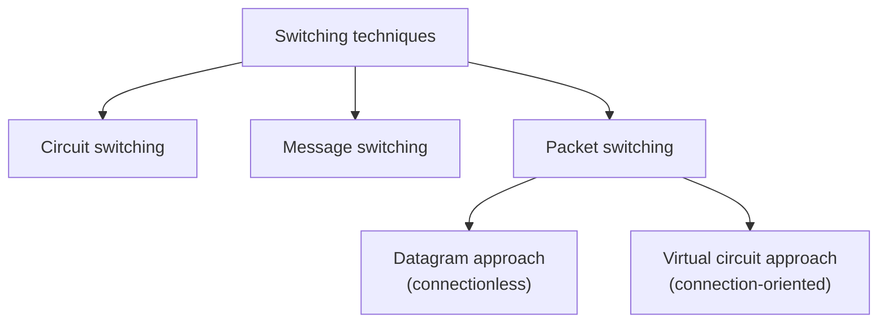

# 16. Principles of Switching: Circuit, Message & Packet Switching

> **Syllabus:** End-term. *Principles of switching*
> **Source:** `Switching.pdf` (14 pages). The transmission-delay calculations in §6 are standard additions marked 🆕.

---

## 🎯 In one line

**Switching** decides **which path** data takes through a network with many possible routes. **Circuit switching** reserves a **dedicated path** first (the telephone network). **Message switching** **stores and forwards whole messages**. **Packet switching** splits data into **packets** routed independently (**datagram**) or along a pre-set **virtual circuit**.

---

## 1. What switching is and why it is needed (pp. 1–3) ⭐⭐

In a large network there may be **several paths** from sender to receiver. **Selecting the path data must take is called switching** (finding the best route).

**Switching is achieved using switches.** A **switch** is a small hardware device that **joins multiple computers within a LAN**.

| Property of a network switch |
|---|
| Operates at **layer 2 (data-link)** of the OSI model |
| **Transparent** to the user; needs no configuration in a home network |
| Forwards packets based on **MAC addresses** |
| Sends data **only to the addressed device** (checks the destination address) |
| Operates in **full-duplex** mode |
| **Minimal collisions**, since it connects source and destination directly |
| Does **not broadcast** the message (it works with limited bandwidth) |

**Why is switching needed?**
1. **Bandwidth** (the maximum transfer rate of a cable) is **critical and expensive**, and switching uses it effectively.
2. **Collisions:** when several devices transmit on the same medium at once, they collide. Switching keeps packets from colliding.

| Advantages of switching | Disadvantages of switching |
|---|---|
| **Increases network bandwidth** | A switch is **more expensive than a bridge** |
| **Reduces workload** on PCs (data goes only to the addressee) | Can't easily diagnose **network connectivity issues** |
| Better overall **performance** (less traffic) | Needs **proper design and configuration** to handle **multicast** packets |
| **Fewer collisions**: each connection is its **own collision domain** | |

---

## 2. Classification of switching techniques (p. 3)



---

## 3. Circuit switching (p. 4) ⭐⭐⭐

A **dedicated path is established between sender and receiver** and **remains until the connection is terminated**. It works **like the telephone**: a complete **end-to-end path must exist before communication starts**.

**How it works:** the sender sends a **request** signal, and the receiver returns an **acknowledgement** confirming the dedicated path is available. Only then is data transferred.

**Three phases:**

```
 1. CIRCUIT ESTABLISHMENT  ──►  2. DATA TRANSFER  ──►  3. CIRCUIT DISCONNECT
   (request / acknowledgement)    (over the dedicated path)    (tear down)
```

- Used in the **public telephone network** (voice).
- A **fixed amount of data** can be transferred at a time.
- Each data unit knows the **entire path**, provided by the source.

*(Standard: implemented with **space-division** switches (crossbar) or **time-division** switches (TSI).)*

---

## 4. Message switching (pp. 5, 7) ⭐⭐

A **message is transferred as a complete unit** and routed through **intermediate nodes**, where it is **stored and forwarded**.

- **No dedicated path** is set up.
- The **destination address is appended** to the message.
- It gives **dynamic routing**: each node routes the message based on the information it carries, and switches are programmed to find the most efficient routes.
- **Every node stores the entire message and then forwards it.** This is a **store-and-forward network**.
- Each message is treated as an **independent entity**.

```
 A ──[whole message]──► Node 1 (store) ──► Node 2 (store) ──► Node 3 (store) ──► B
```

| Advantages | Disadvantages |
|---|---|
| Data channels are **shared**, so bandwidth is used efficiently | Switches need **enough (secondary) storage** to hold whole messages |
| **Traffic congestion reduced**, since messages are stored temporarily | **Long delays** caused by store-and-forward |
| **Message priority** can manage the network | |
| **Variable (unlimited) message size** supported | |

---

## 5. Packet switching (pp. 6, 8–12) ⭐⭐⭐

The message is **divided into smaller pieces called packets**, which are **sent individually**.

- Each packet gets a **unique sequence number** so the receiver can put them in order.
- Each packet **header** contains the **source address, destination address and sequence number**.
- Each data unit knows **only the final destination**. The **intermediate path is decided by the routers**.
- Packets take the **shortest path possible** and are **reassembled in order** at the receiver.
- If a packet is **missing or corrupted**, a request is sent to **resend** it. When all packets arrive in order, an **acknowledgement** is sent.

Packet switching is the norm on **LANs, WANs and the Internet**. It adapts quickly to changing conditions: if a router fails, packets are **re-routed** around it. It is cheaper than circuit switching (no dedicated channel), and **all bandwidth can be used at once**. **VoIP** carries phone calls as packets over the Internet instead of analog phone lines.

### Two approaches to packet switching ⭐⭐⭐

**Datagram packet switching (connectionless)**
- Each packet (**datagram**) is an **independent entity** carrying full destination information.
- **The path is not fixed.** Intermediate nodes make the **routing decisions**.
- Packets may arrive **out of order** and are **reassembled** at the receiver.

**Virtual circuit switching (connection-oriented)**
- A **pre-planned route is established before** messages are sent.
- **Call-request** and **call-accept** packets set up the connection.
- **The path is fixed** for the duration of the logical connection.
- After the data is sent, the receiver **acknowledges**. A **clear signal** terminates the connection.

```
  Virtual circuit (A → 1 → 2 → B):
   A ──call request──► 1 ──► 2 ──► B
   A ◄──call accept─── 1 ◄── 2 ◄── B
   A ══data══════════► 1 ══► 2 ══► B      (all packets follow the same path)
   A ◄──acknowledgement────────────── B
   A ──clear (terminate)─────────────► B
```

| **Datagram approach** | **Virtual circuit approach** |
|---|---|
| **Nodes take routing decisions** to forward each packet | Nodes **don't take routing decisions** (the route is fixed at setup) |
| **Congestion cannot occur** as packets travel in different directions | **Congestion can occur** when a node is busy and blocks other packets |
| **More flexible**: every packet is independent | **Less flexible** |
| Connectionless; no setup | Connection-oriented; setup and teardown phases |
| Packets may arrive **out of order** | Packets arrive **in order** |

### Advantages and disadvantages of packet switching

| Advantages | Disadvantages |
|---|---|
| **Cost-effective**: switches need no massive secondary storage | **Unsuitable** for applications needing **low delay and high quality of service** |
| **Reliable**: a busy node causes packets to be **re-routed** | **Complex protocols** and high implementation cost |
| **Efficient**: no path set up in advance, and **many users share the channel** | Overload or corruption needs **retransmission**, and critical information may be lost if errors aren't recovered |

---

## 6. Circuit vs packet switching (p. 13) ⭐⭐⭐

| **Circuit switching** | **Packet switching** |
|---|---|
| **3 phases**: establishment, data transfer, release | **Direct data transfer** |
| Each data unit knows the **entire path** (given by the source) | Each data unit knows **only the final destination**; routers decide the path |
| Data **processed at the source only** | Data processed at **every intermediate node** as well as the source |
| **Uniform** delay between data units | **Non-uniform** delay |
| **Resource reservation** (fixed path) | **No reservation**; bandwidth is **shared** |
| **More reliable** | Less reliable |
| **More wastage** of resources | **Less wastage** |
| **Not** store-and-forward | **Store-and-forward** |
| Transmission done **by the source** | Done by the source **and intermediate routers** |
| Congestion can occur at **connection establishment** (channel already busy) | Congestion can occur during **data transfer** (many packets at once) |
| **Not convenient** for bilateral traffic | **Suitable** for bilateral traffic |
| Charged by **time and distance**, not traffic | Charged by **number of bytes and connection time** |
| **Recording of packets is never possible** | Recording of packets **is possible** |
| **Physical path** between source and destination | **No physical path** |

### 🆕 Delay comparison (standard numerical)

Send $L$ bits over $k$ hops at rate $R$ bits/s, ignoring propagation delay.

| Scheme | Total delay |
|---|---|
| **Circuit switching** | $t_{setup} + L/R$ |
| **Message switching** (store-and-forward whole message) | $k \cdot L/R$ |
| **Packet switching** with $n$ packets of $L/n$ bits (pipelining) | $(k + n - 1)\cdot\dfrac{L}{nR}$ |

**Example:** $L = 1$ Mbit, $R = 1$ Mbps, $k = 3$ hops.
- **Message switching:** $3 \times 1 = $ **3 s**.
- **Packet switching** with 10 packets of 100 kbit: $(3 + 10 - 1)\times 0.1 = 12 \times 0.1 = $ **1.2 s**, because packets are **pipelined** across the hops.
- **Circuit switching** with a 0.5 s setup: $0.5 + 1 = $ **1.5 s**.

---

## 7. Spanning Tree Protocol (p. 14) ⭐

**STP** is a **layer-2 protocol** that runs on **bridges and switches** (specification **IEEE 802.1D**). Its purpose is to **prevent loops** when the network has **redundant paths**: *"Loops are deadly to a network."* (A loop makes broadcast frames circulate forever, a **broadcast storm**.) STP disables redundant links to form a **loop-free tree** and re-enables them if an active link fails. See [Ch. 19](19-connecting-devices-hubs-bridges-switches.md).

---

## 8. Common exam questions

1. **What is switching? Why is it needed?** See §1.
2. **Classify switching techniques.** See §2.
3. **Explain circuit switching and its three phases.** See §3.
4. **Explain message switching. Why is it called store-and-forward? Advantages and disadvantages.** See §4.
5. **Explain packet switching. Differentiate the datagram and virtual-circuit approaches.** See §5.
6. **Differentiate circuit switching and packet switching** (at least 6 points). See §6.
7. **What is the Spanning Tree Protocol?** See §7.

---

## ⚡ Quick revision

- **Switching** = selecting the path. A **switch** works at **layer 2**, forwards by **MAC address**, is full-duplex, and gives each port its **own collision domain**.
- **Circuit:** a **dedicated path**, 3 phases (**establish → transfer → disconnect**), like the telephone; uniform delay; resources reserved and wasted.
- **Message:** **whole message, store-and-forward**, no dedicated path, needs storage, long delay.
- **Packet:** split into **numbered packets**. **Datagram** = connectionless, independent routing, out-of-order, flexible. **Virtual circuit** = connection-oriented, fixed path (call request/accept, clear), in order.
- Circuit vs packet: **reservation vs sharing**, **uniform vs variable delay**, **time/distance vs bytes charging**, **physical vs no physical path**.
- **STP (IEEE 802.1D)** removes loops on bridges and switches.

---

**Previous:** [← 15. Transmission Media](15-transmission-media.md) · **Next:** [17. Networks, Topologies & Reference Models →](17-networks-topologies-and-reference-models.md)
