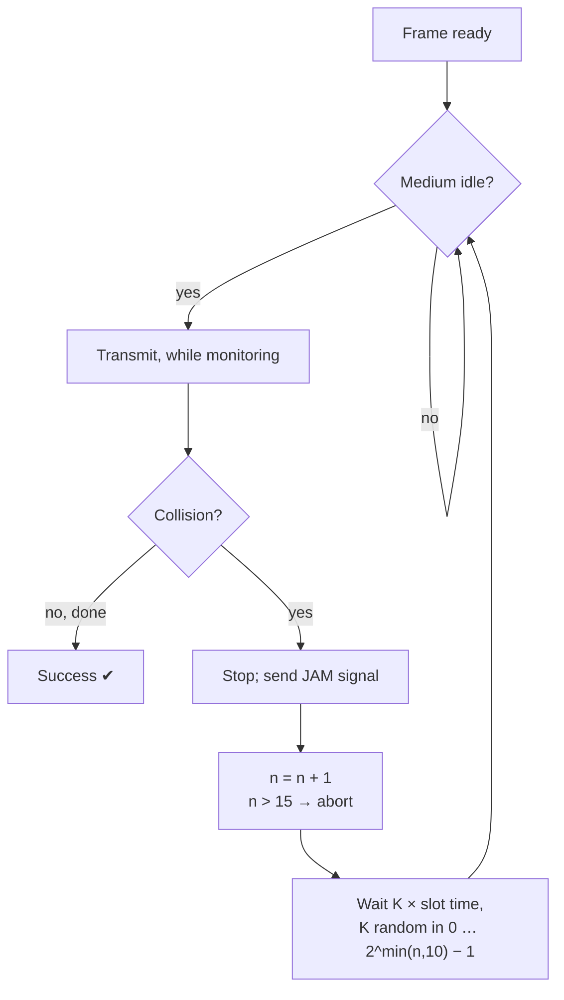

# 18. Local Area Networks: Ethernet, Fast Ethernet, Gigabit Ethernet & WLAN

> ⚠️ **Written from standard course knowledge (Forouzan, *Data Communications and Networking*).** The end-term syllabus lists *"Local area networks: Ethernet, Fast Ethernet, Introduction to Gigabit Ethernet and WLAN"*, but **no class handout covers these topics** yet. Only the CSMA/CD and CSMA/CA definitions appear in `topology.pdf` p. 12. Every numerical example below was checked by computation.
> **Syllabus:** End-term. *Local area networks: Ethernet, Fast Ethernet, introduction to Gigabit Ethernet and WLAN*

---

## 🎯 In one line

**Ethernet (IEEE 802.3)** is the wired LAN. Stations share the medium using **CSMA/CD** with **binary exponential backoff**, frames are **64–1518 bytes** with **48-bit MAC addresses**, and speeds have grown **10 Mbps → 100 Mbps (Fast) → 1 Gbps (Gigabit)**. **WLAN (IEEE 802.11)** is the wireless LAN, and uses **CSMA/CA** with **RTS/CTS** because wireless stations can't detect collisions.

---

## 1. IEEE 802 standards and the data-link sub-layers

IEEE Project 802 splits the data-link layer into two sub-layers:

```
 ┌─────────────────────────────────────────────────────────┐
 │ LLC  (Logical Link Control, IEEE 802.2): common to all LANs │  ← flow & error control, framing
 ├──────────────┬───────────────┬──────────────────────────┤
 │ MAC 802.3    │ MAC 802.5     │ MAC 802.11               │  ← media access (differs per LAN)
 │ Ethernet     │ Token Ring    │ Wireless LAN             │
 ├──────────────┼───────────────┼──────────────────────────┤
 │ Physical     │ Physical      │ Physical                 │
 └──────────────┴───────────────┴──────────────────────────┘
```

| Standard | LAN |
|---|---|
| **802.3** | **Ethernet** (CSMA/CD) |
| 802.4 | Token bus |
| 802.5 | Token ring |
| **802.11** | **Wireless LAN** (CSMA/CA) |
| 802.1D | Spanning Tree Protocol (bridges) |

---

## 2. Standard Ethernet (10 Mbps) ⭐⭐⭐

### 2.1 Access method: CSMA/CD

**Carrier Sense Multiple Access with Collision Detection:**
1. **Carrier sense:** listen before transmitting, and wait if the medium is busy (1-persistent).
2. **Multiple access:** all stations share the medium.
3. **Collision detection:** keep listening while transmitting. On a collision, **stop**, send a **jam signal** (48 bits) so everyone knows, then wait a **random backoff** time and retry. This is "recovery after the collision" (class handout p. 12).



**Binary exponential backoff:** after the $n$-th collision, pick $K$ at random from $\{0, 1, \dots, 2^{\min(n,10)} - 1\}$ and wait $K \times$ **slot time** (51.2 µs at 10 Mbps). Abort after **16** attempts.
*Example:* after the 3rd collision, $K \in \{0, \dots, 7\}$, so the wait is at most $7 \times 51.2 = $ **358.4 µs**.

### 2.2 Minimum frame size: why 64 bytes ⭐⭐⭐

A station must **still be transmitting** when news of a collision gets back to it. Otherwise it would think the frame went through. So:

$$\boxed{T_{frame} \ge 2 \times T_{prop}} \qquad\Longleftrightarrow\qquad \boxed{L_{min} = 2 \times T_{prop} \times B}$$

- Standard Ethernet allows a round-trip time of **51.2 µs** (the **slot time**). At 10 Mbps that is $51.2\,\mu s \times 10^7 = $ **512 bits = 64 bytes**, so the **minimum frame is 64 bytes**.
- *Example 1:* a 1 km cable, propagation $2\times10^8$ m/s, 10 Mbps. $T_{prop} = 5\,\mu s$, so $L_{min} = 2 \times 5\,\mu s \times 10^7 = $ **100 bits**.
- *Example 2:* with 64-byte frames at 10 Mbps, $T_{frame} = 51.2\,\mu s$, so $T_{prop} \le 25.6\,\mu s$ and the maximum length is $25.6\,\mu s \times 2\times10^8 = $ **5120 m** in theory. *The standard limits it to **2500 m**, allowing for repeater and transceiver delays.*

### 2.3 Frame format ⭐⭐⭐

```
┌──────────┬─────┬──────────┬──────────┬────────────┬──────────────────┬──────┐
│ Preamble │ SFD │   Dest   │  Source  │ Type/Length│   Data + Pad     │ CRC  │
│ 7 bytes  │ 1 B │ 6 bytes  │ 6 bytes  │  2 bytes   │  46–1500 bytes   │ 4 B  │
└──────────┴─────┴──────────┴──────────┴────────────┴──────────────────┴──────┘
  10101010…  10101011   ◄─────────────── 64 … 1518 bytes (counted frame) ──────►
  (physical-layer header)
```

| Field | Size | Purpose |
|---|---|---|
| **Preamble** | 7 B | Alternating 1s and 0s for receiver **synchronisation** |
| **SFD** (start frame delimiter) | 1 B | `10101011`: marks the **start of the frame** |
| **Destination address** | 6 B | MAC of the receiver |
| **Source address** | 6 B | MAC of the sender |
| **Type / Length** | 2 B | Upper-layer protocol (or data length) |
| **Data** | **46–1500** B | **Padded** up to 46 if shorter |
| **CRC** | 4 B | Error detection (CRC-32), see [Ch. 9](09-error-detection.md) |

**Minimum frame = 64 B** (6 + 6 + 2 + **46** + 4). **Maximum frame = 1518 B** (6 + 6 + 2 + **1500** + 4). The preamble and SFD are not counted.

### 2.4 MAC addressing ⭐⭐

- A **48-bit (6-byte)** address written in hex, e.g. `4A:30:10:21:10:1A`.
- The **least significant bit of the first byte** gives the type:

| Type | LSB of first byte | Example |
|---|---|---|
| **Unicast** (one station) | **0** | `4A:…` → 4A = 0100 101**0** → unicast |
| **Multicast** (a group) | **1** | `47:…` → 47 = 0100 011**1** → multicast |
| **Broadcast** (all) | All 48 bits = 1 | `FF:FF:FF:FF:FF:FF` |

### 2.5 Physical layer: the 10 Mbps implementations

**Encoding:** **Manchester** (see [Ch. 8](08-line-coding.md)). Naming: `10Base5` means **10** Mbps, **Base**band, segment ≈ **5**00 m.

| Implementation | Medium | Max segment | Topology |
|---|---|---|---|
| **10Base5** ("thick Ethernet") | Thick coaxial | 500 m | **Bus** |
| **10Base2** ("thin Ethernet", "cheapernet") | Thin coaxial | 185 m | **Bus** |
| **10Base-T** | **UTP (Cat 3)**, 2 pairs | 100 m | **Star** (hub) |
| **10Base-F** | **Fibre**, 2 strands | 2000 m | **Star** |

---

## 3. Fast Ethernet (100 Mbps, IEEE 802.3u) ⭐⭐⭐

**Goals:** raise the rate to **100 Mbps**, stay **compatible** with standard Ethernet, keep the **same 48-bit addresses, frame format and minimum/maximum frame lengths**.

- Because the bit rate is **10×**, the slot time shrinks to **5.12 µs**. With the same 64-byte minimum frame, the **maximum collision-domain diameter drops to ~250 m**.
- **Autonegotiation** lets two devices agree on the best common speed and duplex (10 vs 100 Mbps, half vs full duplex).
- In **full-duplex switched** mode there are **no collisions**, so CSMA/CD isn't needed at all.

| Implementation | Medium | Encoding | Max length |
|---|---|---|---|
| **100Base-TX** | **2 pairs** Cat 5 UTP (or STP) | **4B/5B + MLT-3** | 100 m |
| **100Base-FX** | **2 fibres** | **4B/5B + NRZ-I** | 2000 m |
| **100Base-T4** | **4 pairs** Cat 3 UTP | **8B/6T** | 100 m |

> **100Base-T4's 8B/6T** is the encoding mentioned in the class handout (`topology.pdf` p. 69): 8 bits are sent as 6 ternary (3-level) symbols.

---

## 4. Introduction to Gigabit Ethernet (1000 Mbps, IEEE 802.3z / 802.3ab) ⭐⭐

**Goals:** **1 Gbps**, compatible with standard and Fast Ethernet (same address and frame formats, same min/max frame length), with **autonegotiation**.

**Modes:**
- **Full-duplex** (the usual mode): via a **switch**, **no collisions**, so no CSMA/CD. The length is limited only by signal attenuation.
- **Half-duplex** (rare): CSMA/CD would allow only a ~25 m diameter with a 64-byte frame. The fixes are:
  - **Carrier extension:** pad the minimum frame to **512 bytes** (slot time = 512 × 8 / 10⁹ = **4.096 µs**);
  - **Frame bursting:** send several frames back-to-back to recover efficiency.

| Implementation | Medium | Encoding | Max length |
|---|---|---|---|
| **1000Base-SX** | Multimode fibre, **short-wave** laser | 8B/10B + NRZ | 550 m |
| **1000Base-LX** | Single/multimode fibre, **long-wave** laser | 8B/10B + NRZ | 5000 m |
| **1000Base-CX** | **Shielded twinax copper** | 8B/10B + NRZ | 25 m |
| **1000Base-T** | **4 pairs Cat 5 UTP** | 4D-PAM5 | 100 m |

*(Next generation: **10 Gigabit Ethernet**, IEEE 802.3ae, is **full-duplex fibre only**, with no CSMA/CD.)*

### Ethernet evolution at a glance

| | Standard | Fast | Gigabit |
|---|---|---|---|
| Rate | 10 Mbps | 100 Mbps | 1 Gbps |
| IEEE | 802.3 | 802.3u | 802.3z / ab |
| Min frame | 64 B | 64 B | 64 B (512 B with carrier extension in half-duplex) |
| Typical topology | Bus → star (hub) | Star (hub or switch) | Star (**switch**, full duplex) |
| Encoding (copper) | Manchester | 4B/5B + MLT-3 (TX), 8B/6T (T4) | 4D-PAM5 (T) |

---

## 5. Wireless LAN: IEEE 802.11 ⭐⭐⭐

### 5.1 Architecture

| Component | Meaning |
|---|---|
| **BSS** (Basic Service Set) | The building block: stations plus an optional **access point (AP)** |
| **Ad hoc network** | A BSS **without an AP**; stations talk directly |
| **Infrastructure network** | A BSS **with an AP**; stations communicate through it |
| **ESS** (Extended Service Set) | Two or more BSSs with APs, joined by a **distribution system** (usually wired Ethernet) |

**Station mobility types:** **no-transition** (stays in one BSS), **BSS-transition** (moves between BSSs in one ESS), **ESS-transition** (moves between ESSs; not supported seamlessly).

### 5.2 Why not CSMA/CD in wireless?

1. To **detect** a collision a station must **send and receive at once**. A radio's own transmission **swamps** any incoming signal, so collisions can't be detected.
2. **The hidden station problem:** two stations may each be in range of the AP but **not of each other**, so carrier sense fails.
3. **Fading:** signal strength varies, so a distant station's collision may never be "heard".

**So wireless LANs avoid collisions instead: CSMA/CA** (the class handout: *"checks whether the medium is busy… does not work on recovery after the collision"*).

### 5.3 CSMA/CA with RTS/CTS (the DCF method) ⭐⭐⭐

```
 Source                     Destination                Other stations
   │ sense medium idle for DIFS
   │──── RTS (request to send) ──►│
   │                    SIFS      │                    (hear RTS → set NAV)
   │◄─── CTS (clear to send) ─────│
   │      SIFS                    │                    (hear CTS → set NAV)
   │──── DATA ───────────────────►│
   │                    SIFS      │
   │◄─── ACK ─────────────────────│
   │                                                   NAV expires → may contend
```

| Term | Meaning |
|---|---|
| **DIFS** | DCF inter-frame space: the idle time before contending |
| **SIFS** | Short inter-frame space: between RTS/CTS/DATA/ACK in one exchange (shorter than DIFS, so the exchange keeps priority) |
| **RTS / CTS** | Reserve the medium. **CTS is heard by stations hidden from the source**, which **solves the hidden-station problem** |
| **NAV** (network allocation vector) | A timer: stations that hear RTS or CTS stay silent for that duration (**virtual carrier sense**) |
| **ACK** | Confirms receipt, since collisions can't be detected. **No ACK means retransmit** |

*802.11 also defines **PCF** (point coordination function), an optional **contention-free polling** mode run by the AP for time-sensitive traffic.*

**Hidden-station problem illustrated:**

```
  [ A ] ·········· range of A ··········· [ B ] ··········· range of C ········· [ C ]
          A and C can both reach B, but cannot hear each other.
          Without RTS/CTS both may send to B at once → collision at B.
          With RTS/CTS: A sends RTS, B replies CTS → C hears CTS and defers.
```

### 5.4 802.11 physical-layer standards

| Standard | Band | Max rate |
|---|---|---|
| 802.11 (original) | 2.4 GHz (FHSS/DSSS, see [Ch. 13](13-spread-spectrum.md)) / infrared | 1–2 Mbps |
| **802.11b** | 2.4 GHz, **DSSS** | **11 Mbps** |
| **802.11a** | **5 GHz**, OFDM | **54 Mbps** |
| **802.11g** | 2.4 GHz, OFDM | **54 Mbps** |
| **802.11n** | 2.4 / 5 GHz, **MIMO** | up to 600 Mbps |
| 802.11ac | 5 GHz, MU-MIMO | Gbps range |

### Wired vs wireless LAN

| | Ethernet (802.3) | WLAN (802.11) |
|---|---|---|
| Access | **CSMA/CD** (detect) | **CSMA/CA** (avoid) |
| ACK at the MAC layer | No | **Yes** |
| Collision detection | Possible | **Impossible**: hidden stations, fading |
| Medium | Cable (guided) | Radio (unguided) |
| Mobility | None | Yes |
| Security | Physical access needed | Needs encryption (WPA2/WPA3) |

---

## 6. Common exam questions

1. **Explain the IEEE 802 standard and the LLC and MAC sub-layers.** See §1.
2. **Explain CSMA/CD with a flowchart. What is binary exponential backoff?** See §2.1.
3. **Why is the minimum Ethernet frame 64 bytes? Compute the minimum frame size or maximum distance.** See §2.2.
4. **Draw the Ethernet frame format.** See §2.3.
5. **Is `47:20:1B:2E:08:EE` unicast or multicast?** Multicast: the LSB of `47` is 1 (§2.4).
6. **Compare 10Base5, 10Base2, 10Base-T and 10Base-F.** See §2.5.
7. **Explain Fast Ethernet and its implementations. What is autonegotiation?** See §3.
8. **Introduce Gigabit Ethernet: carrier extension and frame bursting.** See §4.
9. **Explain the 802.11 architecture (BSS, ESS).** See §5.1.
10. **Why can't wireless LANs use CSMA/CD? Explain CSMA/CA with RTS/CTS and the hidden-station problem.** See §5.2–§5.3.

---

## ⚡ Quick revision

- **802.3 = Ethernet (CSMA/CD)**, **802.11 = WLAN (CSMA/CA)**; LLC (802.2) over MAC.
- **CSMA/CD:** sense → send → detect → **jam** → **backoff** $K \in [0, 2^n - 1]$ × 51.2 µs; give up after 16 tries.
- **$L_{min} = 2\,T_{prop}\,B$**: 51.2 µs × 10 Mbps = 512 bits = **64 B**. Frame = **64–1518 B** (data 46–1500).
- Frame: **preamble 7 · SFD 1 · dest 6 · src 6 · type 2 · data 46–1500 · CRC 4**.
- **MAC 48-bit.** LSB of the first byte: **0 = unicast, 1 = multicast**; all 1s = broadcast.
- 10 Mbps: **Manchester**; 10Base5 (thick coax 500 m), 10Base2 (thin coax 185 m), **10Base-T (UTP, star, 100 m)**, 10Base-F (fibre 2 km).
- **Fast (100 Mbps, 802.3u):** 100Base-**TX** (4B/5B + MLT-3), **FX** (fibre), **T4** (8B/6T); **autonegotiation**.
- **Gigabit (1 Gbps):** mostly **full-duplex switched**, no CSMA/CD; half-duplex needs **carrier extension (512 B)** and **frame bursting**; SX / LX / CX / T.
- **WLAN:** BSS (ad hoc or infrastructure with AP), ESS. **CSMA/CA:** DIFS → **RTS → CTS → DATA → ACK** (SIFS between), **NAV**; RTS/CTS solves **hidden stations**.

---

**Previous:** [← 17. Networks, Topologies & Reference Models](17-networks-topologies-and-reference-models.md) · **Next:** [19. Connecting Devices: Hubs, Bridges & Switches →](19-connecting-devices-hubs-bridges-switches.md)
