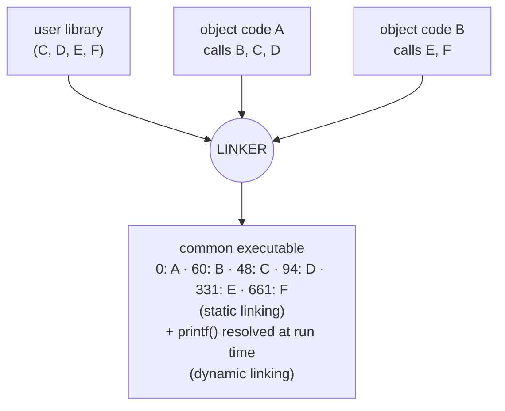

# 23. Memory Management, Object Files, Linker & Loader

> ✅ **From the class notes** (`Rati OS FULL.pdf`, pp. 65–69).
> **Syllabus:** *After-mid: memory management, compilation to object code, relocation, linker, loader, address binding*

---

## 🎯 In one line

Memory management **allocates and deallocates main memory to processes** so that memory is used efficiently and the CPU is kept busy. To get a program into memory, the **compiler** produces relocatable object code, the **linker** combines modules and resolves symbols, and the **loader** places the result in RAM and converts relocatable addresses into **absolute** ones.

---

## 1. What memory management does (p. 65)

- It **handles allocation and deallocation of memory space to processes** during execution.
- It **ensures efficient use of memory and increases CPU utilisation.**

### Why more processes in memory means higher CPU utilisation ⭐⭐

If each process spends a fraction $p$ of its time waiting for I/O, the CPU is idle only when **all** $n$ processes in memory are waiting at once:

$$\boxed{\text{CPU utilisation} = 1 - p^{\,n}}$$

$p$ = fraction of time a process spends doing I/O · $n$ = number of processes in main memory (the degree of multiprogramming).

| $p$ (I/O fraction) | $n = 1$ | $n = 2$ | $n = 4$ | $n = 8$ |
|---|---|---|---|---|
| 0.8 | 20 % | 36 % | 59 % | 83 % |
| 0.5 | 50 % | 75 % | 94 % | 99.6 % |

That is why memory management tries to fit **as many processes as possible** into RAM.

### The memory hierarchy (p. 65)

```
  CPU registers ⇄ Cache ⇄ Main memory (RAM) ⇄ Secondary memory (HDD/SSD)
  fastest, smallest ─────────────────────────────────► slowest, largest
```

---

## 2. From source program to object code (p. 66) ⭐⭐


`gcc` runs all four tools: **compiler → assembler → linker → loader** (the loader runs when you execute the file).

### Layout of an object file ⭐⭐⭐

| Section | Contents |
|---|---|
| **Header** | Where the various segments are present (sizes and offsets) |
| **Text / code** | The machine **instructions** |
| **Data segment** | **Global variables** / statically allocated data |
| **Relocation info** | Which addresses in the code are **relative** and must be adjusted when the program is placed in memory |
| **Symbol table** | Names of functions and variables with their **relocatable addresses** |
| **Debugging info** | Mapping from machine code **back to the source code** (line numbers, variable names) |

### Relocation (p. 66, p. 68)

The compiler doesn't know where in RAM the program will be placed, so it produces **relocatable addresses** that count from 0.

```
 PROGRAM (relocatable)              MAIN MEMORY (loaded at 1000)
 0                                  1000
 1                                  1001
 2                                  1002
 3   L1:                            1003
 4                                  1004
 5   GOTO L1   ─ relocatable addr ─► 1005   GOTO 1003   ← absolute address
```

**Relocation** = changing relocatable addresses into absolute ones: absolute = base address + relocatable address. In the class example on p. 68, `GOTO 3` loaded at base 2000 becomes `GOTO 2003`.

### Symbol table (p. 67)

| Symbol | Relocatable address |
|---|---|
| `max()` | 10046 |
| `printf()` | 108064 |
| `scanf()` | 3004231 |

Shared library functions are stored at some address, and that address is **assigned** (filled in) at link or run time.

---

## 3. The linker (p. 67) ⭐⭐⭐

Programs are split across many object files and libraries. Object code A may call functions B, C, D, object code B calls E, F, and those live in a user library. The **linker** combines them into **one** executable.



The linker does two things:
1. **Symbol resolution:** find what `B`, `C`, `D` (and so on) **are**, i.e. match every external reference to its definition.
2. **Relocation:** **combine** the separate relocatable address spaces into one relocatable address space for the whole program.

| Static linking | Dynamic linking |
|---|---|
| Library code is **copied into** the executable at link time | Library code (`.dll`/`.so`) is linked at **run time** |
| Bigger file, no runtime dependency | Smaller file, shared by many programs, **needs OS support** |

---

## 4. The loader (p. 68) ⭐⭐⭐

- It **loads the program from hard disk to main memory.**
- **Relocation:** it changes **relocatable addresses into absolute addresses** (`GOTO 3` → `GOTO 2003` when loaded at 2000).

| | **Linker** | **Loader** |
|---|---|---|
| Job | **Symbol resolution + relocation** (combining modules) | **Program loading + relocation** (relocatable → absolute) |
| Input | Object files + libraries | Executable on disk |
| Output | One executable | Running process in RAM |
| When | After compilation | When the program is run |

---

## 5. Address binding: when names become addresses (p. 68) ⭐⭐⭐

| Time | Binding |
|---|---|
| **Compile time** | Symbolic names → **relocatable** addresses |
| **Link time** | Relocatable addresses of separate modules → one **combined relocatable** address space |
| **Load time** | Relocatable address → **absolute** address |
| **Run time** | **Dynamic link library** resolution, which **needs OS support** (and hardware such as the MMU) |

> If binding is delayed to **run time**, a process can be **moved** in memory while it runs (compaction, swapping). This is what the base/limit registers ([Ch. 24](24-contiguous-allocation-and-fit-algorithms.md)) and paging ([Ch. 25](25-paging-and-address-translation.md)) support.

---

## 6. Class question (p. 69)

> **Q. In a resident-OS computer, which of the following system software must reside in the main memory under all situations?**
> (a) Assembler (b) Linker (c) Loader (d) Compiler

**Answer: (c) Loader.** Every program, including the assembler, linker and compiler themselves, must be **loaded** into memory before it can run. So the loader must always be resident. The others are ordinary programs that the loader brings in when needed.

---

## 7. Common exam questions

1. **What are the functions of memory management?** See §1.
2. **Derive CPU utilisation with $n$ processes in memory.** $1 - p^n$ (§1).
3. **Describe the structure of an object file.** See §2.
4. **What is relocation? Why are relocatable addresses needed?** See §2.
5. **Explain the functions of the linker and loader. Differentiate them.** See §3–§4.
6. **Static vs dynamic linking.** See §3.
7. **Explain address binding at compile, link, load and run time.** See §5.
8. **Which system software must always be resident?** The loader (§6).

---

## ⚡ Quick revision

- Memory management = allocate/deallocate memory to processes and **maximise CPU utilisation**: $1 - p^n$.
- Pipeline: `.c` → compiler → assembly → assembler → **object code** → **linker** → executable → **loader** → RAM.
- Object file: **header · text · data · relocation info · symbol table · debugging info**.
- **Linker** = symbol resolution + relocation (combine modules). **Loader** = loading + relocation (relocatable → absolute).
- Binding: **compile** (name → relocatable) · **link** (combine) · **load** (→ absolute) · **run** (DLL, needs OS).
- The loader must always be resident.

---

**Previous:** [← 22. Numerical Problem Bank](22-numerical-problem-bank.md) · **Next:** [24. Contiguous Allocation & Fit Algorithms →](24-contiguous-allocation-and-fit-algorithms.md)
