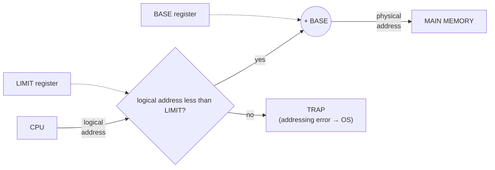

# 24. Contiguous Memory Allocation & the Fit Algorithms

> ✅ **From the class notes** (`Rati OS FULL.pdf`, pp. 69–75). All class questions were re-solved by simulation.
> **Syllabus:** *After-mid: contiguous allocation, fixed and variable partitioning, internal/external fragmentation, compaction, relocation and protection (limit/base registers), free-list data structure, first/next/best/worst fit*

---

## 🎯 In one line

In **contiguous allocation** each process gets **one unbroken block** of memory. Fixed partitions waste space **inside** blocks (internal fragmentation), and variable partitions waste space **between** blocks (external fragmentation). A **fit algorithm** chooses which hole a new process goes into.

---

## 1. Contiguous memory allocation (p. 69)

**Each process is allocated a single contiguous block of memory.** There are two schemes:

### 1.1 Fixed partitioning (p. 69) ⭐⭐

Memory is divided into **fixed-size partitions** at boot. They can be equal or of different sizes, and each partition holds **at most one** process.

```
 ┌──────────┐
 │    OS    │
 ├──────────┤
 │ P1: 1 MB │  ← 2 MB partition, 1 MB used
 │//////////│  ← 1 MB WASTED (internal fragmentation)
 ├──────────┤
 │   2 MB   │
 ├──────────┤
 │   2 MB   │
 └──────────┘
```

**Internal fragmentation:** in the 2 MB slot, a process of 1 MB is using it and the rest is wasted. *Waste **inside** an allocated partition.*

**Limitations of fixed partitioning:**
1. **Internal fragmentation.**
2. **Limit on process size:** a process larger than the biggest partition can never run.
3. **External fragmentation:** wasted space between allocated blocks. When accumulated together it could run a process, but it is not contiguous, so it is wasted.
4. **Limited degree of multiprogramming:** the number of processes in main memory is limited to the number of partitions created initially.

### 1.2 Dynamic / variable-size partitioning (p. 70) ⭐⭐

Main memory is divided into **variable-sized partitions based on the exact size** of the process that needs to be loaded.

| Advantage | Why |
|---|---|
| **Flexibility** | Any process size can be loaded if enough space exists |
| **Better multiprogramming** | More processes fit than with fixed partitioning |
| **Efficient memory use** | Memory is allocated exactly as needed, so there is **no internal fragmentation** |

| Disadvantage | Why |
|---|---|
| **External fragmentation** | As processes leave, memory becomes scattered with small holes |
| **Compaction is expensive** | Moving processes to create one contiguous free region needs run-time relocation and CPU time |

### External fragmentation (p. 75) ⭐⭐⭐

```
 ┌──────────┐
 │    OS    │
 ├──────────┤
 │   1 MB   │ free
 │//////////│ used
 │   1 MB   │ free      a 2 MB process WAITS, even though
 │//////////│ used      1 MB + 1 MB = 2 MB is free
 └──────────┘
```

Say a 2 MB process is waiting. Even though there is **enough total free space**, we **can't allocate** it because the space is not contiguous. That is **external fragmentation**.

| | Internal fragmentation | External fragmentation |
|---|---|---|
| Where the waste is | **Inside** an allocated block | **Between** allocated blocks |
| Caused by | Fixed partitions (and paging's last page) | Variable partitions |
| Fix | Smaller / variable partitions | **Compaction**, or **paging** ([Ch. 25](25-paging-and-address-translation.md)) |

---

## 2. Relocation and protection: limit and base registers (p. 71) ⭐⭐⭐



- **Limit register:** the size of the process's block. **Protection**: every logical address must be < limit.
- **Base (relocation) register:** the starting physical address. **Relocation**: physical = base + logical.

**Example (p. 71):** the limit is 200 B, which P1 needs, and the base has address 1000. The 200 B are allocated to P1 **after 1000** (1000–1199). Logical 150 maps to physical 1150. Logical 250 ≥ 200 traps.

> Because the base is added **at run time**, the OS can move a process (compaction) just by changing its base register.

---

## 3. Keeping track of free and occupied blocks (p. 71)

A **doubly linked list** whose nodes are `[P/H | start | end]` (P = process, H = hole):

```
[P | 0 | 100] ⇄ [H | 101 | 199] ⇄ [P | 200 | 500] ⇄ …
```

A new request scans the list for an **H** node that is large enough. When a process leaves, its node becomes **H** and is **merged** with adjacent holes.

---

## 4. Algorithms for choosing a free block (pp. 71–72) ⭐⭐⭐

| Algorithm | Rule | Notes |
|---|---|---|
| **First fit** | The **first** free block large enough | Fast. Leaves small holes near the start |
| **Next fit** | Like first fit, but **continue from where the previous search ended** | Spreads allocations around |
| **Best fit** | The **smallest** free block that can hold the process | Least leftover, but leaves **tiny unusable holes**. Slow (full search) |
| **Worst fit** | The **largest** available free block | Leftover stays usable. Large blocks get used up |

### Class example (p. 72) ⭐⭐⭐

Free blocks **200, 400, 300, 600** (in order). Processes P1 = **300**, P2 = **200**, P3 = **200**, P4 = **500** arrive in that order.

| Algorithm | P1 (300) | P2 (200) | P3 (200) | P4 (500) | Result |
|---|---|---|---|---|---|
| **First fit** | 400 (→ 100 left) | 200 (→ 0) | 300 (→ 100) | 600 (→ 100) | ✅ all allocated |
| **Next fit** | 400 (→ 100) | 300 *(search continues from 400)* (→ 100) | 600 (→ 400) | needs 500, largest hole is 400 | ❌ **P4 waits** |
| **Best fit** | 300 (→ 0) | 200 (→ 0) | 400 (→ 200) | 600 (→ 100) | ✅ all allocated |
| **Worst fit** | 600 (→ 300) | 400 (→ 200) | 300 (→ 100) | largest hole is 300 | ❌ **P4 waits** |

```
First fit:  [P2 ][ P1 |100][ P3 |100][  P4  |100]
             200     400       300        600
Best fit:   [P2 ][ P3 |200][ P1 ][  P4  |100]
Worst fit:  [ 200 ][ P2 |200][ P3 |100][ P1 |300]   P4 (500) ✘
Next fit:   [ 200 ][ P1 |100][ P2 |100][ P3 |400]   P4 (500) ✘
```

> In this example **first fit and best fit succeed**, while next fit and worst fit fail on P4.

---

## 5. Class questions (pp. 73–75) ⭐⭐⭐

### Q1 (p. 73): FF vs BF

> Memory: `50K (used) | 150K free | 300K (used) | 350K free | 600K (used)`. Requests **300K, 25K, 125K, 50K** in that order. Choose: (i) either FF or BF (ii) FF but not BF (iii) BF but not FF (iv) none.

| Request | **First fit** (holes 150, 350) | **Best fit** (holes 150, 350) |
|---|---|---|
| 300K | 350 → holes 150, **50** | 350 → holes 150, **50** |
| 25K | 150 → holes **125**, 50 | 50 *(smallest that fits)* → holes 150, **25** |
| 125K | 125 → holes **0**, 50 | 150 → holes **25**, 25 |
| 50K | 50 → ✅ | holes 25, 25 → ❌ **fails** |

**Answer: (ii) FF but not BF.** Best fit used up the 50K hole on the 25K request and left two useless 25K holes.

### Q2 (p. 73): best fit with fixed partitions and execution times

> Partitions **4K, 8K, 20K, 2K**. Jobs (in order) with sizes and execution times: 2K/4, 14K/10, 3K/2, 6K/1, 10K/1, 20K/8, 2K/6. Jobs are served in order and each takes the **smallest free partition that fits**. *(The question in this form usually asks: when does the 20K job complete?)*

| t | Event |
|---|---|
| 0 | 2K → **2K** (till 4) · 14K → **20K** (till 10) · 3K → **4K** (till 2) · 6K → **8K** (till 1) |
| 0–10 | 10K needs a partition ≥ 10K; only 20K qualifies, and it is busy until 10 |
| 10 | 10K → **20K** (till 11) |
| 11 | 20K → **20K** (till **19**) · 2K → **2K** (till 17) |

**The 20K job completes at t = 19.**

### Q3 (p. 74): best fit, count small holes

> 8 holes of **20, 4, 25, 18, 7, 9, 15, 12 KB** (in that order, none adjacent). P1 = **16 KB** and P2 = **9 KB** arrive in that order and use **best fit**. How many holes of size < 8 KB are left?

- P1 (16) goes to **18** (the smallest ≥ 16), leaving a hole of 2.
- P2 (9) goes to **9** (exact), leaving no hole.

Remaining holes: 20, 4, 25, **2**, 7, 15, 12. Those < 8 KB are **4, 2, 7**, so the answer is **3**.

### Q4 (pp. 74–75): best fit, then worst fit, with layouts

> 8 holes of **21, 5, 25, 20, 7, 19, 15, 14 KB**. P1 = 16, P2 = 9, P3 = 3 use **best fit**. P4 = 10, P5 = 5 use **worst fit**. Allocation is from the beginning of a hole, and the remainder becomes a new hole.

**(a) Initial layout:**
```
| 21 | 5 | 25 | 20 | 7 | 19 | 15 | 14 |
```

**(b) After P1, P2, P3 (best fit):**
- P1 (16): the smallest ≥ 16 is **19**, leaving 3.
- P2 (9): the smallest ≥ 9 is **14**, leaving 5.
- P3 (3): the smallest ≥ 3 is the **3** left from P1, an exact fit.

```
| 21 | 5 | 25 | 20 | 7 | P1 16 + P3 3 | 15 | P2 9 + 5 |
```

Holes: 21, 5, 25, 20, 7, 15, 5.

**(c) After P4, P5 (worst fit):**
- P4 (10): the largest hole is **25**, leaving 15.
- P5 (5): the largest hole is now **21**, leaving 16.

```
| P5 5 + 16 | 5 | P4 10 + 15 | 20 | 7 | P1 + P3 | 15 | P2 + 5 |
```

Final holes: **16, 5, 15, 20, 7, 15, 5**.

---

## 6. Common exam questions

1. **Differentiate fixed and variable partitioning.** See §1.
2. **Internal vs external fragmentation, with diagrams.** See §1.
3. **What is compaction? Why is it expensive?** See §1.2.
4. **Explain relocation and protection using limit and base registers.** See §2.
5. **Explain first, next, best and worst fit, and allocate the given processes.** See §4.
6. **FF vs BF questions** (Q1), **small-hole counting** (Q3), **layouts** (Q4). See §5.

---

## ⚡ Quick revision

- **Contiguous:** one unbroken block per process.
- **Fixed partitioning:** internal fragmentation, limited process size, limited multiprogramming.
- **Variable partitioning:** no internal fragmentation, but **external fragmentation**, and compaction is expensive.
- **Limit/base:** `if logical < LIMIT then physical = BASE + logical else TRAP`.
- **First fit** = first that fits · **next fit** = first that fits, continuing from the last position · **best fit** = smallest that fits · **worst fit** = largest.
- Class answers: blocks 200/400/300/600 → FF ✅ BF ✅ NF ❌ WF ❌ · 300K/25K/125K/50K → **FF but not BF** · 20K job ends at **19** · small holes → **3**.

---

**Previous:** [← 23. Memory Management, Linker & Loader](23-memory-management-linker-loader.md) · **Next:** [25. Paging & Address Translation →](25-paging-and-address-translation.md)
