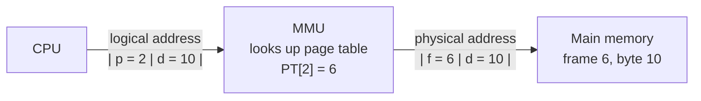

# 25. Paging & Logical-to-Physical Address Translation

> ✅ **From the class notes** (`Rati OS FULL.pdf`, pp. 75–81 and 85). Every number was recomputed. Rows 3–5 of the p. 80 table do not follow the notes' own formula and are corrected below (⚠️).
> **Syllabus:** *After-mid: paging, page table, page number and offset, address translation, bit calculations (LAS/PAS)*

---

## 🎯 In one line

Split the process into fixed-size **pages** and memory into same-size **frames**. Any page can go in any free frame, which removes external fragmentation. A **page table** maps page → frame, and the **offset is copied unchanged**.

---

## 1. Paging (p. 75) ⭐⭐⭐

**Paging** is a memory-management technique in which a process is **not allocated in a contiguous block**.

| Term | Definition |
|---|---|
| **Page** | A fixed-size block of a process's **logical address space** |
| **Frame** | A fixed-size block of **main (physical) memory** |
| Rule | **Frame size = page size** |
| Loading | When a process is loaded, **its pages go into any available frames, not necessarily contiguous** |

```
 Process P1 (4 pages)        Main memory (16 frames)
 page 0 ──────────────────►  frame 0  P1
 page 1 ──────────────────►  frame 1  P1      Pages of P2, P3, P4, P5 fill other
 page 2 ──────────────────►  frame 2  P1      frames. When P1 and P2 finish,
 page 3 ──────────────────►  frame 3  P1      P5's 8 pages can use frames 0–7
                                              even though they were freed separately.
```

> **No external fragmentation** (any free frame will do). The cost is a little **internal fragmentation** in the last page of each process, plus the page-table overhead.

---

## 2. Page table, page number, offset (p. 76) ⭐⭐⭐

- **Page table:** a data structure used by the OS to **keep track of where each page of a process is stored** in physical memory. There is one per process.
- **Page number ($p$):** the **index** used to find the corresponding frame number in the page table.
- **Offset ($d$):** the **exact byte position within the page**.



**Translation:** $\text{LA} = (p, d) \;\longrightarrow\; \text{PA} = (\text{PT}[p], d)$. The **offset stays the same**, and only the page number is replaced by the frame number.

---

## 3. Counting bits (pp. 77–79) ⭐⭐⭐

$n$ distinct addresses need $\lceil \log_2 n \rceil$ bits (1 bit gives 2 numbers, 2 bits give 4, and 8 numbers need $\lceil\log_2 8\rceil = 3$ bits).

### Class example (p. 77)

> Process P1 is **16 bytes**, the page size is **4 bytes** and main memory is **64 bytes**. Memory is byte-addressable.

| Quantity | Calculation | Value |
|---|---|---|
| Logical address bits | $\lceil\log_2 16\rceil$ | **4 bits** |
| Number of pages | $16 / 4$ | **4** |
| Page-number bits | $\log_2 4$ | **2** |
| Offset bits | $\log_2 4$ | **2** |
| Physical address bits | $\log_2 64$ | **6 bits** |
| Number of frames | $64 / 4$ | **16** (P1 gets 4 of them) |
| Frame-number bits | $6 - 2$ | **4** |

```
 Logical address (4 bits):   [ p p | d d ]
 Physical address (6 bits):  [ f f f f | d d ]
```

### When the word is not a byte (p. 78)

The **word** is the smallest addressable unit, so the number of addresses is size / word size.

| Question | Calculation | Answer |
|---|---|---|
| PAS = 128 KB, word = 4 B. How many PA bits? | $\log_2 \dfrac{2^7 \times 2^{10}}{2^2} = \log_2 2^{15}$ | **15** |
| LAS = 256 MB, word = 4 B. How many LA bits? | $\log_2 \dfrac{2^8 \times 2^{20}}{2^2} = \log_2 2^{26}$ | **26** |

> Here **LAS > PAS** (the process is bigger than main memory), so it can't all be in memory at once. Such processes are **virtual processes** and need demand paging ([Ch. 27](27-virtual-memory-and-page-replacement.md)).

### The general formulas (p. 79) ⭐⭐⭐

With everything measured in words: PAS (main memory) = $M$ words, LAS (process size) = $L$ words, page size = $P$ words.

$$m = \lceil\log_2 M\rceil \text{ (PA bits)} \qquad l = \lceil\log_2 L\rceil \text{ (LA bits)} \qquad p = \lceil\log_2 P\rceil \text{ (offset bits)}$$

```
 Physical address:  [ frame no.: m − p | offset: p ]
 Logical address:   [ page no.:  l − p | offset: p ]
```

$$\boxed{\#\text{frames} = 2^{m-p} \qquad \#\text{pages} = 2^{l-p} \qquad \text{PTE size} = m - p \text{ bits} \qquad \text{PT size} = 2^{l-p} \times (m-p) \text{ bits}}$$

---

## 4. The class practice table (p. 80) ⭐⭐⭐

Fill in every column from LAS, PAS and page size (byte-addressable):

| LAS | PAS | LA bits | PA bits | Page size | Offset | # Pages | # Frames | PTE size | PT size |
|---|---|---|---|---|---|---|---|---|---|
| 128 KB | 128 KB | 17 | 17 | 4 KB | 12 | $2^5 = 32$ | $2^5 = 32$ | 5 bits | 160 bits = **20 B** |
| 256 KB | 1 MB | 18 | 20 | 4 KB | 12 | $2^6 = 64$ | $2^8 = 256$ | 8 bits = 1 B | **64 B** |
| 1 MB | 256 KB | 20 | 18 | 1 KB | 10 | $2^{10}$ | $2^8$ | **8 bits** ⚠️ | $2^{10}$ B = **1 KB** ⚠️ |
| 1 MB | 512 MB | 20 | 29 | 4 KB | 12 | $2^8 = 256$ | $2^{17}$ | **17 bits** ⚠️ | 256 × 17 bits = **544 B** ⚠️ |
| 2 KB | 1 KB | 11 | 10 | 2 B | 1 | $2^{10}$ | $2^9$ | **9 bits** ⚠️ | 1024 × 9 bits = **1152 B** ⚠️ |

> ⚠️ **Rows 3–5 in the handwritten table** give PTE sizes of 10 bits, 9 bits (≈1 B) and 10 bits, and PT sizes of 12.5 KB, 256 B and 12.5 KB. These don't match the notes' own formula on p. 79 (PTE $= m - p$ bits, PT $= 2^{l-p} \times (m-p)$). The corrected values are in bold above. *(If the course adds extra bits per PTE, such as valid and dirty bits ([Ch. 26](26-page-table-entry-and-multilevel-paging.md)), the PTE grows accordingly, so check with the teacher.)*

---

## 5. Worked translation with a page table (p. 85) ⭐⭐⭐

> 12-bit virtual and physical addresses, page size **256 B** ($2^8$, so **8 offset bits** = the last 2 hex digits). The first hex digit is the page (or frame) number. Free frames are **D, E, F** (D at the head of the free list, E second, F last).

| Page | 0 | 1 | 2 | 3 | 4 | 5 | 6 | 7 | 8 | 9 |
|---|---|---|---|---|---|---|---|---|---|---|
| Frame | – | 2 | C | A | – | 4 | 3 | – | B | 0 |
| Present | 0 | 1 | 1 | 1 | 0 | 1 | 1 | 0 | 1 | 1 |

| VA | Page, offset | Lookup | PA |
|---|---|---|---|
| `9EF` | 9, `EF` | frame 0 | **`0EF`** |
| `111` | 1, `11` | frame 2 | **`211`** |
| `700` | 7, `00` | **not allocated** → page fault → first free frame **D** | **`D00`** |
| `0FF` | 0, `FF` | **not allocated** → next free frame **E** | **`EFF`** |

---

## 6. Common exam questions

1. **What is paging? Define page, frame, page table, page number and offset.** See §1–§2.
2. **Draw the paging hardware and explain address translation.** See §2.
3. **How does paging remove external fragmentation? Does it have internal fragmentation?** See §1.
4. **Given LAS, PAS and page size, find the LA/PA bits, number of pages and frames, PTE size and PT size.** See §3–§4.
5. **Translate the given virtual addresses using the page table.** See §5.

---

## ⚡ Quick revision

- Page = logical block. Frame = physical block. **Page size = frame size.** Pages go into **any** free frames.
- LA = **[page no. | offset]** → PA = **[frame no. | offset]**. The offset never changes.
- Bits: $m = \log_2(\text{PAS}/\text{word})$, $l = \log_2(\text{LAS}/\text{word})$, $p = \log_2(\text{page size})$.
- **#pages $= 2^{l-p}$**, **#frames $= 2^{m-p}$**, **PTE $= m - p$ bits**, **PT $= \#\text{pages} \times \text{PTE}$**.
- Class answers: 16 B process / 4 B pages / 64 B memory gives LA 4, PA 6, 4 pages, 16 frames. PAS 128 KB with a 4 B word gives 15 bits; LAS 256 MB with a 4 B word gives 26 bits.

---

**Previous:** [← 24. Contiguous Allocation & Fit Algorithms](24-contiguous-allocation-and-fit-algorithms.md) · **Next:** [26. Page Table Entry & Multilevel Paging →](26-page-table-entry-and-multilevel-paging.md)
