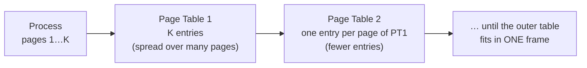

# 26. Page Table Entries & Multilevel Paging

> ✅ **From the class notes** (`Rati OS FULL.pdf`, pp. 81–86). Both multilevel examples were recomputed.
> **Syllabus:** *After-mid: page table, page table entry fields, multilevel (hierarchical) paging*

---

## 🎯 In one line

Each **page table entry** holds a **frame number** plus control bits (present, dirty, reference, protection, caching). When the page table itself is too big for one frame, **page the page table**: keep adding levels until the outermost table fits in a single frame.

---

## 1. Page table and page entry (p. 81)

- The **page table** holds only page entries, stored in data format. It has one entry per page.
- A **page entry** is the mapping data from a page to a frame.
- Its size is generally **fixed and predetermined by the OS**. At minimum it is the number of frame-number bits.

```
  Page table                     Main memory
 ┌──────────────────┐           ┌─────────┐ frame 1
 │ Page Table Entry 1├──────────►│         │ frame 2
 │ Page Table Entry 2├────┐      ├─────────┤ frame 3
 │        ⋮          │    └─────►│         │   ⋮
 └──────────────────┘           └─────────┘
```

---

## 2. Fields of a page table entry (p. 82) ⭐⭐⭐

```
┌──────────┬───────────┬──────────────┬────────────┬─────────────────┬───────────────┐
│ ① Caching│ ② Refer-  │ ③ Modified / │ ④ Protec-  │ ⑤ Present /     │  FRAME NUMBER │
│ disabled │   ence    │    Dirty     │    tion    │   Absent (valid)│               │
└──────────┴───────────┴──────────────┴────────────┴─────────────────┴───────────────┘
```

| # | Field | Meaning |
|---|---|---|
| — | **Frame number** | Which physical frame holds this page. **The only mandatory field** |
| 1 | **Caching disabled** | Whether the page may be carried into the **cache**, or must always be read from main memory (e.g. memory-mapped I/O) |
| 2 | **Reference** | Whether this page was **referred to in the last clock cycle**. Used by page replacement (LRU approximations) |
| 3 | **Modified / Dirty** | Whether the page was modified. **If modified, the change must be written back to the hard disk** before the frame is reused |
| 4 | **Protection** | **Read only, write only, or both** (also execute) |
| 5 | **Present / Absent (valid/invalid)** | For **virtual memory**: only required pages are loaded into main memory. **Absent ⇒ page fault** ([Ch. 27](27-virtual-memory-and-page-replacement.md)) |

---

## 3. Why multilevel paging? (p. 83) ⭐⭐⭐

**Single-level example (p. 83):** LA = 22 bits, page size = 4 KB, PTE = 4 B.

$$\#\text{pages} = \frac{2^{22}}{2^{12}} = 2^{10} = 1024 \qquad \text{PT size} = 2^{10} \times 4\,\text{B} = 4\,\text{KB} = \text{one page} \;✔$$

The page table fits in exactly one frame, so one level is enough.

**The problem:** when a program is really big, the number of pages is really high and the page table takes **too much space**. For a 32-bit LA with 4 KB pages and 4 B PTEs, the table is $2^{20} \times 4 = 4$ MB **per process**, which needs 1024 contiguous frames.

**The idea:** treat the page table like any other data and **page it**. A smaller outer table records where each page of the inner table lives. This is **done iteratively until the final (outermost) table fits in a single frame**.



### General recipe (p. 84)

With $n$ pages, an entry size of $K$ bytes and page size $S$:
- PT1 has $n$ entries, so its size is $nK$ bytes and it occupies $M = nK / S$ pages.
- PT2 has $M$ entries, so its size is $MK$, and so on.
- Stop when a table's size is ≤ $S$.

Shortcut: **entries per page** $e = S / K$, so each level resolves $\log_2 e$ bits of the page number.
$$\#\text{levels} = \left\lceil \frac{\text{page-number bits}}{\log_2(S/K)} \right\rceil$$

---

## 4. Worked example 1: 56-bit virtual address (p. 85) ⭐⭐⭐

> An OS on a 56-bit machine uses hierarchical paging. The page size is **8 KB** and each PTE is **4 B**. (a) How many levels? (b) What is the maximum number of frames needed to store the process and its page tables?

- Offset $= \log_2 8\text{K} = 13$ bits, so the page-number bits are $56 - 13 = 43$ and there are $2^{43}$ pages.
- Entries per page $= 2^{13} / 2^2 = 2^{11}$, i.e. 11 bits per level.

| Level | Entries | Size ($\times 4$ B) | Pages it occupies |
|---|---|---|---|
| Innermost (1st) | $2^{43}$ | $2^{45}$ B | $2^{45}/2^{13} = 2^{32}$ |
| 2nd | $2^{32}$ | $2^{34}$ B | $2^{21}$ |
| 3rd | $2^{21}$ | $2^{23}$ B | $2^{10}$ |
| 4th (outer) | $2^{10}$ | $2^{12}$ B = 4 KB ≤ 8 KB | **1 frame** ✔ |

**(a) 4 levels.** *(Check: $\lceil 43/11 \rceil = 4$.)*

**(b) Maximum frames** = process pages + all page-table pages:
$$\underbrace{2^{43}}_{\text{process}} + \underbrace{2^{32} + 2^{21} + 2^{10} + 1}_{\text{page tables}}$$

---

## 5. Worked example 2: working backwards to the LA size (p. 86) ⭐⭐

> Page size **4 KB**, PTE **4 B**, **3 levels**, and the **outermost page table is 256 B**. How many bits are in the logical address?

- Offset = 12 bits. Entries per full page = $2^{12}/4 = 2^{10}$.

| Level | Calculation | Entries |
|---|---|---|
| 3rd (outer) | 256 B / 4 B | $2^6$ (points to $2^6$ pages of the 2nd level) |
| 2nd | $2^6$ pages × $2^{12}$ B = $2^{18}$ B | $2^{16}$ (points to $2^{16}$ pages of the 1st level) |
| 1st (inner) | $2^{16}$ pages × $2^{12}$ B = $2^{28}$ B | $2^{26}$ = total process pages |

$$\text{LA bits} = \underbrace{6}_{\text{outer}} + \underbrace{10}_{\text{2nd}} + \underbrace{10}_{\text{1st}} + \underbrace{12}_{\text{offset}} = \mathbf{38}$$

```
 Logical address (38 bits):  [ 6 | 10 | 10 | 12 ]
                              PT3  PT2  PT1  offset
```

---

## 6. Common exam questions

1. **What is a page table entry? Explain its fields.** See §2.
2. **What is the dirty bit / present bit used for?** See §2.
3. **Why is multilevel paging needed?** See §3.
4. **Given the LA bits, page size and PTE size, find the number of levels.** See §4.
5. **Find the maximum number of frames for the process plus its page tables.** See §4(b).
6. **Given the levels and the outer-table size, find the LA bits.** See §5.

---

## ⚡ Quick revision

- PTE = **frame no. + caching-disabled + reference + dirty + protection + present/absent**.
- **Dirty** ⇒ write back to disk before replacing. **Absent** ⇒ page fault.
- PT size = #pages × PTE size. If it is bigger than one frame, **page the page table**.
- Entries per page $= S/K$. Levels $= \lceil \text{page bits} / \log_2(S/K) \rceil$.
- Class answers: 22-bit LA gives a 4 KB PT (1 level). 56-bit, 8 KB, 4 B gives **4 levels**, with frames $2^{43} + 2^{32} + 2^{21} + 2^{10} + 1$. 3 levels with a 256 B outer table gives **38-bit LA** (6 + 10 + 10 + 12).

---

**Previous:** [← 25. Paging & Address Translation](25-paging-and-address-translation.md) · **Next:** [27. Virtual Memory & Page Replacement →](27-virtual-memory-and-page-replacement.md)
