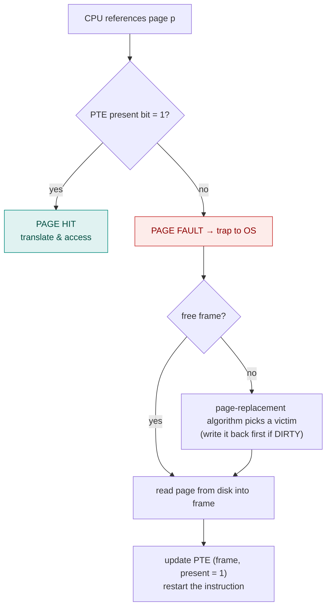

# 27. Virtual Memory, Demand Paging & Page Replacement

> ✅ **From the class notes** (`Rati OS FULL.pdf`, pp. 79, 87–90). All six fault counts were verified by simulation and match the notes.
> **Syllabus:** *After-mid: virtual memory, demand paging, page fault, page hit, thrashing, page replacement (Optimal, LRU, FIFO), Belady's anomaly, stack property*

---

## 🎯 In one line

**Virtual memory** runs processes that are **not entirely in RAM** by loading pages **on demand**. A reference to an absent page causes a **page fault**, and if memory is full a **page-replacement algorithm** picks the victim: **Optimal** looks into the future, **LRU** into the past, and **FIFO** at arrival order.

---

## 1. Definitions (pp. 79, 87) ⭐⭐⭐

| Term | Definition |
|---|---|
| **Virtual memory** | A technique that allows the **execution of a process that may not be completely in main memory** (so LAS may exceed PAS). Extra PTE parameter: **present/absent (valid/invalid)** |
| **Demand paging** | **Pages are loaded into memory only when they are needed**. Only part of the process is in RAM |
| **Page fault** | Occurs when a program tries to access a page **not currently loaded** in main memory. There is a context switch and the OS loads the required page from disk |
| **Page hit** | The page is **already in main memory**, so there is no error and no disk access |
| **Thrashing** | The CPU spends **most of its time swapping pages in and out** rather than executing instructions. **Solution:** better page-replacement algorithms (and fewer processes, i.e. a lower degree of multiprogramming) |

### Handling a page fault



### Thrashing

```
 CPU utilisation
   ▲        ____
   │      /      \
   │    /          \___  ← thrashing: too many processes,
   │  /                    each with too few frames
   └──────────────────────►  degree of multiprogramming
```

---

## 2. The class reference string

$$\textbf{0, 1, 2, 3, 0, 1, 4, 0, 1, 2, 3, 4} \qquad (12 \text{ references, memory initially empty})$$

**Page-fault rate** $= \dfrac{\#\text{faults}}{\#\text{references}}$. **F** = fault, **H** = hit. Each column shows the frame contents **after** the reference.

---

## 3. Optimal (OPT) (p. 88) ⭐⭐⭐

> **Replace the page whose next use is farthest in the future.** If several pages are never used again, replace the **oldest** of them (the class's "replacement protocol 2").

**3 frames:**

| Ref | 0 | 1 | 2 | 3 | 0 | 1 | 4 | 0 | 1 | 2 | 3 | 4 |
|---|---|---|---|---|---|---|---|---|---|---|---|---|
| Frame 1 | 0 | 0 | 0 | 0 | 0 | 0 | 0 | 0 | 0 | **2** | 2 | 2 |
| Frame 2 | | 1 | 1 | 1 | 1 | 1 | 1 | 1 | 1 | 1 | **3** | 3 |
| Frame 3 | | | 2 | **3** | 3 | 3 | **4** | 4 | 4 | 4 | 4 | 4 |
| | F | F | F | F | H | H | F | H | H | F | F | H |

- At **3**: among 0, 1, 2, page 2 is used farthest away, so 3 replaces 2.
- At **4**: 0 and 1 are used soon and 3 is used last, so 4 replaces 3.
- At **2**: neither 0 nor 1 is used again, so the **oldest**, 0, is replaced.
- At **3**: 1 and 2 are never used again, so the oldest, 1, is replaced.

**7 faults, rate 7/12.**

**4 frames:** faults on 0, 1, 2, 3, 4 (replacing 3), and 3 (replacing 0, the oldest of the never-used-again pages). **6 faults, rate 6/12 = 0.5.**

> Optimal gives the **lowest possible** fault count, but it needs future knowledge, so it **cannot be implemented**. It is the **benchmark** for other algorithms.

---

## 4. LRU: Least Recently Used (p. 89) ⭐⭐⭐

> **Replace the page that has not been used for the longest time in the past.** *(Optimal checks the future; LRU checks the past.)*

**3 frames:**

| Ref | 0 | 1 | 2 | 3 | 0 | 1 | 4 | 0 | 1 | 2 | 3 | 4 |
|---|---|---|---|---|---|---|---|---|---|---|---|---|
| Frame 1 | 0 | 0 | 0 | **3** | 3 | 3 | **4** | 4 | 4 | **2** | 2 | 2 |
| Frame 2 | | 1 | 1 | 1 | **0** | 0 | 0 | 0 | 0 | 0 | **3** | 3 |
| Frame 3 | | | 2 | 2 | 2 | **1** | 1 | 1 | 1 | 1 | 1 | **4** |
| | F | F | F | F | F | F | F | H | H | F | F | F |

**10 faults, rate 10/12 = 5/6.**

**4 frames:**

| Ref | 0 | 1 | 2 | 3 | 0 | 1 | 4 | 0 | 1 | 2 | 3 | 4 |
|---|---|---|---|---|---|---|---|---|---|---|---|---|
| Frame 1 | 0 | 0 | 0 | 0 | 0 | 0 | 0 | 0 | 0 | 0 | 0 | **4** |
| Frame 2 | | 1 | 1 | 1 | 1 | 1 | 1 | 1 | 1 | 1 | 1 | 1 |
| Frame 3 | | | 2 | 2 | 2 | 2 | **4** | 4 | 4 | 4 | **3** | 3 |
| Frame 4 | | | | 3 | 3 | 3 | 3 | 3 | 3 | **2** | 2 | 2 |
| | F | F | F | F | H | H | F | H | H | F | F | F |

**8 faults, rate 8/12 = 2/3.**

---

## 5. FIFO: First In First Out (p. 90) ⭐⭐⭐

> **Replace the page that has been in memory the longest** (the oldest arrival), regardless of use.

**3 frames:**

| Ref | 0 | 1 | 2 | 3 | 0 | 1 | 4 | 0 | 1 | 2 | 3 | 4 |
|---|---|---|---|---|---|---|---|---|---|---|---|---|
| Frame 1 | 0 | 0 | 0 | **3** | 3 | 3 | **4** | 4 | 4 | 4 | 4 | 4 |
| Frame 2 | | 1 | 1 | 1 | **0** | 0 | 0 | 0 | 0 | **2** | 2 | 2 |
| Frame 3 | | | 2 | 2 | 2 | **1** | 1 | 1 | 1 | 1 | **3** | 3 |
| | F | F | F | F | F | F | F | H | H | F | F | H |

**9 faults, rate 9/12 = 75 %.**

**4 frames:**

| Ref | 0 | 1 | 2 | 3 | 0 | 1 | 4 | 0 | 1 | 2 | 3 | 4 |
|---|---|---|---|---|---|---|---|---|---|---|---|---|
| Frame 1 | 0 | 0 | 0 | 0 | 0 | 0 | **4** | 4 | 4 | 4 | **3** | 3 |
| Frame 2 | | 1 | 1 | 1 | 1 | 1 | 1 | **0** | 0 | 0 | 0 | **4** |
| Frame 3 | | | 2 | 2 | 2 | 2 | 2 | 2 | **1** | 1 | 1 | 1 |
| Frame 4 | | | | 3 | 3 | 3 | 3 | 3 | 3 | **2** | 2 | 2 |
| | F | F | F | F | H | H | F | F | F | F | F | F |

**10 faults, rate 10/12 = 5/6.** More frames gave **more** faults.

---

## 6. Belady's anomaly and the stack property (p. 90) ⭐⭐⭐

**Belady's anomaly:** when the number of frames **increases**, the number of page faults **also increases**. It is **found in FIFO** (9 → 10 above).

**Stack property** (stack algorithms): the set of pages in memory with $m$ frames is **always a subset** of the set with $m+1$ frames:
$$\text{pages}(m) \subseteq \text{pages}(m+1)$$

- It **applies to LRU** (and Optimal). Stack algorithms **never** suffer Belady's anomaly.
- It **does not apply to FIFO**, so FIFO can show the anomaly.

*Check with LRU:* after each reference, the 3-frame contents are always inside the 4-frame contents. For FIFO, after the 7th reference (4) the 3-frame set is {4, 0, 1} but the 4-frame set is {4, 1, 2, 3}, which does not contain 0.

---

## 7. Summary table

| | 3 frames | 4 frames | Belady? | Implementable? |
|---|---|---|---|---|
| **Optimal** | **7** (58 %) | **6** (50 %) | Never | ❌ needs the future |
| **LRU** | **10** (83 %) | **8** (67 %) | Never (stack) | ✅ (counters/stack, costly) |
| **FIFO** | **9** (75 %) | **10** (83 %) | **Yes** | ✅ (simple queue) |

---

## 8. Common exam questions

1. **Define virtual memory, demand paging, page fault, page hit and thrashing.** See §1.
2. **Describe the steps in handling a page fault.** See §1 (flowchart).
3. **For the reference string …, find the page faults with FIFO/LRU/Optimal using 3 and 4 frames.** See §3–§5.
4. **What is Belady's anomaly? Demonstrate it.** FIFO 9 → 10 (§6).
5. **What is the stack property? Which algorithms have it?** LRU and Optimal (§6).
6. **What causes thrashing and how is it prevented?** See §1.

---

## ⚡ Quick revision

- **Virtual memory** = run processes not fully in RAM. **Demand paging** = load only when needed.
- Page absent ⇒ **page fault** ⇒ OS loads it (evicting a victim, written back if dirty).
- **Thrashing** = CPU busy swapping, not executing.
- **OPT:** farthest future use (tie → oldest). **LRU:** least recently used (past). **FIFO:** oldest arrival.
- String 0 1 2 3 0 1 4 0 1 2 3 4: **OPT 7 / 6 · LRU 10 / 8 · FIFO 9 / 10** (3 / 4 frames).
- **Belady:** more frames → more faults. It happens in **FIFO**, never in stack algorithms (LRU, OPT): $\text{pages}(m) \subseteq \text{pages}(m+1)$.

---

**Previous:** [← 26. Page Table Entry & Multilevel Paging](26-page-table-entry-and-multilevel-paging.md) · **Next:** [28. Effective Access Time & TLB →](28-effective-access-time-tlb.md)
