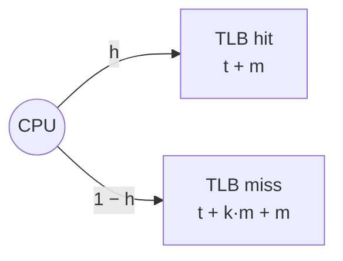

# 28. Effective Access Time (EAT): Paging, TLB & Page Faults

> ✅ **From the class notes** (`Rati OS FULL.pdf`, pp. 91–94). Every class answer (494.5 ns, 197.5 ns and all six rows of the p. 94 table) was recomputed and matches.
> **Syllabus:** *After-mid: effective access time, single- and multi-level paging, TLB hit/miss, demand paging with page faults and dirty victims*

---

## 🎯 In one line

**EAT** is the **average time for one memory reference** once you include page-table lookups, the TLB and page faults. Weight each case (TLB hit, TLB miss with page hit, page fault) by its probability and add them up.

---

## 1. Where we are (p. 91)

```
Contiguous allocation ──external fragmentation──► PAGING ──large page tables──►
BIGGER PAGES ──internal fragmentation──► MULTI-LEVEL PAGING
```

**Effective access time (EAT):** the **average time required by the CPU to access a memory location**, including address translation, page-table look-up and page faults.

**Symbols used throughout:**

| Symbol | Meaning |
|---|---|
| $m$ | Time for one main-memory access |
| $t$ | TLB look-up time |
| $h$ | TLB hit ratio |
| $k$ | Number of page-table levels |
| $f$ (or $p$) | Page-fault rate |
| $s$ | Page-fault service time |
| $T$ | Time to transfer a page to/from disk |
| $d$ | Fraction of victim pages that are **dirty** |

---

## 2. Paging without a TLB (p. 91) ⭐⭐

```
CPU ──m──► page table (in RAM) ──m──► the actual word
           (get the frame no.)        (in the frame)
```

| Paging | EAT |
|---|---|
| **Mono (single) level** | $\boxed{2m}$: one access for the page table, one for the data |
| **$k$ levels** | $\boxed{(k+1)\,m}$ |

Paging without help **doubles** (or worse) every memory access.

---

## 3. The TLB (p. 91) ⭐⭐⭐

**TLB (Translation Look-aside Buffer):** a small, fast **associative cache** that stores the page → frame mappings of **pages frequently referred to** by the CPU.
- The page is found in the TLB: **TLB hit**. The frame number comes straight from the TLB.
- It is not found: **TLB miss**. The CPU goes to the page table in RAM.



$$\boxed{\text{EAT} = h\,(t + m) + (1-h)\,\big(t + (k+1)\,m\big)}$$

Simplified (p. 92): $\text{EAT} = t + m + k(1-h)\,m$.

> Some textbooks look up the TLB and the page table **in parallel**, so a miss costs $(k+1)m$ without the $t$. The class formula adds $t$ on both paths, so use the class form unless told otherwise.

---

## 4. Demand paging and page faults (pp. 92–93) ⭐⭐⭐

With demand paging, a referenced page **may not be present** in main memory (a **page fault**).

$$\boxed{\text{EAT} = (1 - f)\,m_a + f\,s}$$

$m_a$ = access time when there is no fault · $s$ = page-fault service time.

### Page-fault service time with dirty victims (p. 93)

If the victim page is dirty (probability $d$), it must be **written back** before the new page is **read in**:

$$s = (1-d)\,T + d\,(T + T) = \boxed{(1 + d)\,T}$$

---

## 5. Everything together: TLB + paging + page faults (p. 93) ⭐⭐⭐

```
                 ┌── TLB hit (h) ─────────────► memory access          : t + m
 CPU ── TLB ─────┤
                 └── TLB miss (1−h) ─┬─ page hit (1−f) ─► memory access : t + (k+1)m
                                     └─ page fault (f) ─► service, then
                                                          memory access : t + (k+1)m + s
```

$$\boxed{\text{EAT} = h\,(t+m) + (1-h)\Big[(1-f)\big(t + (k+1)m\big) + f\big(t + (k+1)m + s\big)\Big]}, \qquad s = (1+d)\,T$$

---

## 6. Class problems ⭐⭐⭐

### Q1 (p. 93)

> A paging system uses a page table in main memory and a TLB. TLB look-up = **20 ns**, TLB miss rate = **10 %**. The page table has a page hit rate of **95 %**. Each memory access = **400 ns**. Each page transfer to/from disk = **6000 ns**. **15 %** of victim pages are dirty. Find the average memory access time.

$t = 20$, $h = 0.9$, $f = 0.05$, $m = 400$, $T = 6000$, $d = 0.15$, $k = 1$.

$$s = (1 + 0.15)\times 6000 = 6900 \text{ ns}$$

| Case | Probability | Time |
|---|---|---|
| TLB hit | 0.9 | $20 + 400 = 420$ |
| TLB miss, page hit | $0.1 \times 0.95$ | $20 + 400 + 400 = 820$ |
| TLB miss, page fault | $0.1 \times 0.05$ | $20 + 800 + 6900 = 7720$ |

$$\text{EAT} = 0.9(420) + 0.1\,[\,0.95(820) + 0.05(7720)\,] = 378 + 0.1\,[779 + 386] = 378 + 116.5 = \boxed{494.5 \text{ ns}}$$

### Q2 (p. 94)

> Page table in main memory plus a TLB. Memory access = **150 ns**, TLB look-up = **10 ns**, page transfer = **5000 ns**. TLB hit rate = **95 %**, page-fault rate = **10 %**, dirty victims = **20 %**. Find the average MAT.

$$s = (1 + 0.2)\times 5000 = 6000 \text{ ns}$$
$$\text{MAT} = 0.95(10 + 150) + 0.05\,[\,0.9(10 + 150 + 150) + 0.1(10 + 150 + 6000 + 150)\,]$$
$$= 0.95(160) + 0.05\,[0.9(310) + 0.1(6310)] = 152 + 0.05\,[279 + 631] = 152 + 45.5 = \boxed{197.5 \text{ ns}}$$

### Q3 (p. 94): fill in the table (no page faults)

$t = 20$ ns, $m = 100$ ns. Use $\text{EAT} = h(t+m) + (1-h)(t + (k+1)m)$.

| TLB access | Memory access | TLB hit rate | PT levels | **EAT** | Working |
|---|---|---|---|---|---|
| 20 ns | 100 ns | 80 % | 1 | **140 ns** | $0.8(120) + 0.2(220)$ |
| 20 ns | 100 ns | 80 % | 2 | **160 ns** | $0.8(120) + 0.2(320)$ |
| 20 ns | 100 ns | 80 % | 3 | **180 ns** | $0.8(120) + 0.2(420)$ |
| 20 ns | 100 ns | 90 % | 1 | **130 ns** | $0.9(120) + 0.1(220)$ |
| 20 ns | 100 ns | 60 % | 1 | **160 ns** | $0.6(120) + 0.4(220)$ |
| 20 ns | 100 ns | 50 % | 1 | **170 ns** | $0.5(120) + 0.5(220)$ |

**Reverse question** (the bottom of p. 94): what hit rate gives EAT = 130 ns with 1 level?
$120h + 220(1-h) = 220 - 100h = 130 \Rightarrow h = 0.9$.

> **Patterns to remember:** each extra page-table level adds $(1-h)\,m$ (here 20 ns). Each 10 % of hit rate saves $0.1 \times k\,m$ (here 10 ns).

---

## 7. Common exam questions

1. **Define EAT. Why does paging increase memory access time?** See §1–§2.
2. **What is a TLB? Define TLB hit and miss.** See §3.
3. **Derive EAT with a TLB for $k$-level paging.** See §3.
4. **Derive EAT with page faults, and the service time with dirty pages.** See §4.
5. **Compute EAT** (the Q1/Q2 pattern) or **fill in the table** (Q3). See §6.

---

## ⚡ Quick revision

- No TLB: **$2m$** (1 level), **$(k+1)m$** ($k$ levels).
- TLB: **$h(t+m) + (1-h)(t + (k+1)m)$**.
- Faults only: **$(1-f)m_a + f s$**, with **$s = (1+d)T$**.
- All together: $h(t+m) + (1-h)[(1-f)(t+(k+1)m) + f(t+(k+1)m+s)]$.
- Class answers: **494.5 ns** (p. 93) · **197.5 ns** (p. 94) · table **140, 160, 180, 130, 160, 170**.

---

**Previous:** [← 27. Virtual Memory & Page Replacement](27-virtual-memory-and-page-replacement.md) · **Next:** [29. Disk Structure & Disk Scheduling →](29-disk-structure-and-scheduling.md)
