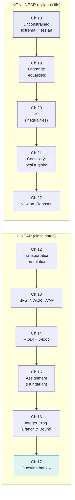

# Optimization — Mid-Term & End-Sem Notes

| Part | Chapters | Status |
|---|---|---|
| **Mid-term** (up to Duality) | [1–11](#mid-term-chapters) | ✅ Complete |
| **After-mid: Transportation, Assignment, IP** (class notes) | [12–17](#after-mid-chapters) | ✅ Complete, from the class notes |
| **After-mid: Nonlinear optimization** (syllabus file) | [18–22](#after-mid-chapters) | ✅ Complete, ⚠️ from standard theory (no class notes yet) |

---

## Mid-term

> **Syllabus (from teacher):** *"Mid term syllabus: from the beginning up to duality."*
> *"For the Simplex Method and Revised Simplex Method portion, study **only from the class notes**."*
> *"Study the question pattern given in this assignment."*

That last instruction matters — [Chapter 10](notes/10-assignment-question-bank.md) works through every question in the assignment.

> ⭐ **The teacher mainly sets exam questions from the class notes.** [Chapter 11](notes/11-class-notes-question-bank.md) solves **every example, question and practice problem in Class Notes 1–5**, with full simplex tables checked against the teacher's answers. It also solves the problems the notes state but never solve (🆕 Big-M Ex 2 and duality Practice Problems 1–4). **Make Ch. 11 your main revision source**, with Ch. 10 second.

### Mid-term chapters

| # | Chapter | Source |
|---|---|---|
| 1 | [Introduction to Optimization & LPP](notes/01-introduction-to-optimization-and-lpp.md) | Class Note 1 |
| 2 | [LPP Formulation](notes/02-lpp-formulation.md) | Class Note 1 |
| 3 | [Basic Solutions & BFS](notes/03-basic-solutions-and-bfs.md) | Class Note 1, 2 |
| 4 | [Graphical Method](notes/04-graphical-method.md) | Class Note 1 |
| 5 | [Standard Form, Slack & Surplus](notes/05-standard-form-slack-surplus.md) | Class Note 2 |
| 6 | [Simplex Method](notes/06-simplex-method.md) | Class Notes 2, 3 |
| 7 | [Artificial Variables, Big-M & Two-Phase](notes/07-big-m-and-two-phase.md) | Class Notes 3, 4 |
| 8 | [Revised Simplex Method](notes/08-revised-simplex-method.md) | Class Note 4 |
| 9 | [Duality](notes/09-duality.md) | Class Note 5 |
| 10 | [Assignment Question Bank (solved)](notes/10-assignment-question-bank.md) | `optimization__assignment_I.pdf` |
| 11 | [**Class Notes Question Bank (solved)**](notes/11-class-notes-question-bank.md) ⭐ | All five class notes |

---

## After-mid (end-semester)

> **Syllabus file:** [`source/aftermid-syllabus.txt`](source/aftermid-syllabus.txt) lists the **nonlinear** topics: optimization problems and NLP, unconstrained extrema, Lagrange multipliers, KKT, convex optimization and Newton–Raphson.
> **Class notes:** `Optimiztion Techniques_Transportation_Assignment_Integer Programming Problem_Classnotes.pdf` (23 pages) covers **Transportation, Assignment and Integer Programming**. This is not in the syllabus file, but it was taught, so it is covered too.

> ⭐ **Start with [Ch. 17](notes/17-transportation-assignment-ip-question-bank.md).** It re-solves **every** example and homework problem in the class notes, verified by computer, and answers all the theory homework questions. **Three corrections to the notes are flagged there:**
> 1. The cement example's final answer is **₹10,000** (₹10,100 is the intermediate BFS).
> 2. In the 3×5 problem, VAM gives 68 but **MODI improves it to 67**.
> 3. The least-cost table on p. 18 adds up to **78, not 83**.
>
> Homework Problem 2 (p. 19) has **two blank cost rows** in the notes; it is solved with the standard textbook data and flagged.

> ⚠️ **Chapters 18–22 (nonlinear)** are written from standard theory because no class notes for them have been supplied yet. They follow the syllabus file topic by topic. Every example was verified with a computer algebra system. When the class notes arrive, they can be checked against them.

### After-mid chapters

| # | Chapter | Source |
|---|---|---|
| 12 | [Transportation Problem: formulation, BFS, degeneracy](notes/12-transportation-problem.md) | Class notes pp. 1–5, 10 |
| 13 | [Initial BFS: NWCR, Row/Column minima, LCM, VAM](notes/13-initial-bfs-methods.md) | pp. 6, 8–9, 11, 13–14 |
| 14 | [MODI Method & the θ-loop](notes/14-modi-method.md) | pp. 7, 11–12, 14–17 |
| 15 | [Assignment Problem: Hungarian Method](notes/15-assignment-problem.md) | p. 20 |
| 16 | [Integer Programming: Branch & Bound](notes/16-integer-programming.md) | pp. 21–22 |
| 17 | [**Transportation, Assignment & IP Question Bank (solved)**](notes/17-transportation-assignment-ip-question-bank.md) ⭐ | pp. 13–23, all problems + theory homework |
| 18 | [NLP & Unconstrained Extrema (Hessian, D-test, triangle)](notes/18-nlp-and-unconstrained-extrema.md) ⚠️ | Syllabus §1–2 |
| 19 | [Lagrange Multipliers & the Bordered Hessian](notes/19-lagrange-multipliers.md) ⚠️ | Syllabus §3 |
| 20 | [KKT Conditions](notes/20-kkt-conditions.md) ⚠️ | Syllabus §4 |
| 21 | [Convex Sets, Convex Functions & Convex Optimization](notes/21-convex-optimization.md) ⚠️ | Syllabus §5 |
| 22 | [Newton–Raphson Methods (+ Python)](notes/22-newton-raphson-methods.md) ⚠️ | Syllabus §6 |

---

## Source files

| File | Content |
|---|---|
| `OPTIMIZATION_CLASS_NOTE-1.pdf` | Intro, classification, LPP, formulation, basic solutions, graphical method |
| `Optimization _Class Note_II.pdf` | Simplex: slack/surplus, standard matrix form, initial BFS |
| `OPtimization_class_notes_III.pdf` | Simplex table, computational steps, artificial variables |
| `optimization IV.pdf` | Revised simplex, artificial variable technique, Big-M |
| `class Note 5.pdf` | Duality |
| `optimization__assignment_I.pdf` | Assignment — **the stated question pattern** |
| `Optimiztion Techniques_Transportation_Assignment_Integer Programming Problem_Classnotes.pdf` | **After-mid:** transportation (NWCR, VAM, MODI), assignment (Hungarian), integer programming (B&B), homework |
| `midterm-syllabus.txt` / `aftermid-syllabus.txt` | The two syllabi |

---

## Revision checklist

### Mid-term

**Class-notes questions (highest priority — the teacher sets exams from these; see [Ch. 11](notes/11-class-notes-question-bank.md))**
- [ ] Formulate: shopkeeper, diet, lamps, tyres
- [ ] Basic solutions: Class Note 1 Ex 6–10 (including "show this is **not** a basic solution")
- [ ] Graphical: Ex 11 (min, $Z = 240$) and Ex 12 (max, $Z = 325500$)
- [ ] Reduce F.S. → B.F.S.: Class Note II Ex 2, 3, 5 (two answers) and 4/6 (tie → degenerate)
- [ ] Simplex: Class Notes III Ex 1–5 (1000 · 765/41 · −11 · 6 · 3600)
- [ ] Big-M: Ex 1 (52, alternative optima) · 🆕 Ex 2 (**infeasible**)
- [ ] Revised simplex: Ex 1 (5) · Ex 2 (13/7)
- [ ] Duality: Ex 1–4 · 🆕 Practice Problems 1–4

**General**
- [ ] Can classify an optimization problem (linear / nonlinear / integer / convex …)
- [ ] Can formulate a word problem into an LPP
- [ ] Know: solution vs feasible solution vs basic solution vs BFS vs optimal BFS
- [ ] Can find **all** basic solutions of a system and label degenerate / non-degenerate
- [ ] Can solve a 2-variable LPP graphically (corner point **and** iso-profit)
- [ ] Know when to add slack / surplus / artificial variables
- [ ] Can run a full simplex table to optimality
- [ ] Know the Big-M and Two-Phase procedures, and the infeasibility test
- [ ] Can compute a revised simplex iteration using $B^{-1}$
- [ ] Can write the dual of any primal (≤, ≥, =, unrestricted)
- [ ] Know the duality theorems and what $Z_P = Z_D$ means

### After-mid

**Class-notes problems (see [Ch. 17](notes/17-transportation-assignment-ip-question-bank.md))**
- [ ] Class Problem p. 13: NWCR 1095 · LCM 922 · **VAM 796** → MODI says optimal
- [ ] Cement p. 15: VAM ₹10,200 → ₹10,100 → **₹10,000** (tie rule in Δ)
- [ ] 3×5 p. 18: NWCR 153 · LCM 78 · VAM 68 → **67**
- [ ] Homework 1–4: degenerate (ε), textbook data, unique optimum, **unbalanced + alternative optima**
- [ ] Hungarian: $[9\,2\,7;\,6\,4\,3;\,5\,8\,1]$ → **9**
- [ ] Branch & Bound: $\max 5x_1 + 4x_2$ → LP 21 → **(4, 0), Z = 20**
- [ ] All theory homework questions (p. 18 + p. 23; 12 distinct questions, answered in Ch. 17 §J)

**General**
- [ ] Formulate a TP; balanced vs unbalanced; FS / BFS / degenerate; why $m+n-1$
- [ ] IBFS by NWCR, row-minima, column-minima, LCM, **VAM** (penalties, tie rule)
- [ ] MODI: $u_i + v_j = c_{ij}$, $\Delta_{ij} = u_i + v_j - c_{ij}$, closed loop, θ
- [ ] Degeneracy (ε) and alternative optima ($\Delta = 0$)
- [ ] Hungarian with line covering; unbalanced, maximisation and forbidden assignments
- [ ] Branch & Bound tree; fathoming rules; why rounding fails; $Z_{IP} \le Z_{LP}$
- [ ] Classify critical points by $D = f_{xx}f_{yy} - f_{xy}^2$; absolute extrema on a triangle
- [ ] Lagrange multipliers + bordered Hessian (2 and 3 variables)
- [ ] KKT: four conditions, active-set case analysis
- [ ] Convex sets/functions, Hessian test (PD/PSD/ND/NSD/indefinite), local = global proof
- [ ] Newton–Raphson (root, stationary point, 2-variable, damped) + Python

---

## Formula sheet

### Mid-term

$$x_B = B^{-1}b \qquad Y_j = B^{-1}\alpha_j \qquad Z = c_B^T x_B \qquad \Delta_j = c_j - c_B^T Y_j$$

| Rule | Statement |
|---|---|
| **Optimality** (max) | Optimal when $\Delta_j \le 0$ for all $j$ |
| **Entering variable** | Largest positive $\Delta_k = \max\{\Delta_j : \Delta_j > 0\}$ |
| **Leaving variable** | $\dfrac{x_{Br}}{y_{rk}} = \min_i \left\{ \dfrac{x_{Bi}}{y_{ik}} : y_{ik} > 0 \right\}$ |
| **Unbounded** | Entering column has $\Delta_k > 0$ but every $y_{ik} \le 0$ |
| **Infeasible** | Phase I ends with $W^* > 0$, or an artificial variable is positive at the Big-M optimum |
| **Min → Max** | $\min Z = -\max(-Z)$; if $\max(-Z) = v$ then $\min Z = -v$ |

### After-mid

| Topic | Formula / rule |
|---|---|
| **Feasibility of a TP** | $\sum a_i = \sum b_j$ (otherwise add a dummy with cost 0) |
| **Basic cells** | $m + n - 1$ (fewer ⇒ degenerate ⇒ add ε) |
| **VAM penalty** | second-smallest cost − smallest cost |
| **MODI** | $u_i + v_j = c_{ij}$ (occupied) · $\Delta_{ij} = u_i + v_j - c_{ij}$ (empty) · optimal iff all $\Delta_{ij} \le 0$ |
| **θ-loop** | $\theta = \min$ of the $(-)$ corners; the cost falls by $\theta \cdot \Delta$ |
| **Hungarian** | row-reduce → column-reduce → min lines; if $< n$, subtract the min uncovered and add it at intersections |
| **B&B** | branch $x_k \le \lfloor v \rfloor$ / $x_k \ge \lceil v \rceil$; fathom if infeasible / integer / bound ≤ incumbent |
| **2-variable test** | $D = f_{xx}f_{yy} - f_{xy}^2$: $D > 0$ & $f_{xx} > 0$ min · $D > 0$ & $f_{xx} < 0$ max · $D < 0$ saddle · $D = 0$ ? |
| **Lagrange** | $\nabla f = \lambda\nabla g$; bordered $\det H_B > 0$ max, $< 0$ min (2 variables, 1 constraint) |
| **KKT** | $\nabla f + \sum\mu_i\nabla g_i + \sum\lambda_j\nabla h_j = 0$, $g \le 0$, $\mu \ge 0$, $\mu_i g_i = 0$ |
| **Convex** | Hessian PSD ⇔ convex; PD ⇒ strictly convex; local min = global min |
| **Newton** | $x_{k+1} = x_k - f/f'$ (root) · $x_k - f'/f''$ (opt.) · $\mathbf x_k - \alpha H^{-1}\nabla f$ (damped, n-D) |

---

**Back to:** [5th Semester index](../README.md)
