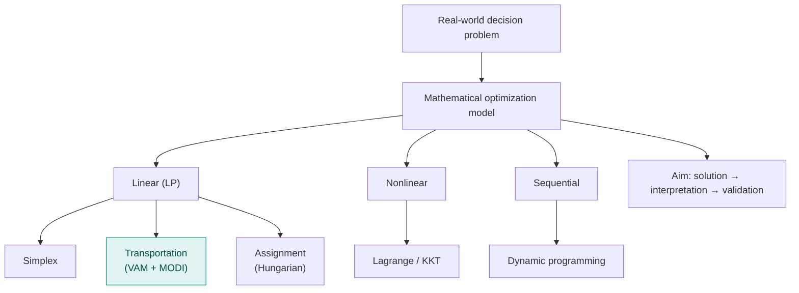
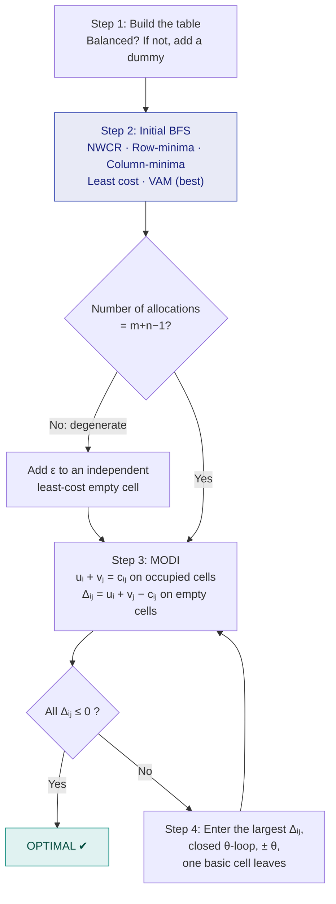

# 12. The Transportation Problem

> **Syllabus:** After-mid. *Transportation problem* (from the class notes)
> **Source:** `Optimiztion Techniques_Transportation_Assignment_Integer Programming Problem_Classnotes.pdf`, pp. 1–5 and the summary page p. 10

---

## 🎯 In one line

A transportation problem is a **special LPP**. You ship one commodity from $m$ sources to $n$ destinations at **minimum total cost**. Its constraints all have **coefficient 1**, so a table method (IBFS → MODI) replaces the simplex method.

---

## 1. Where it sits in optimization (class-notes overview, p. 1, p. 10)



**Optimization** is *the mathematical process of finding the best possible solution to a problem by maximizing or minimizing an objective function subject to given constraints.*

**Uses (from the notes):**
1. **ML and AI**: training a model means finding parameters that minimise the loss: $\min_\theta \; L(y_i, f_\theta(x_i))$. The pipeline is *data → model → loss function → optimization → learned parameters → prediction*.
2. **Computer networks and routing**: find the shortest, fastest or least expensive route between network nodes: $\min_P \sum_{e \in P} c_e$.

---

## 2. Motivation: the bottled-water example (p. 2) ⭐

A company produces bottled drinking water at **two factories** and supplies **three shops**. Each factory can produce only a certain amount and each shop needs a certain amount. Shipping costs differ because distances differ. The company must ship so that:

1. every shop receives the quantity it needs,
2. no factory supplies more than it has, and
3. the total transportation cost is as low as possible.

| | $S_1$ | $S_2$ | $S_3$ | Supply |
|---|---|---|---|---|
| $F_1$ | $c_{11}=4$ | $c_{12}=6$ | $c_{13}=9$ | $a_1 = 100$ |
| $F_2$ | $c_{21}=5$ | $c_{22}$ | $c_{23}$ | $a_2 = 80$ |
| **Demand** | $b_1 = 60$ | $b_2 = 70$ | $b_3 = 50$ | |

*(The handwriting gives $c_{11}=4$, $c_{12}=6$, $c_{13}=9$ and $c_{21}=5$. The remaining costs are not legible; only the formulation is asked.)*

$x_{ij}$ = quantity transported from factory $i$ to shop $j$, and $c_{ij}$ = cost per unit from factory $i$ to shop $j$.

$$\text{Minimize } Z = c_{11}x_{11} + c_{12}x_{12} + \dots + c_{23}x_{23}$$

$$\underbrace{\begin{aligned} x_{11}+x_{12}+x_{13} &= 100 \\ x_{21}+x_{22}+x_{23} &= 80 \end{aligned}}_{\text{supply constraints}} \qquad \underbrace{\begin{aligned} x_{11}+x_{21} &= 60 \\ x_{12}+x_{22} &= 70 \\ x_{13}+x_{23} &= 50 \end{aligned}}_{\text{demand constraints}} \qquad x_{ij} \ge 0$$

Total supply $= 180 =$ total demand, so this problem is **balanced**.

---

## 3. General formulation (p. 4) ⭐⭐

There are $m$ plants (**origins**) and $n$ distribution centres (**destinations**). Plant $i$ has capacity $a_i$, destination $j$ requires $b_j$, and shipping one unit from $i$ to $j$ costs $c_{ij}$.

**Objective:** determine the number of units to ship from each plant to each destination so that total transportation cost is minimum.

$$\boxed{\text{Minimize } Z = \sum_{i=1}^{m}\sum_{j=1}^{n} c_{ij}\,x_{ij}}$$

$$\text{subject to}\quad \sum_{j=1}^{n} x_{ij} = a_i \;\; (i=1,\dots,m), \qquad \sum_{i=1}^{m} x_{ij} = b_j \;\; (j=1,\dots,n), \qquad x_{ij} \ge 0$$

| Count | Value |
|---|---|
| Sources | $m$ |
| Destinations | $n$ |
| Shipment variables $x_{ij}$ | $mn$ |
| Equations | $m$ supply + $n$ demand $= m+n$ |
| **Linearly independent equations** | $m+n-1$ *(one is redundant, because the sum of the supply equations = the sum of the demand equations)* |
| **Basic variables in a BFS** | $\mathbf{m+n-1}$ |

> **Why $m+n-1$?** Adding all $m$ supply equations gives $\sum\sum x_{ij} = \sum a_i$. Adding all $n$ demand equations gives $\sum\sum x_{ij} = \sum b_j$. These are the same equation when the problem is balanced, so one constraint is dependent. The rank of the constraint matrix is $m+n-1$, and a basis therefore contains $m+n-1$ basic variables.

---

## 4. The transportation table (p. 5)

```
                     Destinations (distribution centres)
                 1        2      ...      j      ...      n       Supply
            ┌────────┬────────┬───────┬────────┬───────┬────────┐
         1  │    c11 │    c12 │       │    c1j │       │    c1n │   a1
            ├────────┼────────┼───────┼────────┼───────┼────────┤
Origins  2  │    c21 │    c22 │       │    c2j │       │    c2n │   a2
 (plants)   ├────────┼────────┼───────┼────────┼───────┼────────┤
         i  │    ci1 │    ci2 │       │[xij]cij│       │    cin │   ai
            ├────────┼────────┼───────┼────────┼───────┼────────┤
         m  │    cm1 │    cm2 │       │    cmj │       │    cmn │   am
            └────────┴────────┴───────┴────────┴───────┴────────┘
  Demand        b1       b2             bj               bn      Σai = Σbj
```

- The $mn$ squares are called **cells**.
- $c_{ij}$ is written in the **lower-right** of cell $(i,j)$. An allocation $x_{ij}$ goes in a **small square at the upper-left** of the cell.
- The $a_i$ and $b_j$ are called **rim requirements**. Feasibility is checked by summing $x_{ij}$ along each row and down each column.

---

## 5. Definitions (p. 3–4, p. 10) ⭐⭐⭐

| Term | Definition |
|---|---|
| **Balanced TP** | $\displaystyle\sum_{i=1}^m a_i = \sum_{j=1}^n b_j$ (total supply = total demand) |
| **Unbalanced TP** | $\sum a_i \ne \sum b_j$. Add a **dummy** source or destination with **zero** costs to absorb the difference |
| **Feasible solution (FS)** | Any allocation that satisfies all supply constraints, demand constraints and $x_{ij} \ge 0$ |
| **Basic feasible solution (BFS)** | A feasible solution with **at most $m+n-1$ strictly positive** allocations. It is obtained by choosing $m+n-1$ linearly independent basic variables and setting the non-basic ones to zero |
| **Non-degenerate BFS** | All $m+n-1$ basic variables are **strictly positive** (exactly $m+n-1$ positive allocations) |
| **Degenerate BFS** | At least one basic variable is **zero**, i.e. **fewer than $m+n-1$** positive allocations |
| **Optimal solution** | A feasible solution that gives the **minimum** possible total transportation cost |

**Theorem (existence).** A transportation problem has a feasible solution **if and only if** $\displaystyle\sum_{i=1}^m a_i = \sum_{j=1}^n b_j$.

**Result.** If a classical balanced TP has an optimal solution, then **at least one optimal solution is a BFS**.

> **Proof idea of the theorem.** If $\sum a_i = \sum b_j = T$, the allocation $x_{ij} = a_i b_j / T$ is feasible: row sums are $a_i \sum_j b_j / T = a_i$ and column sums are $b_j$. Conversely, a feasible $x$ gives $\sum a_i = \sum\sum x_{ij} = \sum b_j$.

---

## 6. Why not just use simplex? (p. 5, observations)

1. Every $x_{ij}$ has **coefficient 1** in the constraints, and total supply equals total demand.
2. The objective and constraints are linear, so simplex *can* solve it. But with $mn$ variables and $m+n$ equality constraints (each needing an artificial variable) the tableau gets **too large**. Because all the coefficients are 1, a much simpler table technique exists.

---

## 7. Unbalanced problems (p. 6, p. 9 step 1)

| Case | Fix |
|---|---|
| $\sum a_i > \sum b_j$ (excess supply) | Add a **dummy destination** with demand $\sum a_i - \sum b_j$ and cost **0** in every cell |
| $\sum a_i < \sum b_j$ (excess demand) | Add a **dummy source** with supply $\sum b_j - \sum a_i$ and cost **0** in every cell |

Allocations to a dummy are **not real shipments**. A dummy destination is stock left at the source, and a dummy source is demand left unmet. *(Homework Problem 4 in [Ch. 17](17-transportation-assignment-ip-question-bank.md) needs a dummy source.)*

---

## 8. The working procedure: a map of the next two chapters (p. 6–7, p. 11–12)



- Step 2 (initial BFS) is in [Ch. 13](13-initial-bfs-methods.md).
- Steps 3–5 (MODI and the θ-loop) are in [Ch. 14](14-modi-method.md).

---

## 9. Common exam questions

1. **Define a transportation problem and give its mathematical formulation.** Use §3 with the boxed objective.
2. **Define balanced TP / FS / BFS / degenerate BFS / optimal solution.** Use the table in §5.
3. **State and prove the necessary and sufficient condition for a TP to have a feasible solution.** It is $\sum a_i = \sum b_j$ (§5).
4. **Why does a BFS of an $m\times n$ TP have $m+n-1$ basic variables?** One of the $m+n$ equations is redundant (§3).
5. **How is an unbalanced TP solved?** Add a dummy row or column with zero costs (§7).
6. **Formulate:** the bottled-water problem (§2).
7. **Can a TP be solved by simplex? Why use a special method?** See §6.

---

## ⚡ Quick revision

- TP = **special LPP**: $\min \sum\sum c_{ij}x_{ij}$, row sums $= a_i$, column sums $= b_j$, $x_{ij} \ge 0$.
- **Balanced** ⇔ $\sum a_i = \sum b_j$ ⇔ **a feasible solution exists**.
- $mn$ variables, $m+n$ equations, **rank $m+n-1$**, so a BFS has **$m+n-1$ basic cells**.
- Fewer than $m+n-1$ positive allocations means **degenerate**.
- Unbalanced: add a **dummy** row or column with **cost 0**.
- Pipeline: **table → IBFS (VAM best) → check $m+n-1$ → MODI → θ-loop → repeat until all $\Delta_{ij} \le 0$**.

---

**Previous:** [← 11. Class Notes Question Bank](11-class-notes-question-bank.md) · **Next:** [13. Initial BFS Methods →](13-initial-bfs-methods.md)
