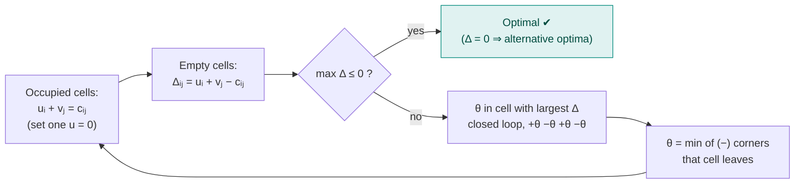

# 14. Optimality Test: the MODI Method and the θ-Loop

> **Syllabus:** After-mid. *Transportation problem: optimality check (MODI) and iteration towards the optimal solution*
> **Source:** Transportation class notes pp. 7, 11–12, 14–17

---

## 🎯 In one line

Give every row a potential $u_i$ and every column a potential $v_j$ so that $u_i + v_j = c_{ij}$ on **occupied** cells. Then $\Delta_{ij} = u_i + v_j - c_{ij}$ on each **empty** cell tells you how much the cost would fall per unit shipped there. If every $\Delta_{ij} \le 0$ you are optimal. Otherwise push units round a **closed loop** into the cell with the largest $\Delta_{ij}$.

---

## 1. Before you start: the $m+n-1$ check (p. 7, p. 11)

> *"In the above solution, the number of allocations must be $m+n-1$, otherwise the basic solution degenerates."*

| Allocations | Action |
|---|---|
| $= m+n-1$ | Non-degenerate. Apply ordinary MODI |
| $< m+n-1$ | **Degenerate.** Put a tiny $\varepsilon$ (treated as 0) in an empty **independent** cell, i.e. one that does **not** form a closed loop with the occupied cells. Prefer the least-cost such cell. Then apply MODI |

> **Why it matters:** MODI needs $m+n-1$ equations $u_i + v_j = c_{ij}$ to find the $m+n$ unknowns (after fixing one at 0). Too few occupied cells leaves some $u_i$ or $v_j$ undetermined.

---

## 2. MODI (Modified Distribution) method: steps (p. 7, p. 11)

**Step 3: optimality check**

1. **Row and column potentials.** For every **occupied** cell solve
   $$\boxed{u_i + v_j = c_{ij}}$$
   starting with some $u_i = 0$ (usually the row with the most allocations). Here $u_i$ is the **row potential**, $v_j$ the **column potential** and $c_{ij}$ the unit transportation cost.
2. **Net evaluations (opportunity costs).** For every **unoccupied** cell compute
   $$\boxed{\Delta_{ij} = u_i + v_j - c_{ij}}$$
   *(the notes also write this as $w_{ij}$)* and write it in the upper-right corner of the cell.
3. **Optimality condition.**
   - If **all $\Delta_{ij} \le 0$**, the current BFS is **optimal**.
   - If **even one $\Delta_{ij} > 0$**, the solution is **not optimal**, because shipping into that cell lowers the cost by $\Delta_{ij}$ per unit.
   - If the solution is optimal but some $\Delta_{ij} = 0$, there are **alternative optimal solutions**.

**Step 4: iterate towards the optimal solution**

1. Choose the unoccupied cell with the **largest positive $\Delta_{ij}$** and mark **$\theta$** in it. *Tie: pick the cell with the lower original cost.*
2. Draw a **closed path (loop)** of horizontal and vertical lines that begins and ends at the θ-cell and has **all its other corners at allocated cells**.
3. **Add and subtract θ alternately** at the corners: $+\theta$ at the entering cell, $-\theta$ at the next corner, $+\theta$, and so on. This keeps every rim requirement satisfied.
4. Assign the **maximum** θ such that one basic variable becomes **zero** and the others stay **non-negative**:
   $$\theta = \min\{x_{ij} \text{ at the } (-\theta) \text{ corners}\}$$
   The basic cell whose allocation drops to zero **leaves the basis**.

**Step 5.** Return to Step 3 and repeat until an optimal BFS is obtained.



### Rules for the closed loop

- It starts and ends at the entering (empty) cell.
- It moves **only horizontally and vertically**, turning **only at occupied cells** (it may pass through other cells without turning).
- It has an **even number of corners** (at least 4), so the $+$ and $-$ signs balance in every row and column.
- For a non-degenerate BFS **exactly one** such loop exists for each empty cell.

---

## 3. Worked example 1: the class Problem (p. 14) is already optimal ⭐

The VAM IBFS from [Ch. 13](13-initial-bfs-methods.md) has $Z = 796$ with $x_{14}=11$, $x_{21}=6$, $x_{22}=3$, $x_{24}=4$, $x_{32}=7$, $x_{33}=12$ (6 cells $= m+n-1$, so ordinary MODI applies).

**Potentials.** The notes set $u_2 = 0$ because row II has the most allocations.

| Occupied cell | Equation | Result |
|---|---|---|
| (2,1) | $u_2 + v_1 = 17$ | $v_1 = 17$ |
| (2,2) | $u_2 + v_2 = 18$ | $v_2 = 18$ |
| (2,4) | $u_2 + v_4 = 23$ | $v_4 = 23$ |
| (3,2) | $u_3 + v_2 = 27$ | $u_3 = 9$ |
| (3,3) | $u_3 + v_3 = 18$ | $v_3 = 9$ |
| (1,4) | $u_1 + v_4 = 13$ | $u_1 = -10$ |

**Net evaluations** on the six empty cells:

| Cell | $u_i + v_j - c_{ij}$ | $\Delta_{ij}$ |
|---|---|---|
| (1,1) | $-10 + 17 - 21$ | $-14$ |
| (1,2) | $-10 + 18 - 16$ | $-8$ |
| (1,3) | $-10 + 9 - 25$ | $-26$ |
| (2,3) | $0 + 9 - 14$ | $-5$ |
| (3,1) | $9 + 17 - 32$ | $-6$ |
| (3,4) | $9 + 23 - 41$ | $-9$ |

All $\Delta_{ij} < 0$, so **the current allocation is optimal**, with $Z_{\min} = \mathbf{796}$. No $\Delta_{ij} = 0$, so the optimum is **unique**.

---

## 4. Worked example 2: cement factories (pp. 15–17) ⭐⭐⭐

> Three cement factories (cities 1, 2, 3) supply four projects (towns 1–4). Daily supply is **6, 1, 10** truckloads and requirements are **7, 5, 3, 2**. Costs are in **hundreds of rupees** per truckload:

| | P1 | P2 | P3 | P4 | Supply |
|---|---|---|---|---|---|
| **F1** | 2 | 3 | 11 | 7 | 6 |
| **F2** | 1 | 0 | 6 | 1 | 1 |
| **F3** | 5 | 8 | 15 | 9 | 10 |
| **Demand** | 7 | 5 | 3 | 2 | **17** |

The problem is balanced (17 = 17) and $m+n-1 = 6$.

### Step 2: VAM IBFS (pp. 15–16)

| Round | Penalties (rows; columns) | Largest | Allocation |
|---|---|---|---|
| 1 | rows 1, 1, 3; columns 1, 3, 5, **6** | 6 (P4) | $x_{24} = \min\{1, 2\} = 1$ (cost 1). Row F2 done |
| 2 | rows 1, 3; columns 3, **5**, 4, 2 | 5 (P2) | $x_{12} = \min\{6, 5\} = 5$ (cost 3). Column P2 done |
| 3 | rows **5**, 4; columns 3, 4, 2 | 5 (row F1) | $x_{11} = \min\{1, 7\} = 1$ (cost 2). Row F1 done |
| 4 | only F3 is left | – | $x_{31} = 6$, $x_{33} = 3$, $x_{34} = 1$ |

$$Z_0 = (1\times2 + 5\times3 + 1\times1 + 6\times5 + 3\times15 + 1\times9)\times 100 = 102 \times 100 = \mathbf{₹10{,}200}$$

### Step 3: optimality check, iteration 1 (p. 16)

6 allocations $= m+n-1$. Set $u_1 = 0$:

$u_1+v_1 = 2 \Rightarrow v_1 = 2$ · $u_1+v_2 = 3 \Rightarrow v_2 = 3$ · $u_3+v_1 = 5 \Rightarrow u_3 = 3$ · $u_3+v_3 = 15 \Rightarrow v_3 = 12$ · $u_3+v_4 = 9 \Rightarrow v_4 = 6$ · $u_2+v_4 = 1 \Rightarrow u_2 = -5$

| Empty cell | $\Delta_{ij}$ |
|---|---|
| (1,3) | $0 + 12 - 11 = \mathbf{+1}$ |
| (1,4) | $0 + 6 - 7 = -1$ |
| (2,1) | $-5 + 2 - 1 = -4$ |
| (2,2) | $-5 + 3 - 0 = -2$ |
| (2,3) | $-5 + 12 - 6 = \mathbf{+1}$ |
| (3,2) | $3 + 3 - 8 = -2$ |

Two cells are positive, so the solution is **not optimal**.

**Choose the entering cell.** It is a tie at $\Delta = 1$ between (1,3) and (2,3). Take the one with the **lower original cost**: $c_{23} = 6 < 11$, so **(2,3)** enters.

**Loop:** $(2,3)^{+} \to (2,4)^{-} \to (3,4)^{+} \to (3,3)^{-} \to$ back to $(2,3)$

$$\theta = \min\{x_{24}, x_{33}\} = \min\{1, 3\} = 1$$

The new allocations are $x_{23} = 1$, $x_{24} = 0$ (**leaves**), $x_{34} = 2$ and $x_{33} = 2$.

$$Z_1 = (1\times2 + 5\times3 + 1\times6 + 6\times5 + 2\times15 + 2\times9)\times100 = 101\times100 = \mathbf{₹10{,}100}$$

### Iteration 2 (p. 17)

Set $u_1 = 0$: $v_1 = 2$, $v_2 = 3$, $u_3 = 3$, $v_3 = 12$, $v_4 = 6$, $u_2 = 6 - 12 = -6$.

| Empty cell | $\Delta_{ij}$ |
|---|---|
| (1,3) | $0 + 12 - 11 = \mathbf{+1}$ |
| (1,4) | $0 + 6 - 7 = -1$ |
| (2,1) | $-6 + 2 - 1 = -5$ |
| (2,2) | $-6 + 3 - 0 = -3$ |
| (2,4) | $-6 + 6 - 1 = -1$ |
| (3,2) | $3 + 3 - 8 = -2$ |

(1,3) is still positive, so the solution is **not optimal**. The loop is $(1,3)^{+} \to (1,1)^{-} \to (3,1)^{+} \to (3,3)^{-}$ and $\theta = \min\{x_{11}, x_{33}\} = \min\{1, 2\} = 1$.

The new allocations are $x_{13} = 1$, $x_{11} = 0$ (**leaves**), $x_{31} = 7$ and $x_{33} = 1$.

### Iteration 3: optimal (p. 17)

```
           P1      P2      P3      P4     supply   uᵢ
  F1        2    [5] 3  [1] 11      7       6       0
  F2        1       0   [1] 6       1       1      −5
  F3    [7] 5       8   [1] 15  [2] 9      10       4
  demand    7       5       3       2
  vⱼ        1       3      11       5
```

Potentials: $v_2 = 3$, $v_3 = 11$, $u_2 = -5$, $u_3 = 4$, $v_1 = 1$, $v_4 = 5$.

$\Delta_{11} = -1$ · $\Delta_{14} = -2$ · $\Delta_{21} = -5$ · $\Delta_{22} = -2$ · $\Delta_{24} = -1$ · $\Delta_{32} = -1$

**All $\Delta_{ij} \le 0$, so the solution is optimal.**

$$Z_{\min} = (5\times3 + 1\times11 + 1\times6 + 7\times5 + 1\times15 + 2\times9)\times 100 = 100\times100 = \boxed{₹10{,}000}$$

**Optimal policy:** F1 → P2: 5, F1 → P3: 1 · F2 → P3: 1 · F3 → P1: 7, F3 → P3: 1, F3 → P4: 2.

> ✅ Verified with an LP solver: the optimum is 100 (₹10,000). Each iteration lowered the cost by exactly $\theta \times \Delta = 1 \times 1 = 1$ hundred rupees.

---

## 5. Degeneracy in MODI: worked illustration

Homework Problem 1 (p. 19; full solution in [Ch. 17](17-transportation-assignment-ip-question-bank.md)): VAM's first allocation $x_{23} = 30$ exhausts row 2 **and** column 3 at the same time, leaving only **4** positive allocations when $m+n-1 = 5$.

**Fix:** put $\varepsilon$ in an empty cell that does not form a loop with the occupied cells. The cheapest is (3,3), with $c = 2$. Treat it as a basic cell with value 0, compute $u_i, v_j$ as usual, and let $\varepsilon \to 0$ at the end.

---

## 6. Common exam questions

1. **State the MODI optimality condition** for a minimisation TP. All $\Delta_{ij} = u_i + v_j - c_{ij} \le 0$ (p. 23 Q3).
2. **Why is a closed loop necessary for improving a solution?** Moving θ round a loop with alternating $\pm$ keeps every row and column sum unchanged, so the solution stays feasible, and exactly one basic cell becomes 0 so it stays basic (p. 23 Q4).
3. **Test the given IBFS for optimality and find the optimal solution.** Use the §3–§4 template.
4. **What does $\Delta_{ij} = 0$ at the optimum mean?** There is an alternative optimal solution.
5. **Can MODI be applied directly to an unbalanced TP?** No. First balance it with a dummy, which is also what makes $m+n-1$ equations consistent (p. 18 Q4).
6. **How do you handle degeneracy?** Use the ε-cell rule (§1, §5).

---

## ⚡ Quick revision

- Check **allocations = $m+n-1$**. If fewer, add **ε** at an independent least-cost cell.
- **Occupied:** $u_i + v_j = c_{ij}$ (set one $u = 0$). **Empty:** $\Delta_{ij} = u_i + v_j - c_{ij}$.
- **All $\Delta \le 0$ ⇒ optimal.** Any $\Delta > 0$ ⇒ improve. $\Delta = 0$ at the optimum ⇒ **alternative optima**.
- Enter the **largest Δ** (tie ⇒ lower $c_{ij}$). Build a loop with **+θ −θ +θ −θ**. θ = **min of the − corners**. That cell leaves.
- Each iteration lowers the cost by $\theta \times \Delta$.
- Class answers: Problem **796** (optimal at once) · Cement **₹10,200 → ₹10,100 → ₹10,000**.

---

**Previous:** [← 13. Initial BFS Methods](13-initial-bfs-methods.md) · **Next:** [15. Assignment Problem →](15-assignment-problem.md)
