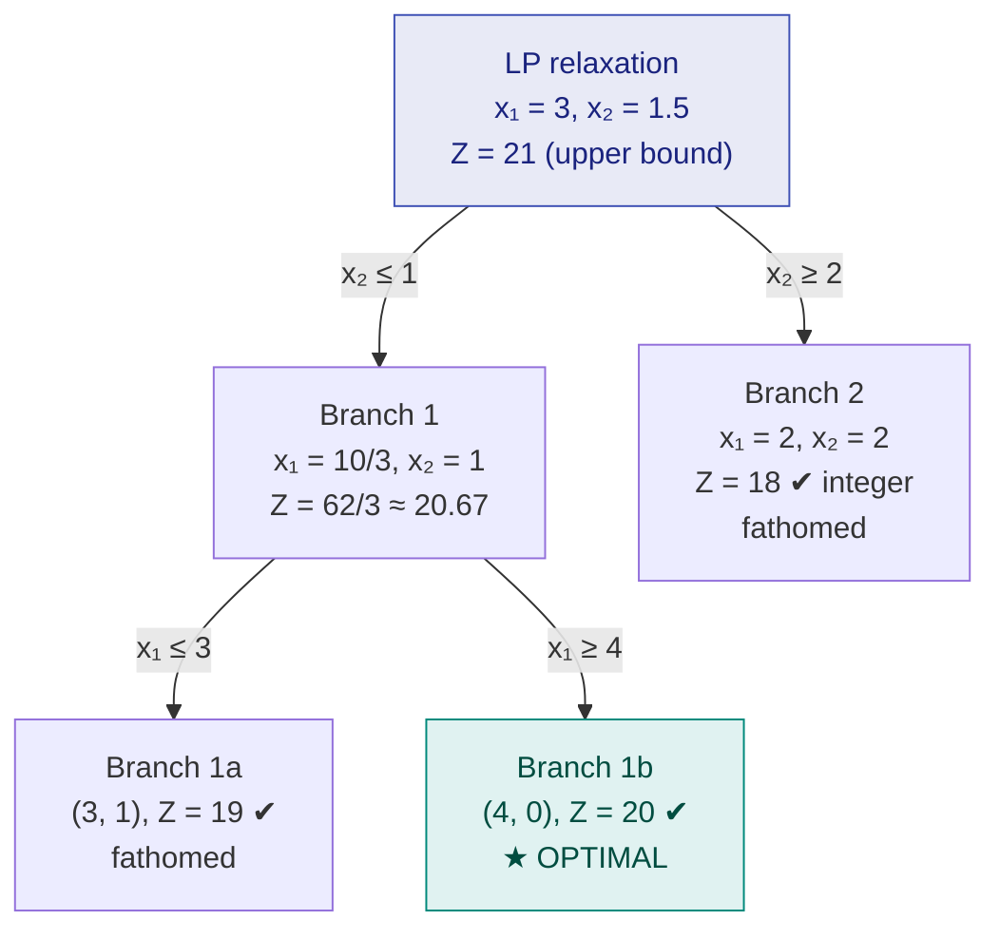

# 16. Integer Programming: Branch and Bound

> **Syllabus:** After-mid. *Integer programming problem*
> **Source:** Transportation/Assignment/IP class notes pp. 21–23. The enumeration check and the cutting-plane illustration (§6) are 🆕 additions, verified by computer.

---

## 🎯 In one line

An **integer programming problem** is an LPP whose variables must be integers. Solve the **LP relaxation**, and if a variable comes out fractional, **branch** into $x \le \lfloor v \rfloor$ and $x \ge \lceil v \rceil$. Use the best integer value found so far as a **bound** to prune (fathom) branches.

---

## 1. Definitions (p. 21)

An **integer programming problem (IPP)** is an optimization problem in which **all decision variables are required to take integer values**.

When the objective function and constraints are **linear**, it is called an **integer linear programming problem (ILP)**:

$$\text{Optimize } Z = c_1x_1 + c_2x_2 + \dots + c_nx_n \quad \text{subject to } Ax \le b, \quad x_i \in \mathbb{Z}$$

| Type | Which variables are integer? |
|---|---|
| **Pure (all-) integer** | All of them |
| **Mixed integer (MILP)** | Only some |
| **0–1 (binary)** | $x_i \in \{0, 1\}$, e.g. the assignment problem ([Ch. 15](15-assignment-problem.md)) |

**LP relaxation:** the same problem with the integer restriction **dropped**, so the $x_i$ may be any non-negative real numbers.

---

## 2. Methods for integer programming (p. 21)

| # | Method | Idea |
|---|---|---|
| 1 | **Enumeration** | List every feasible integer point and pick the best. Only for tiny problems |
| 2 | **Branch and Bound** ⭐ | Split the feasible region on a fractional variable and prune branches using bounds |
| 3 | **Cutting Plane** (Gomory) | Add new constraints (*cuts*) that remove the fractional LP optimum but no integer point |
| 4 | **Branch and Cut** | Branch and bound with cutting planes added at the nodes. This is what modern solvers do |

---

## 3. Branch and Bound: the procedure ⭐⭐⭐

1. **Solve the LP relaxation.** If the solution is all-integer, stop: it is optimal. For a max problem its value is an **upper bound** on the integer optimum.
2. **Branch.** Pick a variable with a fractional value $x_k = v$. Create two sub-problems:
   $$\text{Branch A: } x_k \le \lfloor v \rfloor \qquad \text{Branch B: } x_k \ge \lceil v \rceil$$
   This removes the strip $\lfloor v \rfloor < x_k < \lceil v \rceil$, which contains **no integer points**.
3. **Bound.** Solve the LP relaxation of each sub-problem. Keep the best integer solution found so far, the **incumbent**.
4. **Fathom (prune)** a node when:
   - its LP is **infeasible**, or
   - its LP solution is **already integer** (record it as the incumbent if better), or
   - its LP value is **no better than the incumbent** ($\le$ the incumbent for max), since nothing below it can win.
5. Repeat until every node is fathomed. The incumbent is the optimal integer solution.

---

## 4. Worked example: class Problem 1 (pp. 21–22) ⭐⭐⭐

$$\text{Maximize } Z = 5x_1 + 4x_2 \quad \text{s.t.} \quad 6x_1 + 4x_2 \le 24, \quad x_1 + 2x_2 \le 6, \quad x_1, x_2 \ge 0, \quad x_1, x_2 \in \mathbb{Z}$$

### Step 1: solve the LP relaxation

Ignore the integer restrictions and allow $x_1, x_2$ to be non-negative reals. The optimum is at the intersection of the two constraint boundaries:

$$6x_1 + 4x_2 = 24, \quad x_1 + 2x_2 = 6 \;\Rightarrow\; x_1 = 3, \; x_2 = 1.5$$
$$Z_{LP} = 5(3) + 4(1.5) = \mathbf{21}$$

*(Checking the other vertices confirms it: $(4, 0)$ gives 20 and $(0, 3)$ gives 12.)* However, $x_2 = 1.5$ is **not an integer**.

### Step 2: apply Branch and Bound

$x_2 = 1.5$, so create the branches **$x_2 \le 1$** and **$x_2 \ge 2$**.

**Branch 1: $x_2 \le 1$.** The LP relaxation gives $x_2 = 1$ and $6x_1 = 20$, so $x_1 = \frac{10}{3}$ and $Z = \frac{50}{3} + 4 = \frac{62}{3} \approx 20.667$.

$x_1$ is fractional, so branch again on $x_1$:
- **Branch 1a: $x_1 \le 3$**. The optimum is $(3, 1)$ with $Z = 19$. It is integer, so it becomes the incumbent and the node is fathomed.
- **Branch 1b: $x_1 \ge 4$**. The feasible solution is $(4, 0)$ with $Z = 20$. It is integer and better than 19, so it becomes the **new incumbent** and the node is fathomed.

**Branch 2: $x_2 \ge 2$.** The LP relaxation gives $x_1 = 2$, $x_2 = 2$, $Z = 18$. This is already integer, so the branch is **fathomed** (and $18 < 20$ anyway).

### Step 3: compare the integer solutions

| Solution | $x_1$ | $x_2$ | Objective value |
|---|---|---|---|
| Branch 1a | 3 | 1 | 19 |
| Branch 1b | 4 | 0 | **20** |
| Branch 2 | 2 | 2 | 18 |

$$\boxed{x_1^* = 4, \; x_2^* = 0, \; Z_{\max} = 20}$$

> The LP relaxation gave an **upper bound of 21**, while Branch and Bound established the **optimal integer objective value of 20**.

### 🆕 Check by enumeration (method 1)

| $x_2$ | Feasible integer $x_1$ | $Z = 5x_1 + 4x_2$ |
|---|---|---|
| 0 | 0–4 | 0, 5, 10, 15, **20** |
| 1 | 0–3 | 4, 9, 14, 19 |
| 2 | 0–2 | 8, 13, 18 |
| 3 | 0 | 12 |

The best is $(4, 0)$ with $Z = 20$ ✔.

---

## 5. Why not just round? (p. 23 Q8) ⭐

The LP optimum is $(3, 1.5)$.
- Rounding **up** to $(3, 2)$ gives $6(3) + 4(2) = 26 > 24$, which is **infeasible**.
- Rounding **down** to $(3, 1)$ gives $Z = 19$, which is feasible but **not optimal** (the optimum is 20 at $(4, 0)$, far from the LP point).

Rounding can make the solution infeasible or sub-optimal, and with many variables there are $2^n$ ways to round. Branch and Bound is **systematic** and **guaranteed** to find the true optimum.

---

## 6. 🆕 Cutting-plane method in one example

A **Gomory cut** is built from a row of the optimal simplex table that has a fractional basic variable. In the example, the final-table row for $x_2$ is

$$x_2 - \tfrac{1}{8}s_1 + \tfrac{3}{4}s_2 = \tfrac{3}{2}$$

Take the **fractional parts** of each coefficient ($-\frac18 \to \frac78$, $\frac34 \to \frac34$, $\frac32 \to \frac12$). The cut is

$$\tfrac{7}{8}s_1 + \tfrac{3}{4}s_2 \ge \tfrac{1}{2} \quad\Longleftrightarrow\quad 6x_1 + 5x_2 \le 25 \quad (\text{substituting } s_1, s_2)$$

It **removes** $(3, 1.5)$, since $18 + 7.5 = 25.5 > 25$, but keeps **every** integer point (for example $(4, 0)$: $24 \le 25$). Re-solving gives a new LP optimum $(10/3, 1)$. More cuts are added until the LP optimum is integer.

---

## 7. Common exam questions

1. **Define an integer programming problem / ILP.** See §1.
2. **Name the methods for solving IPPs.** Enumeration, Branch and Bound, Cutting Plane, Branch and Cut (§2).
3. **Solve by Branch and Bound.** Use the §4 template: LP relaxation → branch → bound → compare.
4. **Why can't we simply round the LP relaxation solution?** See §5 (p. 23 Q8).
5. **Explain the conditions under which a node is fathomed in Branch and Bound.** The node is infeasible, its LP solution is integer, or its bound is no better than the incumbent (§3) (p. 23 Q9).
6. **Can an IPP have a better optimal objective value than its LP relaxation? Justify.** **No.** Every integer-feasible point is also LP-feasible, so the IP feasible set is a *subset* of the LP feasible set. For a max problem $Z_{IP}^* \le Z_{LP}^*$ (here $20 \le 21$), and for a min problem $Z_{IP}^* \ge Z_{LP}^*$. They are equal only when the LP optimum happens to be integer (p. 23 Q10).

---

## ⚡ Quick revision

- IPP: variables must be **integers**. ILP: plus a linear objective and constraints.
- **LP relaxation** = drop the integrality. For max it gives an **upper bound**.
- B&B: branch on fractional $x_k = v$ into **$x_k \le \lfloor v \rfloor$ | $x_k \ge \lceil v \rceil$**.
- **Fathom** if: infeasible · integer · bound ≤ incumbent.
- Class answer: LP $(3, 1.5)$, $Z = 21$ → branches 19 / **20** / 18 → **$x^* = (4, 0)$, $Z = 20$**.
- Rounding fails: $(3, 2)$ is infeasible and $(3, 1)$ is sub-optimal.
- $Z_{IP} \le Z_{LP}$ for max, always.

---

**Previous:** [← 15. Assignment Problem](15-assignment-problem.md) · **Next:** [17. Transportation, Assignment & IP Question Bank →](17-transportation-assignment-ip-question-bank.md)
