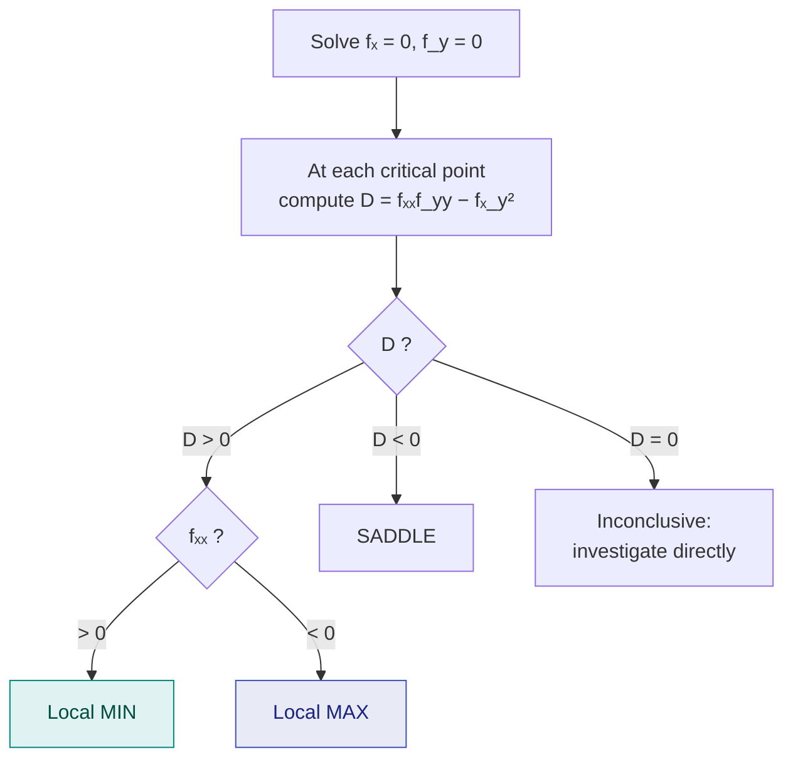

# 18. Nonlinear Programming & Unconstrained Extrema (Functions of Two Variables)

> ⚠️ **Written from standard course knowledge.** No class notes for the nonlinear half have been supplied yet. The topic list comes from [`source/aftermid-syllabus.txt`](../source/aftermid-syllabus.txt) §1–2. Every worked example was verified with a computer algebra system.
> **Syllabus:** *What an optimization problem is (objective function, design vector, inequality and equality constraints) · what an NLP is · local and absolute maxima/minima · critical points · saddle points · the Hessian and the second-derivative test (D > 0, D < 0, D = 0) · absolute extrema on a closed region such as a triangle*

---

## 🎯 In one line

Find where the **gradient is zero** (critical points). Then let the **Hessian determinant** $D = f_{xx}f_{yy} - f_{xy}^2$ decide: $D > 0$ gives a min or max (by the sign of $f_{xx}$), $D < 0$ gives a saddle, and $D = 0$ means the test is inconclusive. On a **closed region**, also check the **boundary**.

---

## 1. What an optimization problem is

$$\text{Find } \mathbf{X} = \begin{pmatrix} x_1 \\ x_2 \\ \vdots \\ x_n \end{pmatrix} \text{ which minimizes } f(\mathbf{X})$$
$$\text{subject to}\quad g_j(\mathbf{X}) \le 0,\; j = 1,\dots,m \qquad h_k(\mathbf{X}) = 0,\; k = 1,\dots,p$$

| Term | Meaning |
|---|---|
| **Design vector** $\mathbf{X}$ | The $n$ decision (design) variables we are free to choose |
| **Objective function** $f(\mathbf{X})$ | The quantity to minimise (cost, weight, error) or maximise (profit). $\max f = -\min(-f)$ |
| **Inequality constraints** $g_j(\mathbf{X}) \le 0$ | Limits such as capacity or stress ≤ allowable |
| **Equality constraints** $h_k(\mathbf{X}) = 0$ | Exact requirements such as balance equations |
| **Feasible region** | All $\mathbf{X}$ satisfying every constraint |
| **Unconstrained problem** | No $g$ or $h$ at all |

### Nonlinear programming problem (NLP)

An optimization problem is an **NLP** if the **objective function or at least one constraint is nonlinear** in the design variables. An LPP is the special case where everything is linear.

| LPP | NLP |
|---|---|
| Optimum always at a **corner** (vertex) of the feasible region | Optimum can be **anywhere**: interior, on an edge, or at a corner |
| Any local optimum is global | There may be **several local optima** |
| Simplex method | Calculus (this chapter), Lagrange ([Ch. 19](19-lagrange-multipliers.md)), KKT ([Ch. 20](20-kkt-conditions.md)), numerical methods ([Ch. 22](22-newton-raphson-methods.md)) |

---

## 2. Local vs absolute extrema ⭐

Let $f(x, y)$ be defined on a region $R$ containing $(a, b)$.

| Term | Definition |
|---|---|
| **Local (relative) maximum** at $(a,b)$ | $f(a,b) \ge f(x,y)$ for all $(x,y)$ in some **open disk** around $(a,b)$ |
| **Local (relative) minimum** at $(a,b)$ | $f(a,b) \le f(x,y)$ for all $(x,y)$ in some open disk around $(a,b)$ |
| **Absolute (global) maximum** on $R$ | $f(a,b) \ge f(x,y)$ for **all** $(x,y) \in R$ |
| **Absolute (global) minimum** on $R$ | $f(a,b) \le f(x,y)$ for **all** $(x,y) \in R$ |

> Every absolute extremum in the **interior** of $R$ is also a local extremum. An absolute extremum can also occur on the **boundary**, where it need not be a critical point.

---

## 3. Critical points and saddle points

**First-derivative test (necessary condition).** If $f$ has a local extremum at an interior point $(a,b)$ and the first partial derivatives exist there, then

$$\nabla f(a,b) = \mathbf{0}, \qquad\text{i.e.}\qquad f_x(a,b) = 0, \quad f_y(a,b) = 0$$

A **critical point** is an interior point where $f_x = f_y = 0$ **or** where a partial derivative does not exist.

> A critical point is **not necessarily** an extremum.

A **saddle point** is a critical point where $f$ has **neither** a max nor a min: in every disk around it there are points with $f$ larger **and** points with $f$ smaller. The surface curves **up** in one direction and **down** in another, like a horse's saddle. *Example:* $f = x^2 - y^2$ at $(0,0)$ increases along the $x$-axis and decreases along the $y$-axis.

---

## 4. The Hessian and the second-derivative test ⭐⭐⭐

**Hessian matrix** (the matrix of second partial derivatives):

$$H = \begin{bmatrix} f_{xx} & f_{xy} \\ f_{yx} & f_{yy} \end{bmatrix}, \qquad \boxed{D = \det H = f_{xx}f_{yy} - f_{xy}^2}$$

**Second-derivative test.** At a critical point $(a,b)$ with $f_x = f_y = 0$:

| Condition | Conclusion |
|---|---|
| $D > 0$ and $f_{xx} > 0$ | **Local minimum** |
| $D > 0$ and $f_{xx} < 0$ | **Local maximum** |
| $D < 0$ | **Saddle point** |
| $D = 0$ | **Test is inconclusive.** Investigate another way (look along lines, complete the square, etc.) |

**Why it works.** Near a critical point $f(a+h, b+k) \approx f(a,b) + \frac12(f_{xx}h^2 + 2f_{xy}hk + f_{yy}k^2)$. That quadratic form is positive for all $(h,k) \ne 0$ when $D > 0$ and $f_{xx} > 0$ (min), negative when $D > 0$ and $f_{xx} < 0$ (max), and takes both signs when $D < 0$ (saddle).

**$n$-variable version.** Check the leading principal minors $D_1, D_2, \dots, D_n$ of $H$:
- All $D_k > 0$ means $H$ is positive definite, so the point is a **local min**.
- Signs alternate $D_1 < 0, D_2 > 0, D_3 < 0, \dots$ means negative definite, so the point is a **local max**.
- Otherwise, if $\det H \neq 0$ and $H$ is indefinite, the point is a **saddle**.



---

## 5. Worked examples

### Example 1: $f(x,y) = x^3 + y^3 - 3xy$ ⭐

**Critical points.**
$$f_x = 3x^2 - 3y = 0 \Rightarrow y = x^2, \qquad f_y = 3y^2 - 3x = 0 \Rightarrow x = y^2$$
Substituting gives $x = x^4$, so $x(x^3 - 1) = 0$, i.e. $x = 0$ or $x = 1$. The critical points are $(0,0)$ and $(1,1)$.

**Second derivatives.** $f_{xx} = 6x$, $f_{yy} = 6y$, $f_{xy} = -3$, so $D = 36xy - 9$.

| Point | $f_{xx}$ | $D$ | Nature | $f$ |
|---|---|---|---|---|
| $(0,0)$ | 0 | $-9 < 0$ | **Saddle point** | 0 |
| $(1,1)$ | $6 > 0$ | $27 > 0$ | **Local minimum** | $-1$ |

### Example 2: $f(x,y) = x^4 + y^4 - 4xy + 1$

$f_x = 4x^3 - 4y = 0$ and $f_y = 4y^3 - 4x = 0$, so $y = x^3$ and $x = x^9$. That gives $x \in \{0, 1, -1\}$ and the points $(0,0)$, $(1,1)$, $(-1,-1)$.

$f_{xx} = 12x^2$, $f_{yy} = 12y^2$, $f_{xy} = -4$, so $D = 144x^2y^2 - 16$.

| Point | $D$ | $f_{xx}$ | Nature | $f$ |
|---|---|---|---|---|
| $(0,0)$ | $-16$ | 0 | **Saddle** | 1 |
| $(1,1)$ | $128$ | 12 | **Local min** | $-1$ |
| $(-1,-1)$ | $128$ | 12 | **Local min** | $-1$ |

### Example 3: $f(x,y) = 2x^3 + xy^2 + 5x^2 + y^2$ (four critical points)

$f_x = 6x^2 + y^2 + 10x = 0$ and $f_y = 2xy + 2y = 2y(x+1) = 0$.
- If $y = 0$: $6x^2 + 10x = 0$, so $x = 0$ or $x = -\frac53$.
- If $x = -1$: $6 + y^2 - 10 = 0$, so $y = \pm 2$.

$f_{xx} = 12x + 10$, $f_{yy} = 2x + 2$, $f_{xy} = 2y$.

| Point | $f_{xx}$ | $D = f_{xx}f_{yy} - f_{xy}^2$ | Nature | $f$ |
|---|---|---|---|---|
| $(0, 0)$ | 10 | $20 > 0$ | **Local min** | 0 |
| $(-\frac53, 0)$ | $-10$ | $\frac{40}{3} > 0$ | **Local max** | $\frac{125}{27}$ |
| $(-1, 2)$ | $-2$ | $-16 < 0$ | **Saddle** | 3 |
| $(-1, -2)$ | $-2$ | $-16 < 0$ | **Saddle** | 3 |

### Example 4: the $D = 0$ case

For $f_1 = x^4 + y^4$, $f_2 = -(x^4 + y^4)$ and $f_3 = x^4 - y^4$, the only critical point is $(0,0)$ and **$D = 0$** for all three. Looking directly:
- $f_1 \ge 0 = f_1(0,0)$, so it is a **minimum**.
- $f_2 \le 0$, so it is a **maximum**.
- $f_3$ is positive on the $x$-axis and negative on the $y$-axis, so it is a **saddle**.

The same $D = 0$ gives three different answers, which is why the test is **inconclusive**.

---

## 6. Absolute extrema on a closed bounded region ⭐⭐⭐

**Extreme Value Theorem.** A **continuous** function on a **closed and bounded** region attains an absolute maximum and an absolute minimum there.

**Procedure:**
1. Find the **interior critical points** and evaluate $f$ there.
2. On each **edge** of the boundary, restrict $f$ to a one-variable function, find its critical points (by setting the derivative to 0), and evaluate $f$.
3. Evaluate $f$ at the **vertices** (corner points).
4. The **largest** value is the absolute max and the **smallest** is the absolute min.

> You don't need the second-derivative test here. Just **compare the values**.

### Example 5: triangular plate ⭐

Find the absolute max and min of $f(x,y) = 2 + 2x + 2y - x^2 - y^2$ on the triangle bounded by $x = 0$, $y = 0$ and $y = 9 - x$.

```
  y
  9 ● (0,9)
    │ \
    │   \   y = 9 − x
    │     \
    │  (1,1)\
    │   ●     \
    └───────────● (9,0)  x
  (0,0)
```

**Step 1: interior.** $f_x = 2 - 2x = 0$ and $f_y = 2 - 2y = 0$ give $(1,1)$ (inside), with $f(1,1) = \mathbf{4}$.

**Step 2: edges.**

| Edge | Restricted function | Critical point | Value |
|---|---|---|---|
| $y = 0$, $0 \le x \le 9$ | $f = 2 + 2x - x^2$ | $x = 1$ | $f(1,0) = 3$ |
| $x = 0$, $0 \le y \le 9$ | $f = 2 + 2y - y^2$ | $y = 1$ | $f(0,1) = 3$ |
| $y = 9 - x$, $0 \le x \le 9$ | $f = -61 + 18x - 2x^2$ | $x = \frac92$ | $f(\frac92, \frac92) = -\frac{41}{2}$ |

**Step 3: vertices.** $f(0,0) = 2$, $f(9,0) = -61$, $f(0,9) = -61$.

**Step 4: compare.** The candidates are $4,\ 3,\ 3,\ -20.5,\ 2,\ -61,\ -61$.

$$\boxed{\text{Absolute max} = 4 \text{ at } (1,1); \qquad \text{absolute min} = -61 \text{ at } (9,0) \text{ and } (0,9)}$$

---

## 7. Common exam questions

1. **Define an optimization problem: objective function, design vector, constraints. What is an NLP?** See §1.
2. **Define local and absolute extrema, critical point and saddle point.** See §2–§3.
3. **State the second-derivative test.** Give the $D$ table in §4, including the inconclusive case.
4. **Find and classify all critical points of $f(x,y) = \dots$** Use Examples 1–3.
5. **Find the absolute max and min of $f$ on the triangle/rectangle …** Use Example 5: interior + edges + vertices.
6. **Show that the test fails at $(0,0)$ for $x^4 + y^4$** (Example 4).

---

## ⚡ Quick revision

- Optimization: **min $f(\mathbf X)$** s.t. $g_j \le 0$, $h_k = 0$. **NLP** = something nonlinear.
- Critical point: $f_x = f_y = 0$ (or a partial doesn't exist).
- $D = f_{xx}f_{yy} - f_{xy}^2$. **$D > 0$, $f_{xx} > 0$ ⇒ min**. **$D > 0$, $f_{xx} < 0$ ⇒ max**. **$D < 0$ ⇒ saddle**. **$D = 0$ ⇒ no conclusion.**
- $n$ variables: leading minors all $+$ ⇒ min; alternating $-, +, -, \dots$ ⇒ max.
- **Closed region:** interior critical points + edge critical points + vertices, then compare values.
- Must-know answers: $x^3 + y^3 - 3xy$ has a saddle at $(0,0)$ and a min of $-1$ at $(1,1)$. The triangle example has max 4 at $(1,1)$ and min $-61$ at the corners $(9,0)$, $(0,9)$.

---

**Previous:** [← 17. Transportation, Assignment & IP Question Bank](17-transportation-assignment-ip-question-bank.md) · **Next:** [19. Lagrange Multipliers →](19-lagrange-multipliers.md)
