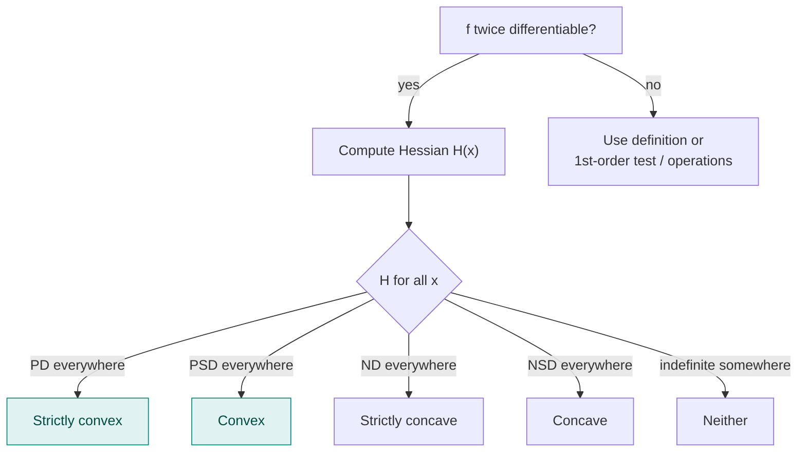

# 21. Convex Sets, Convex Functions & Convex Optimization

> ⚠️ **Written from standard course knowledge.** No class notes for this topic yet. The scope follows [`source/aftermid-syllabus.txt`](../source/aftermid-syllabus.txt) §5. Hessian examples were verified by computer (eigenvalues and leading minors).
> **Syllabus:** *Affine and convex sets (examples, counterexamples) · convex hull; intersection of convex sets is convex · convex and concave functions (strict and non-strict) · first-derivative, second-derivative and Hessian tests (PD, PSD, ND, NSD, indefinite) with a summary flowchart · operations preserving convexity · convex problems in standard form; local = global · unconstrained stationary points, affine equality constraints, KKT sufficiency (+ counterexample without convexity)*

---

## 🎯 In one line

In a **convex problem** (a convex objective over a convex feasible set) every local minimum is global, and any KKT point is optimal. That is why we check convexity with the **Hessian**.

---

## 1. Affine sets and convex sets ⭐

For two points $x_1, x_2$ and a real number $\theta$, the point $\theta x_1 + (1-\theta)x_2$ lies on the **line** through them. If $\theta \in [0, 1]$, it lies on the **segment** between them.

| | Definition | Allowed $\theta$ |
|---|---|---|
| **Affine set** | Contains the **whole line** through any two of its points | $\theta \in \mathbb R$ |
| **Convex set** | Contains the **whole segment** between any two of its points | $\theta \in [0, 1]$ |

$$C \text{ convex} \iff \forall x_1, x_2 \in C,\; \forall \theta \in [0,1]: \;\; \theta x_1 + (1-\theta)x_2 \in C$$

Every affine set is convex, but not conversely.

| ✅ Convex | ❌ Not convex (counterexamples) |
|---|---|
| A line, a plane, $\{x : Ax = b\}$ (also **affine**) | A **circle** $x^2 + y^2 = 1$ (the curve only) |
| A half-space $\{x : a^Tx \le b\}$ | An **annulus** $1 \le x^2 + y^2 \le 4$ |
| A ball / disc $\{x : \lVert x - c\rVert \le r\}$ | $\{x : \lvert x\rvert \ge 1\}$ (two pieces) |
| A polyhedron $\{x : Ax \le b\}$, e.g. the LP feasible region | A crescent or L-shape |
| $\mathbb R^n$, a single point, the empty set | The set of integer points (IP feasible set, [Ch. 16](16-integer-programming.md)) |

```
  Convex:  ●───────●   whole segment inside        Not convex:  ●  ╭──╮  ●
          ( any two points )                                      ╰──╯   segment leaves the set
```

### Convex combination and convex hull

A **convex combination** of $x_1, \dots, x_k$ is $\sum \theta_i x_i$ with $\theta_i \ge 0$ and $\sum \theta_i = 1$.

The **convex hull** $\operatorname{conv}(S)$ is the set of **all convex combinations** of points of $S$. It is the **smallest convex set containing $S$** (like a rubber band stretched round the points). For example, the convex hull of three non-collinear points is the filled triangle.

### Theorem: an intersection of convex sets is convex ⭐

*Proof.* Let $C_1, C_2$ be convex and $x, y \in C_1 \cap C_2$. For $\theta \in [0,1]$, $z = \theta x + (1-\theta) y$ is in $C_1$ (because $C_1$ is convex) **and** in $C_2$ (because $C_2$ is convex), so $z \in C_1 \cap C_2$. The same argument works for any number of sets. ∎

> **Consequence:** a feasible region defined by many convex constraints $g_i(x) \le 0$ is convex, because each $\{x : g_i(x) \le 0\}$ is convex when $g_i$ is convex. **An LP feasible region is convex** because it is an intersection of half-spaces. (The union of convex sets is **not** convex in general.)

---

## 2. Convex and concave functions ⭐⭐

$f$ (defined on a convex set) is **convex** if the chord lies on or above the graph:

$$\boxed{f(\theta x + (1-\theta)y) \le \theta f(x) + (1-\theta) f(y) \quad \forall x, y,\; \theta \in [0, 1]}$$

| Type | Definition |
|---|---|
| **Convex** | $\le$ above |
| **Strictly convex** | $<$ for $x \ne y$, $\theta \in (0,1)$ |
| **Concave** | $\ge$, i.e. $-f$ is convex |
| **Strictly concave** | $>$ |

Affine functions $a^Tx + b$ are **both** convex and concave.

| Convex | Concave | Neither |
|---|---|---|
| $x^2$, $e^x$, $\lvert x\rvert$, $x^4$, $-\log x$, $\lVert x\rVert$ | $\sqrt x$, $\log x$, $-x^2$ | $x^3$ on $\mathbb R$, $\sin x$, $x^2 - y^2$ |

```
  convex:   ╲        ╱      chord ──── above the curve
              ╲____╱
  concave:    ╱‾‾‾‾╲         chord ──── below the curve
            ╱        ╲
```

---

## 3. Tests for convexity ⭐⭐⭐

| Test | Condition for **convex** | Strictly convex |
|---|---|---|
| **Definition** | inequality above | strict inequality |
| **First-derivative test** ($f$ differentiable) | $f(y) \ge f(x) + \nabla f(x)^T(y - x)$ for all $x, y$: the graph lies **above every tangent** | $>$ for $x \ne y$ |
| **Second-derivative test** (1 variable) | $f''(x) \ge 0$ everywhere | $f''(x) > 0$ is **sufficient** (not necessary) |
| **Hessian test** ($n$ variables) | $\nabla^2 f(x)$ is **positive semidefinite** everywhere | $\nabla^2 f(x)$ **positive definite** is sufficient |

> $f(x) = x^4$ is **strictly** convex, yet $f''(0) = 0$. A positive second derivative is sufficient for strict convexity but not necessary.

### Classifying a symmetric matrix $H$

| Class | Eigenvalues | Leading principal minors $D_1, D_2, \dots$ | $f$ is… |
|---|---|---|---|
| **PD** (positive definite) | all $> 0$ | all $> 0$ | **strictly convex** |
| **PSD** (positive semidefinite) | all $\ge 0$ | *all* principal minors $\ge 0$ | **convex** |
| **ND** (negative definite) | all $< 0$ | alternate: $D_1 < 0, D_2 > 0, D_3 < 0, \dots$ | **strictly concave** |
| **NSD** | all $\le 0$ | $(-1)^k \times$(principal minors of order $k$) $\ge 0$ | **concave** |
| **Indefinite** | some $> 0$, some $< 0$ | none of the above | **neither** (saddle) |

> For PSD you must check **all** principal minors, not only the leading ones. Example: $\begin{bmatrix} 0 & 0 \\ 0 & -1 \end{bmatrix}$ has leading minors $0, 0$ but is **not** PSD.

### Summary flowchart



### Worked Hessian classifications

| $f(x,y)$ | $H$ | $D_1$ | $D_2$ | Eigenvalues | Verdict |
|---|---|---|---|---|---|
| $x^2 + xy + y^2$ | $\begin{bmatrix} 2 & 1 \\ 1 & 2 \end{bmatrix}$ | 2 | 3 | 1, 3 | **PD → strictly convex** |
| $x^2 - y^2$ | $\begin{bmatrix} 2 & 0 \\ 0 & -2 \end{bmatrix}$ | 2 | $-4$ | 2, $-2$ | **Indefinite → neither** |
| $x^2 + 4xy + y^2$ | $\begin{bmatrix} 2 & 4 \\ 4 & 2 \end{bmatrix}$ | 2 | $-12$ | 6, $-2$ | **Indefinite → neither** |
| $-x^2 + xy - y^2$ | $\begin{bmatrix} -2 & 1 \\ 1 & -2 \end{bmatrix}$ | $-2$ | 3 | $-1, -3$ | **ND → strictly concave** |
| $e^x + y^2$ | $\begin{bmatrix} e^x & 0 \\ 0 & 2 \end{bmatrix}$ | $e^x > 0$ | $2e^x > 0$ | – | **PD everywhere → strictly convex** |
| $x^4 + y^2$ | $\begin{bmatrix} 12x^2 & 0 \\ 0 & 2 \end{bmatrix}$ | $\ge 0$ | $24x^2 \ge 0$ | – | **PSD → convex** (in fact strictly) |

**Three variables:** $f = x^2 + 2y^2 + 3z^2 + 2xy + 2xz$ gives

$$H = \begin{bmatrix} 2 & 2 & 2 \\ 2 & 4 & 0 \\ 2 & 0 & 6 \end{bmatrix}, \qquad D_1 = 2,\; D_2 = 4,\; D_3 = 8 \;\; (\text{all} > 0) \;\Rightarrow\; \text{PD, strictly convex}$$

---

## 4. Operations that preserve convexity

| Operation | Rule | Example |
|---|---|---|
| **Non-negative weighted sum** | $f_1, f_2$ convex, $w_i \ge 0$ ⇒ $w_1f_1 + w_2f_2$ convex | $3x^2 + e^x$ |
| **Affine substitution** | $f$ convex ⇒ $f(Ax + b)$ convex | $(2x - 3y + 1)^2$, $\lVert Ax - b\rVert$ |
| **Pointwise maximum** | $f_1, \dots, f_k$ convex ⇒ $\max_i f_i$ convex | $\lvert x\rvert = \max(x, -x)$, the max of linear functions |
| **Scalar composition** | $h$ convex **and non-decreasing**, $g$ convex ⇒ $h(g(x))$ convex | $e^{x^2}$, $(x^2 + 1)^2$ |
| **Partial minimisation** | $f(x, y)$ jointly convex, $C$ convex ⇒ $g(x) = \inf_{y\in C} f(x,y)$ convex | distance to a convex set |

---

## 5. Convex optimization problems: standard form

$$\begin{aligned} \text{minimise } \; & f_0(x) && f_0 \text{ convex} \\ \text{subject to } \; & f_i(x) \le 0,\; i = 1..m && f_i \text{ convex} \\ & a_j^T x = b_j,\; j = 1..p && \text{equalities affine} \end{aligned}$$

The feasible set is then an intersection of convex sets, so it is convex. **LP is a convex problem.** IP is **not** (the integer set is not convex).

> Maximising a **concave** function over a convex set is also a convex problem (minimise $-f$).

### Theorem: every local minimum is a global minimum ⭐⭐⭐

*Proof.* Let $x$ be a local minimum, and suppose some feasible $y$ has $f(y) < f(x)$. For a small $\theta \in (0, 1]$, the point $z = \theta y + (1-\theta)x$ is feasible (the set is convex) and arbitrarily close to $x$. By convexity,
$$f(z) \le \theta f(y) + (1-\theta) f(x) < \theta f(x) + (1-\theta) f(x) = f(x),$$
so points arbitrarily close to $x$ have a smaller value, which **contradicts** $x$ being a local minimum. ∎

If $f$ is **strictly** convex, the global minimiser is also **unique**.

---

## 6. Optimality conditions for convex problems

| Situation | Condition for $x^*$ to be a global minimum |
|---|---|
| **Unconstrained**, $f$ convex and differentiable | $\nabla f(x^*) = 0$, which is **necessary and sufficient** |
| **Affine equality constraints** $Ax = b$ | $Ax^* = b$ and $\nabla f(x^*) + A^T\nu = 0$ for some $\nu$ (Lagrange, [Ch. 19](19-lagrange-multipliers.md)) |
| **Inequalities** (convex $f_i$) + Slater's condition | The KKT conditions ([Ch. 20](20-kkt-conditions.md)) are **necessary and sufficient** |

**Example (unconstrained).** $f = x^2 + xy + y^2 - 3x$. The Hessian is PD, so $f$ is strictly convex. $\nabla f = 0$ gives $2x + y = 3$ and $x + 2y = 0$, so $(x, y) = (2, -1)$ is the **unique global minimum**, with $f = -3$.

**Example (affine equality).** $\min x^2 + y^2$ s.t. $x + y = 2$: $2x + \nu = 0$ and $2y + \nu = 0$ give $x = y = 1$, $\nu = -2$. This is the global minimum, $f = 2$.

> **Slater's condition:** there is a strictly feasible point ($f_i(x) < 0$ for all $i$, with the equalities satisfied). It guarantees the multipliers exist. Most textbook convex problems satisfy it.

---

## 7. When KKT is *not* enough: a counterexample without convexity ⭐

$$\min\ f(x) = -x^2 \quad \text{s.t.} \quad -1 \le x \le 1$$

$f$ is **concave**, so the problem is not convex. The KKT points are:
- $x = 0$: $f'(0) = 0$ with both constraints inactive ($\mu = 0$). KKT is satisfied, but $f(0) = 0$ is the **global maximum** on $[-1, 1]$.
- $x = \pm 1$: KKT is satisfied with $\mu = 2$, and $f = -1$. These are the actual **global minima**.

A KKT point need not be a minimum at all when the problem is not convex. (A simpler unconstrained version: $f = x^3$ has $f'(0) = 0$, but $0$ is neither a max nor a min.)

---

## 8. Common exam questions

1. **Define affine set, convex set and convex hull. Give examples and counterexamples.** See §1.
2. **Prove that the intersection of convex sets is convex.** See §1.
3. **Define convex, strictly convex and concave functions.** See §2.
4. **Test the convexity of $f(x, y) = \dots$ using the Hessian.** Use the §3 tables.
5. **Define PD/PSD/ND/NSD/indefinite.** See §3.
6. **List operations that preserve convexity.** See §4.
7. **Prove that in a convex problem a local minimum is global.** See §5.
8. **When are KKT conditions sufficient? Give a counterexample when convexity fails.** See §6–§7.

---

## ⚡ Quick revision

- **Affine set:** contains whole lines. **Convex set:** contains whole segments ($\theta \in [0,1]$).
- **Convex hull** = all convex combinations = the smallest convex superset. **∩ of convex sets is convex**; ∪ is not.
- **Convex $f$:** $f(\theta x + (1-\theta)y) \le \theta f(x) + (1-\theta) f(y)$. The graph lies above its tangents. **Hessian PSD.**
- **PD ⇒ strictly convex. ND ⇒ strictly concave. Indefinite ⇒ neither.** PSD needs **all** principal minors.
- Preserved by: $\ge 0$ sums, affine substitution, max, $h(g)$ with $h$ convex non-decreasing, partial min.
- **Convex problem ⇒ local min = global min.** ∇f = 0 is sufficient, and **KKT is sufficient**.
- Counterexample: $\min -x^2$ on $[-1, 1]$, where $x = 0$ satisfies KKT but is the **max**.

---

**Previous:** [← 20. KKT Conditions](20-kkt-conditions.md) · **Next:** [22. Newton–Raphson Methods →](22-newton-raphson-methods.md)
