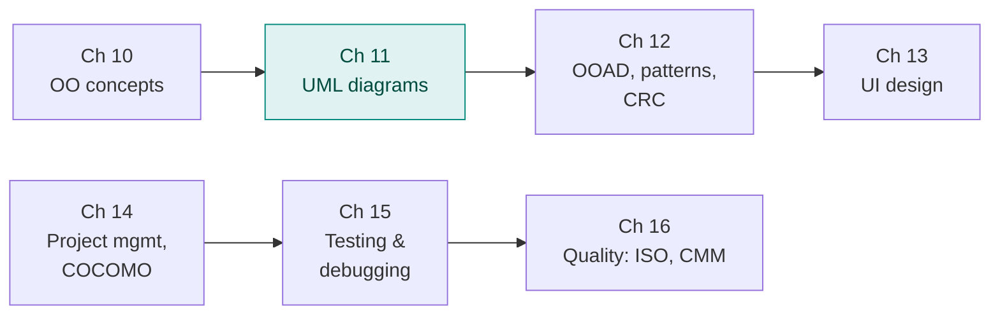

# Software Engineering — Mid-Term & End-Sem Notes

| Part | Chapters | Status |
|---|---|---|
| **Mid-term** (L1–L7b) | [1–9](#chapters) | ✅ Complete |
| **After-mid** (L9, L9B, L10, L12, L13, L17) | [10–16](#after-mid-end-semester) | ✅ Complete, from the lecture slides |

> ⚠️ **No syllabus file was supplied for this subject.** These notes are scoped to the **lectures actually present** in `source/`. If your teacher gives a syllabus, check it against this chapter list.

**Course:** NIT-CS3501 · **Instructor:** Dr. Prahlada Rao B B, ANRF PM Professor, CSE Department, NIT Manipur

## Chapters

| # | Chapter | Lecture | Source file |
|---|---|---|---|
| 1 | [Introduction to Software Engineering](notes/01-introduction-to-software-engineering.md) | **L1** (22-07-2026) | `1.pdf` |
| 2 | [Software Life Cycle Models](notes/02-software-life-cycle-models.md) | **L2** | `pdf  L2-Life Cycle Models-Prahlad 2ppg.pdf` |
| 3 | [Requirements Analysis & Specification (SRS)](notes/03-requirements-analysis-and-srs.md) | **L3** (12-08-2026) | `Lecture 3- Requirements Analysis and Specification -PDF.md` |
| 4 | [Decision Tables & Decision Trees](notes/04-decision-tables-and-trees.md) | **L3** | same as above |
| 5 | [Formal Specification of Systems](notes/05-formal-specification-of-systems.md) | **L4** (18-08-2026) | `Lecture 4- Formal Specification of Systems 2pg  pdf.md` |
| 6 | [Software Design Fundamentals](notes/06-software-design-fundamentals.md) | **L6** (28-08-2026) | `Lecture 6 Software Design-Prahlad-NIT-CS3501.md` |
| 7 | [Function-Oriented Design](notes/07-function-oriented-design.md) | **L7** (09-09-2026) | `Lecture 7 Function Oriented Design-Prahlad-NIT-CS3501.md` |
| 8 | [Structured Design — Examples & Structure Charts](notes/08-structured-design-examples-and-structure-charts.md) | **L7b** (15–18-09-2026) | `8.pdf` |
| 9 | [Mid-Sem 2025 Paper — Solved](notes/09-mid-sem-2025-paper-solved.md) ⭐ *last year's actual paper* | — | `MID-SEM- SE_2025.pdf` |

## After-mid (end-semester)

| # | Chapter | Lecture | Source file |
|---|---|---|---|
| 10 | [Object-Oriented Concepts](notes/10-object-oriented-concepts.md) | **L9** (29-09 to 06-10-2026) | `LECTURE 9- Ch7-Object Oriented Modelling Using UML  pdf.pdf` |
| 11 | [UML: Views, Use Case, Class, Interaction, Activity & State-Chart Diagrams](notes/11-uml-diagrams.md) ⭐ | **L9** (06-10 to 28-10-2026) | same + UML 2.0 slides of L9B |
| 12 | [OO Software Development: OOAD, Design Patterns & CRC Cards](notes/12-object-oriented-design-and-patterns.md) ⭐ | **L9B** (30-10 to 13-11-2026) | `LECTURE 9B- Ch8-Object Oriented Design  &SW Development  pdf.pdf` |
| 13 | [User Interface Design](notes/13-user-interface-design.md) | **L10** (13-11-2026) | `LECTURE 10  Ch9- User Interface Design 141126.pdf` |
| 14 | [Software Project Management: Planning, COCOMO, Staffing & Teams](notes/14-software-project-management.md) ⭐ | **L12** (22-11-2026) | `Lecture 12-Software Project Management _Prahlad NIT 2026.pdf` |
| 15 | [Testing & Debugging](notes/15-testing-and-debugging.md) ⭐ | **L13** (17-11-2026) | `Lecture 13 Testing & Debugging 171126.pdf` |
| 16 | [Software Quality Management: ISO 9000, SEI CMM, PSP, Six Sigma](notes/16-software-quality-management.md) | **L17** (18–20-11-2026) | `LECTURE 17- Software Quality Management Prahlad NIT CS3501.pdf` |

> **Gaps in the after-mid lecture numbering:** L11 and L14–L16 are not in `source/`. *(The testing slides call themselves "Lecture 11" inside the file, while the file name says Lecture 13.)* White-box testing is explicitly excluded in class. If more lectures arrive, they slot in between these chapters.

## Exam pattern (from the 2025 paper)

**30 marks · 1:30 hours.** Q1 has six 1-mark definitions. Then come four 6-mark questions, with an **either/or** choice between Waterfall (Q3) and Agile (Q4). Questions are tagged **CO1** (intro, life cycle models) and **CO2** (requirements, UML).

## ⚠️ Known gaps

- **Lecture 5 is missing** from the folder. L1–L4, L6, L7 and L7b are covered. If you get L5 material, it slots between chapters 5 and 6.
- **The 2025 paper asks about topics not in L1–L7:** **Agile**, **UML**, **use case diagrams**, **sequence diagrams**, **inheritance** and **structured programming**. They account for **9 compulsory marks** (Q1 ii, iv, v and Q6). Agile is the Q4 alternative, so you can avoid it by answering Waterfall. Full answers are in [Ch. 9](notes/09-mid-sem-2025-paper-solved.md). **Update:** UML, use cases, sequence diagrams and inheritance are now taught in **Lecture 9** ([Ch. 10–12](notes/10-object-oriented-concepts.md)), so expect them in the end-sem. **Agile** is still not in any supplied lecture.

## About the source files

`8.pdf` (L7b) is a scanned slide deck with no text layer; it was read page by page. The four `.md` files in `source/` are **raw OCR dumps of the lecture slides** — the reading order is scrambled, strikethrough artefacts remain, and slide numbers appear mid-sentence. They are kept as reference so any point can be traced back, but they are **not** usable for revision. The chapters in `notes/` are the rewritten, readable versions.

## Revision checklist

- [ ] Why software engineering exists — the effort–size curve, Art → Craft → Engineering
- [ ] **Abstraction** and **decomposition** — the two fundamental principles
- [ ] Classical vs **Iterative** Waterfall; the shortcomings of the classical model
- [ ] Prototyping, Evolutionary/Incremental, Spiral models + when to use each
- [ ] Comparison table of all life cycle models
- [ ] Functional vs non-functional requirements
- [ ] SRS characteristics and IEEE structure; the three types of SRS problems
- [ ] Draw a **decision table** and a **decision tree** for a given problem
- [ ] Formal specification: model-oriented vs property-oriented; axiomatic vs algebraic
- [ ] **Cohesion** — all 7 levels, in order
- [ ] **Coupling** — all 5 levels, in order
- [ ] Functional independence — why high cohesion + low coupling
- [ ] DFD symbols, levels (context/level-0, level-1, …), balancing, data dictionary
- [ ] Structure charts; transform vs transaction analysis
- [ ] **L7b:** TAS context diagram + level-1 DFD + data dictionary · the 7 DFD guidelines · the **9 common DFD errors** · DFD shortcomings · Ward and Mellor
- [ ] **L7b:** structure-chart symbols (library module, selection, repetition) and rules · flow chart vs structure chart · the RMS, Tic-tac-toe and TAS structure charts
- [ ] **2025 paper:** software crisis (1960s) · Agile model + manifesto · SRS organization **with an example** · "Renew book" use case + **sequence diagram**
- [ ] One-line definitions: feasibility study, structured programming, decision tree, inheritance, UML, functional requirements

**After-mid**
- [ ] OO concepts: object, class (= ADT?), the **four relationships**, **aggregation vs composition** (Order example), abstraction, encapsulation, **static vs dynamic binding**, genericity, OO pros and cons
- [ ] UML: origin, **five views and their diagrams**, why the user's view is central
- [ ] **Use case diagram + text description** (supermarket prize scheme), **include / extend / generalisation**, packaging
- [ ] **Class diagram** notation (◇ ◆ △, dotted arrow, multiplicity); object diagram
- [ ] **Sequence vs collaboration** diagram (renew book); **activity diagram** (IIT admission, swim lanes); **state-chart** (Order object)
- [ ] UML 2.0: 13 diagrams, combined fragments
- [ ] OOA vs OOD; **design patterns** (4 parts; architectural / design / idiom; antipatterns); **Expert, Creator, Controller, Facade, MVC / publish–subscribe**
- [ ] OOAD / Unified Process; **boundary / entity / controller** objects; **CRC cards**; tic-tac-toe and supermarket designs
- [ ] UI: characteristics of a good UI, error messages, mode-based vs modeless, **command / menu / direct-manipulation** interfaces, menu structuring, WMS and widgets
- [ ] Project management: SPMP, **LOC vs FP**, Delphi, **basic / intermediate / complete COCOMO** (32 KLOC → 91 PM, 14 months), Rayleigh curve, **Putnam** (halve the time → 16× effort), team structures
- [ ] Testing: error / fault / failure, **verification vs validation**, **ECP and BVA** (square root 1–5000), debugging approaches, **integration** (big bang / top-down / bottom-up / mixed), **alpha / beta / acceptance / stress**, **error seeding**
- [ ] Quality: quality factors, **inspection → QC → QA → TQM**, product vs process metrics, **ISO 9001** (stages, clauses, shortcomings), **CMM five levels + KPAs**, ISO vs CMM, PSP, **Six Sigma** (3.4 DPMO, DMAIC / DMADV)

## The two facts most likely to be asked

$$\textbf{Good design} = \textbf{High Cohesion} + \textbf{Low Coupling}$$

| Cohesion — 7 levels (worst → best) | Coupling — 5 levels (worst → best) |
|---|---|
| 7. Coincidental | 5. Content |
| 6. Logical | 4. Common |
| 5. Temporal | 3. Control |
| 4. Procedural | 2. Stamp |
| 3. Communicational | **1. Data** ⭐ *(best)* |
| 2. Sequential | |
| **1. Functional** ⭐ *(best)* | |

*Degree of cohesiveness **increases** from Coincidental to Functional. Degree of coupling **increases** from Data to Content.*

## End-sem formula and fact sheet

| Topic | Formula / fact |
|---|---|
| Function points | $FP = 4\cdot\text{in} + 5\cdot\text{out} + 4\cdot\text{inq} + 10\cdot\text{files} + 10\cdot\text{interfaces}$ |
| Basic COCOMO | $E = a(\text{KLOC})^b$ PM, $T = 2.5\,E^c$ months. Organic 2.4 / 1.05 / 0.38 · semi-detached 3.0 / 1.12 / 0.35 · embedded 3.6 / 1.20 / 0.32 |
| Putnam | $L = C_k K^{1/3} t_d^{4/3}$, so $K_1/K_2 = (t_{d2}/t_{d1})^4$ (halving the time gives 16× the effort). Boehm's limit ≈ 75 % of nominal |
| Error seeding | Remaining $= n\,(S - s)/s$ |
| CMM levels | Initial → Repeatable → Defined (≈ ISO 9001) → Managed → Optimizing |
| Six Sigma | ≤ 3.4 defects per million (5σ = 230, 4σ = 6210) |
