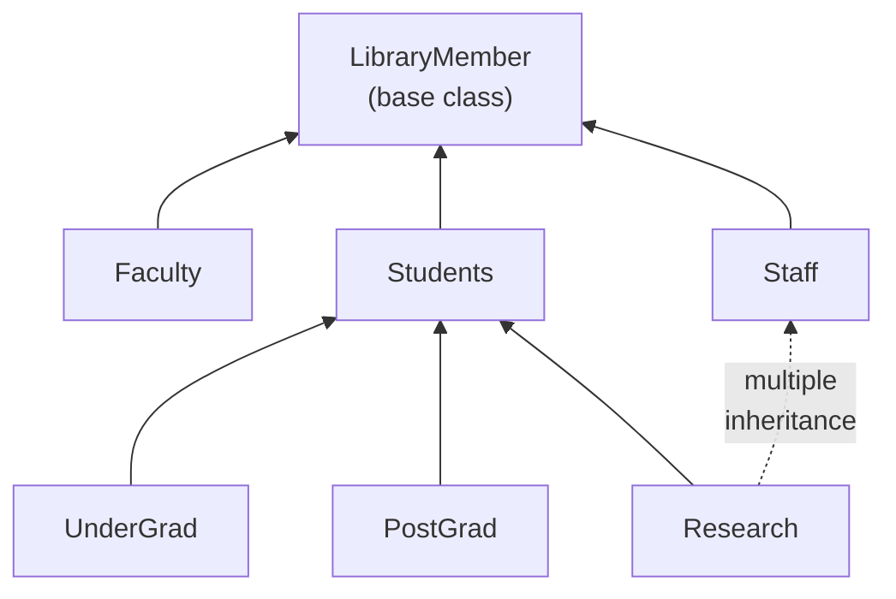

# 10. Object-Oriented Concepts

> **Lecture:** L9, Part 1 (29-09-2026 to 06-10-2026) · **Source:** `LECTURE 9- Ch7-Object Oriented Modelling Using UML  pdf.pdf`, slides 1–53 (Rajib Mall, Ch. 7)
> **Continued in [Ch. 11](11-uml-diagrams.md)** (UML) and **[Ch. 12](12-object-oriented-design-and-patterns.md)** (OOAD and design patterns).

---

## 🎯 In one line

An object-oriented system is a **set of interacting objects**. Each object **hides its data** behind its methods, and classes are linked by **inheritance, association, aggregation/composition and dependency**. Polymorphism and genericity let one piece of code serve many types.

---

## 1. The object-oriented approach (slides 3–8)

**OO design** became popular in the early 1980s and is now mature, with wide acceptance in industry and academia. UML is an **ISO standard (ISO/IEC 19501)**.

The intuitively appealing approach:
1. Identify the **natural objects** occurring in the problem (employees, a pay-roll register, …).
2. Determine the **relationships** among them (composition, reference, inheritance).
3. Each object acts as a **data-hiding (data-abstraction) entity**.

**Example: a manually operated library.** To issue a book, the issue register is filled in and the return date is stamped. In OO library software the **book object** and the **issue-register object** carry out analogous activities.

Objects are usually **real-world entities** (a library member, a book, an issue register), but can also be **conceptual** (a scheduler, a controller, a manager).

---

## 2. Objects, attributes and methods (slides 8–12) ⭐⭐

| Term | Meaning |
|---|---|
| **Object** | Data plus the functions that operate on that data |
| **Attributes** | The data stored inside an object |
| **Methods** | The operations an object supports |

- An object's methods are the **only** code with authority to touch its private data.
- **No object can directly access another object's data.** Every object hides its internal organisation, which is **data abstraction**.

```
            ┌──────────── object ────────────┐
   m1 ─────►│  ┌──────────────────────────┐  │◄───── m4
   m2 ─────►│  │   private data           │  │◄───── m5
   m3 ─────►│  │   (attributes)           │  │◄───── m6
            │  └──────────────────────────┘  │
            └── mᵢ = methods: the only way in ┘
```

**Example: the `LibraryMember` object**

| Methods (operations) | Private data (attributes) |
|---|---|
| issue-book, find-books-outstanding, find-books-overdue, return-book, find-membership-details | member name, membership number, address, phone, e-mail, admission date, expiry date, books issued |

**Terminology caution:** "object" sometimes means a single entity and sometimes the whole group (the class). Context resolves it.

### Are OO programs made only of objects? (slides 13–14)

- **Smalltalk** (Xerox, 1970s) was the first OO language and was **pure**: everything, even integers, was an object. It saw little adoption because programmers had to learn an entirely new paradigm.
- **C++ and Java** treat **primitive data (int, float) differently from objects**: objects are passed by **reference** and primitives by **value**. C++ was designed as a small extension of C (early C++ was translated to C by a preprocessor), which made migration easy and is a big reason for its popularity.

---

## 3. Class (slides 15–16) ⭐⭐

- **Similar objects make up a class.** All objects of a class have the same attributes and methods.
- A class is a **template for creating objects**. Objects are **instances** of a class, so a class is a **data type**.

> **Q. Is a class an abstract data type (ADT)?** A data type defines a set of values plus predefined operations and can be instantiated, and a class does exactly that. So **a class is an ADT**. **But an ADT need not be a class:** to be a class it must also support **inheritance** and the other OO properties.

- **Abstract classes** are not meant to produce instances. They only define common features for subclasses.

### Methods and messages (slide 17)

Methods are invoked by **sending a message** to the object (a method call), for example `calculate_salary`, `issue-book` or `member_details`.

---

## 4. The four relationships among classes (slide 18) ⭐⭐⭐

| Relationship | Meaning | UML notation |
|---|---|---|
| **Inheritance** | "is-a": generalisation–specialisation | Hollow triangle arrow **from subclass to superclass** |
| **Association** | Objects know each other's identity and can call each other | Plain line (named, with multiplicities) |
| **Aggregation / Composition** | "has-a": whole–part | Hollow diamond (aggregation) / **filled** diamond (composition) at the whole |
| **Dependency** | One class uses another | **Dotted arrow** from the dependent to the independent class |

### 4.1 Inheritance (slides 19–22)

- A **derived class** (subclass, child) is defined by extending or modifying a **base class** (superclass, parent).
- It represents **generalisation–specialisation**. The base class holds only what is **common** to all its derived classes, and each derived class is a **specialised** base class.
- It allows **method overriding** (redefining an inherited method).
- Common data and methods are defined **once** in the base class and inherited by every subclass, instead of being repeated.



**Multiple inheritance:** a subclass inherits from **more than one** base class. For example, `Research` inherits from both `Students` and `Staff` (Fig. 7.4).

### 4.2 Association (slides 23–27)

- If two classes are associated, their objects **know each other's identities (addresses)** and one can **invoke the other's methods**. This is how objects communicate.
- Usually **binary**, but it can be **n-ary**. A **ternary** example is `Person`–`Skill`–`Competency level`.
- A class can be associated with **itself** (recursive association).
- An **arrowhead** next to the name shows the **reading direction**, and **multiplicity** shows how many instances take part.
- A **link** is an instance of an association, i.e. a relationship between two particular objects. Links are **created and destroyed dynamically** (an employee joins an organisation, leaves, joins another).

```
 LibraryMember  1 ───── borrowed by ◄ ───── *  Book
```

### 4.3 Aggregation and composition (slides 28–34) ⭐⭐⭐

**Aggregation** is a **whole–part** relationship (a diamond at the composite end).
- It **cannot be reflexive** (recursive).
- It is **not symmetric**: A and B cannot contain each other.
- It **can be transitive** (Document ◇— Paragraph ◇— Line).
- It is limited to a **tree hierarchy**, with no circular inclusion.

```
 Document ◇────────* Paragraph ◇────────* Line      (aggregation, hollow ◇)
 Order    ◆────────* Item                           (composition, filled ◆)
```

| | **Aggregation** ◇ | **Composition** ◆ |
|---|---|---|
| Lifetimes | **Different**: parts can outlive the whole | **Same**: parts are created and destroyed with the whole |
| Parts added or removed dynamically? | **Yes** | **No** |
| Order example | Items **can be changed or deleted** after the order is placed | Items **cannot** be changed; to change one you cancel and re-order |

| | **Inheritance** | **Aggregation** |
|---|---|---|
| Purpose | Different object types with **similar features** | **Containment**: building complex objects from parts |
| Relation | is-a | has-a |

### 4.4 Dependency (slide 35)

One class depends on another (it uses it, e.g. as a parameter). It is drawn as a **dotted arrow** from the dependent class to the independent class.

---

## 5. Key concepts (slides 36–50) ⭐⭐⭐

### Abstraction

Consider only the aspects relevant for a certain purpose and **suppress the non-relevant ones**.
- Types: **data abstraction** and **behaviour abstraction**.
- Advantages: it **reduces design complexity**, enhances understandability and increases productivity. *Productivity is inversely proportional to complexity.*

### Encapsulation

Objects communicate with the outside world **only through messages**. The data is **encapsulated within the methods** and accessible only through them.
- **Data hiding:** the internal data structure is hidden, so all interactions are simple and standardised.
- **Weak coupling:** objects cannot change each other's data, so they are weakly coupled and **each can be understood in isolation**.

### Polymorphism ("many forms")

The **same message** sent to an object can produce **different actions**.

| Kind | When the method is chosen | Mechanism | Example |
|---|---|---|---|
| **Static binding** (static polymorphism) | **Compile time** | **Overloading**: same name, different parameters | `Circle.create()`, `create(x, y, r)`, `create(x, y, r, fillType)` |
| **Dynamic binding** (dynamic polymorphism) | **Run time** | **Overriding** + inheritance + assignment to compatible types | `shape.draw()` calls the right `draw` for a Circle, Rectangle, … |

```java
class Circle {
    private float x, y, radius;
    private int fillType;
    public create();                                       // default
    public create(float x, float y, float r);              // centre + radius
    public create(float x, float y, float r, int fillType);
}   // 'create' is OVERLOADED: chosen at compile time by its parameters
```

**Liskov's substitution principle:** an object can be assigned to a variable of its **ancestor** class, but not the other way round:
```
A a;  B b;     // B is derived from A
a = b;   ✔ OK
b = a;   ✘ not OK
```

**Why dynamic binding matters:**

| Traditional code | Object-oriented code |
|---|---|
| `for (i = 0; i < 1000; i++)`<br/>`  if (s[i] == Circle) draw_circle();`<br/>`  else if (s[i] == Rectangle) draw_rectangle(); …` | `for (i = 0; i < 1000; i++)`<br/>`  s[i].draw();` |
| Adding a new shape means editing every `if` chain | Adding a new shape means adding one subclass with its own `draw()` |

### Genericity (slides 49–50)

The ability to **parameterise class definitions**. For example, define one **generic `Stack<T>`** and later instantiate it as an integer, character or floating-point stack. Likewise, a `Set<T>` with `insert(T)` and `remove(T)` can be refined into `EmployeeSet`.

---

## 6. Advantages and disadvantages of OO development (slides 51–53) ⭐⭐

| Advantages | Disadvantages |
|---|---|
| **Code and design reuse** (class libraries, inheritance) | Initially **higher cost**; savings come only after some projects |
| **Increased productivity**: well-established OO projects cost **20–50 %** of traditional development | Abstraction, data hiding and inheritance add **run-time overhead**, so OO programs run **slower** than equivalent procedural ones |
| Easier **testing and maintenance** | Data that is centralised in a procedural program gets **scattered across objects**: weak **spatial locality** → more **cache misses** → longer memory access and run time |
| Better understandability; simpler, more intuitive abstraction | |
| **Elegant design**: loosely coupled, highly cohesive objects | |
| Better problem decomposition | |

---

## 7. Common exam questions

1. **Define object, class, attribute, method and message.** See §2–§3.
2. **Is a class an ADT? Is every ADT a class?** See §3.
3. **Explain the four relationships among classes, with UML notation.** See §4.
4. **Differentiate aggregation and composition with an example** (the Order example). See §4.3.
5. **Explain abstraction, encapsulation and polymorphism.** See §5.
6. **Differentiate static and dynamic binding.** Overloading vs overriding (§5).
7. **What is genericity?** See §5.
8. **Advantages and disadvantages of OO development.** See §6.
9. **What is inheritance? / multiple inheritance?** See §4.1. *(This was a 2025 mid-sem one-liner; see [Ch. 9](09-mid-sem-2025-paper-solved.md).)*

---

## ⚡ Quick revision

- Object = **attributes + methods**; data is reachable **only via methods**.
- Class = template = **ADT** (but an ADT need not be a class).
- Relationships: **inheritance** (△, is-a) · **association** (line, a link is its instance) · **aggregation** (◇) / **composition** (◆, same lifetime) · **dependency** (dotted arrow).
- Aggregation: not reflexive, not symmetric, can be transitive, tree only.
- **Abstraction** (suppress irrelevant detail) · **encapsulation** (data hiding → weak coupling) · **polymorphism** (static = overloading, dynamic = overriding) · **genericity** (`Stack<T>`).
- Liskov: `ancestor = descendant` ✔, `descendant = ancestor` ✘.
- OO costs: run-time overhead and poor cache locality. OO gains: reuse, 20–50 % of the cost once established.

---

**Previous:** [← 9. Mid-Sem 2025 Paper — Solved](09-mid-sem-2025-paper-solved.md) · **Next:** [11. UML Diagrams →](11-uml-diagrams.md)
