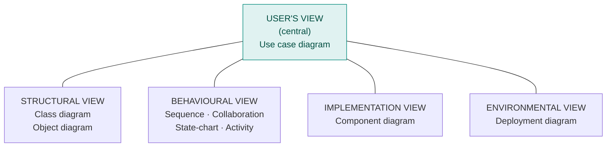
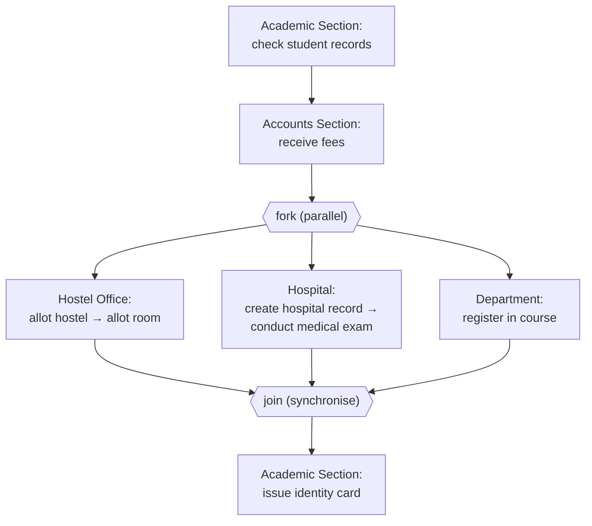
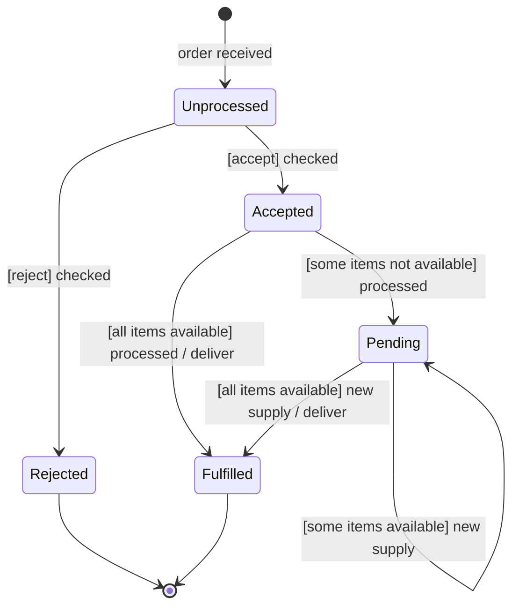

# 11. UML: Views, Use Cases, Class, Interaction, Activity & State-Chart Diagrams

> **Lecture:** L9, Part 2 (06-10-2026 to 28-10-2026) · **Source:** `LECTURE 9- Ch7-Object Oriented Modelling Using UML  pdf.pdf`, slides 54–138, plus the UML 2.0 slides 163–166 of `LECTURE 9B-…pdf`
> **The 2025 mid-sem Q6 ("renew book" use case + sequence diagram) is solved in [Ch. 9](09-mid-sem-2025-paper-solved.md).**

---

## 🎯 In one line

**UML** is a **graphical language for documenting** OO analysis and design. It is not a methodology. Its diagrams capture **five views** of a system, and the **user's view (use case diagram)** is the central one that every other view must conform to.

---

## 1. What UML is (slides 54–60) ⭐⭐

- UML is a **modelling language** used to **document** OO analysis and design results. It has **syntax** (symbols and sentence-formation rules) and **semantics** (meanings).
- It is **independent of any design methodology**. It is **neither** a system design **nor** a development methodology.
- It provides graphical notations (rectangles, lines, ellipses, …) that can be combined to document designs.

**Origin.** In the late 1980s and early 1990s every software house used its own notation, each tied to its own methodology. UML (early 1990s) was created to **standardise** them. It is based principally on:

| Source | Author |
|---|---|
| **OMT** | Rumbaugh, 1991 |
| **Booch's methodology** | Booch, 1991 |
| **OOSE** | Jacobson, 1992 |
| Odell's methodology | Odell, 1992 |
| Shlaer and Mellor | 1992 |

- It was **adopted by the OMG** (Object Management Group, an industry association) in **1997**, and later by **ISO**.
- It is used even **outside software**, e.g. car manufacturing.
- **CASE tools** (Rational Rose, MagicDraw, many free ones) draw UML diagrams and **generate code templates** from them.
- Versions: UML 1.0 → 1.x → **2.0** (adds support for embedded systems; §10).

### What is a model and why build one? (slides 61–64)

- A **model** is an **abstraction** of a real problem built by leaving out unnecessary detail. It reduces complexity, and different models result when different aspects are ignored.
- The initial model is the **analysis model**. A design methodology refines it into a **design model**.
- Models are used for analysis, specification, design, coding, visualisation, testing, etc. **A model's level of detail depends on its purpose**: an analysis model shows **no design decisions**, while a design model must capture **all** of them. So state the purpose of each model.
- A building can be modelled from several perspectives (ventilation, electrical, lighting, heating). Likewise, UML diagrams give **different perspectives** of a software system.

---

## 2. The five views and their diagrams (slides 65–71) ⭐⭐⭐

UML 1.0 used **nine diagram types** to capture **five views**.



| View | Captures | Diagrams | Nature |
|---|---|---|---|
| **User's view** | Functionalities offered to users. A **black-box** view: no internal structure, dynamics or implementation | **Use case** | **Functional** model. The **central** view, which all others must conform to |
| **Structural view** | Classes (object types) and their relationships | **Class**, **object** | **Static** model (structure doesn't change with time) |
| **Behavioural view** | How objects interact **over time** | **Sequence**, **collaboration**, **state-chart**, **activity** | **Dynamic** model |
| **Implementation view** | Major components and their interdependencies (e.g. GUI, middleware, database) | **Component** | |
| **Environmental view** | How components are deployed on hardware | **Deployment** | |

> **Why is the user's view central even in OO development?** Users see the system as a **set of functionalities**, which is the crux of user-centric development.

**Are all views needed for a typical system? No.**
- A simple system needs a use case diagram, a class diagram and one interaction diagram.
- A **state-chart** is needed only when a class's state changes significantly (it is trivial with one or two states).
- A **deployment** diagram is needed when there are many hardware components.

---

## 3. Use case model (slides 72–94) ⭐⭐⭐

### Use cases

- A use case is a **way in which the system can be used** by its users. It corresponds to a **high-level requirement**, represents a **transaction** between user and system, and defines **external behaviour without revealing internal structure**.
- It is a set of related **scenarios** tied together by a common **goal**.
- Use cases are **independent** of each other, though **implicit dependencies** may exist. For example, `renew-book` and `reserve-book` are independent use cases, but implementing renew-book requires checking whether the book is reserved.
- Library examples: issue-book, query-book, return-book, create-member, add-book.
- The use case model is **not really an object-oriented model**. It is a **functional (process) model**.

### Notation

| Element | Symbol |
|---|---|
| Use case | **Ellipse** |
| System boundary | **Rectangle** |
| Actor (user) | **Stick figure** |
| Communication between actor and use case | **Line** |
| External system | Stereotype `<<external system>>` |

> **Naming:** name use cases from the **user's perspective**. The tic-tac-toe game has **one** use case, **"play move"**, not "get-user-move", which would be the developer's view.

### Text description

An ellipse alone says very little, so **every use case diagram must have a text description**: the **mainline sequence**, **alternate sequences**, system responses and exceptional conditions. It can also include:

| Item | Content |
|---|---|
| Contact persons | Client staff consulted, with date and time |
| Actors | Information that helps implementation |
| **Pre-condition** | System state before the use case starts |
| **Post-condition** | System state after successful completion |
| Non-functional requirements | Platform, response time, … |
| Exceptions / error situations | **Domain** errors only (no access rights, invalid input), not software errors |
| Sample dialogs, UI requirements, document references | |

### Worked example: Supermarket Prize Scheme (slides 81–84) ⭐⭐⭐

> A supermarket wants to reward regular customers. A customer **registers** (address, phone, driving-licence number) and gets a unique **customer number (CN)**. At each purchase the CN is shown and the **value is credited** against it. At year end, **surprise gifts go to the 10 highest spenders**, and a **22-carat gold coin** goes to every customer whose purchases **exceed Rs 10,000**. Entries are reset on the last day of the year after the winner lists are generated.

```
 ┌──────────── Supermarket Prize Scheme ────────────┐
 │                                                  │
 │   ( register-customer )◄──────────────── Customer
 │                                                  │
 │   ( register-sales    )◄──────────────── Sales clerk
 │                                                  │
 │   ( select-winners    )◄──────────────── Manager
 └──────────────────────────────────────────────────┘
```

**U1: register-customer.** The customer registers by providing their details.

| Scenario | Steps |
|---|---|
| 1. Mainline | 1. Customer: selects the register-customer option · 2. System: prompts for name, address, telephone · 3. Customer: enters the values · 4. System: **displays the generated id** and a success message |
| 2. At step 4 | 4. System: displays "customer has **already registered**" |
| 3. At step 4 | 4. System: displays a message that **required fields are missing**. *(The slide repeats scenario 2's text here; this is the usual alternate.)* |

**U2: register-sales.** 1. Clerk: selects register sales · 2. System: prompts for purchase details and customer id · 3. Clerk: enters them · 4. System: confirms the sale is registered.

**U3: select-winners.** 1. Manager: selects select-winners · 2. System: displays the **gold-coin and surprise-gift winner lists**.

### Why develop a use case diagram? Why identify actors? (slide 85)

- Use cases with their text descriptions serve as the **requirements specification**, and as the model **from which all other models are developed**.
- Identifying actors helps to:
  - implement **appropriate interfaces** for each category of user;
  - build a **security mechanism** via login, so each actor can invoke only what they are entitled to;
  - write documents such as the **user's manual**;
  - identify use cases and understand how the system works.

### How to identify use cases (slide 86)

Brainstorm and review the SRS. **High-level requirements in the SRS correspond to use cases.** Without a good SRS, use the **actor-based** method: identify the types of actors and, for each, the functions they initiate or take part in.

### Factoring use cases (slides 87–91) ⭐⭐⭐

**Why factor?**
1. To decompose a **complex** use case into simpler ones. This makes it easier to understand, and keeps its interaction diagram small enough for one A4 page.
2. To capture **common behaviour** (such as error handling) **once** and reuse it.

| Mechanism | Meaning | Example |
|---|---|---|
| **Generalisation** | A child use case is **similar** to the parent but slightly different or extended. It inherits the parent's behaviour. The notation is the same as for class inheritance, and each needs its own text description | *Pay membership fee* → *pay through library pay card* / *pay through credit card* |
| **`<<include>>`** (formerly *uses*) | The base use case **compulsorily and automatically includes** the common use case's behaviour. Use it for behaviour **common to several use cases**, or to split a big one | *Issue book* and *renew book* both **include** *check reservation*, *get user selection* and *update selected books* |
| **`<<extend>>`** | The base use case is **optionally** extended by extra behaviour **under some condition** | *Issue book* `<<extend>>` *pay fine*, when the member has overdue books *(standard example; the slide gives only the notation)* |

```
 ( Issue Book ) ──<<include>>──► ( Check Reservation ) ◄──<<include>── ( Renew Book )
```

> **Include vs extend:** include is **mandatory** (the base can't complete without it). Extend is **optional or conditional** (the base is complete on its own).

### Organising many use cases (slides 92–94)

- **Hierarchical organisation:** factored use cases form a hierarchy. Top-level use cases are **super-ordinate**, and refined ones are **sub-ordinate**.
- **Packaging:** group related use cases into **packages** (a **folder** symbol) so the top-level diagram has **at most 6–7 packages**. For example, an *Accounts* package holds query balance, receive grant, print balance sheet and make payments.

---

## 4. Class diagram (slides 96–113) ⭐⭐⭐

Describes the **static structure** of a system: the classes and their relationships (generalisation, aggregation, association, dependencies). It shows how a system is **structured**, not how it behaves.

### Class notation

```
┌──────────────────────────┐
│     LibraryMember        │  ← name: mandatory, bold, centred, singular noun, UpperCamelCase
├──────────────────────────┤
│ memberName : String      │  ← attributes: optional; lower-case start
│ membershipNumber : Int   │
│ booksIssued[10] : Book   │  ← [10] = multiplicity
├──────────────────────────┤
│ issueBook(in bookName):  │  ← operations: optional; lower-case start
│            Boolean       │
│ findPendingBooks()       │
└──────────────────────────┘
```

| Element | Rules |
|---|---|
| Class name | **Mandatory** compartment, **bold**, centred, **mixed case starting upper-case** (`LibraryMember`), a singular noun |
| Object name | Mixed case starting **lower-case** (`studentMember`) |
| Attributes | Lower-case start. Optional **type** (`: Int`), initial value and constraints. **Multiplicity** in brackets (`sensorStatus[10]`); no brackets means exactly one value |
| Operations | Lower-case start. **Abstract** operations in *italics*. Parameter kinds **`in`** (default), **`out`** and **`inout`**. A return type, e.g. `issueBook(in bookName):Boolean`. **Class scope** (shared by all objects) is **underlined** |

**Why so many representations of a class?** Early in design only the **name** is known (the most abstract form). Attributes and operations are added as they are identified. A class appearing on several diagrams shows its compartments on only one of them.

**Operation vs method:** an operation is a service the class supports. When several **methods** implement one operation (static polymorphism, distinguished by parameters), the two differ. With a single method the terms are interchangeable.

### Relationships in a class diagram

| Relation | Notation | Notes |
|---|---|---|
| **Association** | Straight line; the **name** written beside it; an **arrowhead** for **reading direction** (not pointer direction); **multiplicity** at each end (`1`, `1..5`, `*` = zero or more) | Appears as **verbs** in the problem statement. Implemented with reference attributes or pointers, or a separate link class. CASE tools use **role names** for the generated attributes |
| **Aggregation** | **Hollow diamond** at the aggregate end | The aggregate knows its parts' addresses, can invoke their methods, and **creates and destroys** them. E.g. a book register is an aggregation of book objects. `1` at the diamond and `*` at the other end means one document has many paragraphs (write `10` for exactly 10). Not symmetric; can be transitive |
| **Composition** | **Filled diamond** at the composite end | Parts are **existence-dependent**, with an identical lifeline. Order ◆— items (items can't change after ordering) |
| **Inheritance** | **Hollow arrow** from subclass to superclass. Several subclass arrows can merge into one line labelled with the **discriminator** | E.g. *issuable* / *reference* are discriminators for Book. The subclasses sharing a discriminator form a **partition** |
| **Dependency** | **Dotted arrow** from the dependent to the independent class | |
| **Constraint** | `{ … }` annotation | A condition or integrity rule: permissible values, pre/post-conditions, ordering. E.g. `{sorted by ISBN}` on Book |

### Object diagram (slide 111)

A **snapshot** of objects at one moment, showing **instances rather than classes** (also called an **instance diagram**). Objects are drawn as **rounded rectangles** (with the name `mritunjay:LibraryMember` underlined in standard UML). It changes continuously as execution proceeds (links are formed and broken, objects created and destroyed). It is useful for **explaining how the system works**.

---

## 5. Interaction diagrams (slides 115–123) ⭐⭐⭐

When a user invokes a function, the behaviour is realised by **several objects interacting via messages**. **Each interaction diagram realises one use case** (complex use cases may need several). There are two kinds, **equivalent** but with different perspectives:

### 5.1 Sequence diagram

- A **2-D chart read top to bottom**.
- **Objects** are boxes along the top, labelled **`object:Class`** and **underlined**. `:Book` means *any arbitrary instance* of Book.
- **Lifeline:** a **vertical dashed line** below each object, showing its existence. A **cross (X)** ends the lifeline where the object is destroyed. Objects created during execution appear at that point.
- **Activation:** a **thin rectangle** on the lifeline while the object is active.
- **Messages:** labelled **arrows**, with optional control information:
  - **condition** `[invalid]`: sent only if true;
  - **iteration** `*`: sent many times, e.g. `*[for every book object]`.

**Example: renew book** (slide 121)

```
:LibraryBoundary  :LibraryBookRenewalController  :LibraryBookRegister  :Book  :LibraryMember
      │ renewBook          │                           │                 │          │
      │──────────────────►│  findMemberBorrowing      │                 │          │
      │                    │─────────────────────────────────────────────────────►│
      │ displayBorrowing   │                           │                 │          │
      │◄──────────────────│                           │                 │          │
      │ selectBooks        │                           │                 │          │
      │──────────────────►│  bookSelected             │                 │          │
      │                    │─────────────────────────►│  *find          │          │
      │                    │                           │───────────────►│          │
      │                    │      [reserved] apology   │                 │          │
      │  [reserved] apology│◄─────────────────────────│  update         │          │
      │◄──────────────────│                           │───────────────►│          │
      │                    │                     confirm│                 │          │
      │                    │◄─────────────────────────│                 │          │
      │                    │  updateMemberBorrowing                       │          │
      │      confirm       │─────────────────────────────────────────────────────►│
      │◄──────────────────│                           │                 │          │
```

### 5.2 Collaboration diagram (called a *communication diagram* in UML 2.0)

- It shows **both structural and behavioural** aspects. The structure is the **objects (collaborators)** and the **links** between them (associations). The behaviour is the **messages** exchanged.
- Messages are **labelled arrows next to the links**, **prefixed with sequence numbers** to show order: `1: renewBook`, `2: findMemberBorrowing`, `3: displayBorrowing`, …, `6: *find`, `7: apology`, `12: confirm`.
- It can be derived **mechanically** from a sequence diagram (and vice versa).

| | Sequence diagram | Collaboration diagram |
|---|---|---|
| Emphasis | **Time ordering** of messages | **Structural links** among objects |
| Order shown by | Vertical position | **Sequence numbers** |
| Shows links? | No | **Yes** |

---

## 6. Activity diagram (slides 124–129) ⭐⭐

- **New in UML** (not in earlier techniques), possibly based on Odell's **event diagram**.
- It represents **activities** (chunks of processing) and their **sequence of activation**. Activities need not correspond to methods.
- An **activity** is a state with an internal action and one or more outgoing transitions. With several outgoing transitions, **conditions** must say which is taken.
- **Swim lanes** group activities by **who performs them** (academic section, hostel office, …), showing **parallel** activities and **synchronisation**.
- It is used in **business-process modelling** during requirements analysis, and helps develop the interaction diagrams.

| Activity diagram | Flow chart |
|---|---|
| Supports **parallel activities** and **synchronisation** (fork/join bars) | Sequential only |
| **Swim lanes** show responsibilities | No notion of who does what |

**Example: student admission at IIT** (Fig. 7.32)



After fees are received, **parallel activities** start at the hostel office, hospital and department. When **all** are complete (the synchronisation bar), the academic section issues the identity card.

---

## 7. State-chart diagram (slides 130–133) ⭐⭐⭐

- Based on **David Harel's** work (1990). It models **how the state of an object changes over its lifetime**, and is good for behaviour that spans **several use-case executions**.
- Based on the **finite state machine (FSM)** formalism, but **avoids the state explosion** of plain FSMs through a **hierarchical** model with **composite (nested) states**.
- It is **not** for modelling several collaborating objects; use sequence or collaboration diagrams for that.

| Element | Symbol |
|---|---|
| Initial state | **Filled circle** ● |
| Final state | **Filled circle inside a larger circle** ◉ |
| State | **Rounded rectangle** |
| Transition | Arrow labelled **`[guard] event / action`** (a guard is a Boolean condition; the transition fires only if it is true) |

**Example: an Order object in trade-house automation** (Fig. 7.33)



The automatic, implicit transition from *Rejected* to the end state is a **pseudo transition**.

---

## 8. Package, component and deployment diagrams (slides 134–138)

| Diagram | View | Purpose |
|---|---|---|
| **Package diagram** | (structural) | A **package** groups classes (like Java packages). It shows **module dependencies**, which is useful for large projects |
| **Component diagram** | **Implementation** | A **component** is software that can be independently purchased, upgraded and integrated: executables, libraries, tables, files, documents. It captures the **physical structure** of the code, organises source code for **executable releases**, specifies a physical database, and shows **dependencies**. Built by architects and programmers |
| **Deployment diagram** | **Environmental** | Captures the **hardware topology**: which component runs on which **node** (a piece of hardware) and how nodes communicate. It models the **run-time architecture** and is useful to operations staff |

> Moderate-sized software houses mostly use use-case, class and interaction diagrams. Large houses also use deployment and package diagrams.

---

## 9. UML 2.0 (L9B slides 163–166) ⭐

**New support:**
1. Concurrent execution, asynchronous messages, events, ports, active objects.
2. Embedded and telecom applications: the **timing diagram**.
3. **XMI** (XML Metadata Interchange) for interoperability between CASE tools.

**13 diagram types in three categories:**

| Category | Diagrams |
|---|---|
| **Structure** (6) | Class, object, component, **composite structure**, package, deployment |
| **Behaviour** (3) | Use case, activity, state machine |
| **Interaction** (4) | Sequence, **communication** (the renamed collaboration diagram), **timing**, **interaction overview** |

**Combined fragments** in sequence diagrams draw control and logic structures (including concurrency) visually. A fragment is a **box** enclosing part of the interaction. Each **interaction operand** may have a **guard** (interaction constraint), and an **interaction operator** sits at the **top-left**:

| Operator | Meaning |
|---|---|
| `opt` | The fragment executes **only if its guard is true** (optional). *The slide's wording "various fragments can execute at the same time" describes `par`.* |
| `alt` | Alternatives (if/else) |
| `loop` | Repeat while the guard is true |
| `par` | Fragments execute **in parallel** |
| `region` / `critical` | A **critical region**: only one thread at a time |

**Composite structure diagram:** shows a class's **internal structure** using **parts**, **ports** (addressable connection points) and **connectors** (between two or more parts).

---

## 10. Common exam questions

1. **What is UML? Is it a methodology? Name its origins.** See §1.
2. **What is a model? Why build models?** See §1.
3. **Explain the five views of UML and the diagrams for each. Why is the user's view central?** See §2.
4. **What is a use case? Draw a use case diagram with a text description** (supermarket prize scheme / library). See §3.
5. **Explain factoring of use cases: generalisation, include and extend.** See §3.
6. **Draw the class diagram showing association, aggregation, composition and inheritance.** See §4.
7. **Differentiate sequence and collaboration diagrams. Draw them for "renew book".** See §5.
8. **Activity diagram vs flow chart; draw the student admission activity diagram.** See §6.
9. **Draw a state-chart diagram for an Order object.** See §7.
10. **What's new in UML 2.0?** See §9.

---

## ⚡ Quick revision

- UML = **notation, not methodology** (OMT + Booch + OOSE …; OMG 1997).
- **5 views:** **user** (use case, central) · **structural** (class, object) · **behavioural** (sequence, collaboration, state-chart, activity) · **implementation** (component) · **environmental** (deployment).
- Use case: **ellipse**; actor: **stick figure**; boundary: **rectangle**. Always add a text description (mainline + alternates, pre/post-conditions).
- Factoring: **generalisation** · **include** (mandatory, shared) · **extend** (optional, conditional). Packages hold at most 6–7 at the top.
- Class box: name / attributes / operations. **◇ aggregation · ◆ composition · △ inheritance · dotted arrow = dependency**.
- Sequence: **lifelines + activations**, `[condition]`, `*iteration`. Collaboration: **numbered messages on links**.
- Activity: swim lanes + fork/join (parallelism). State-chart: ● initial, ◉ final, `[guard] event / action`.
- UML 2.0: **13 diagrams**, combined fragments (`opt`, `alt`, `loop`, `par`, `critical`), communication diagram, timing diagram.

---

**Previous:** [← 10. Object-Oriented Concepts](10-object-oriented-concepts.md) · **Next:** [12. OO Design & Design Patterns →](12-object-oriented-design-and-patterns.md)
