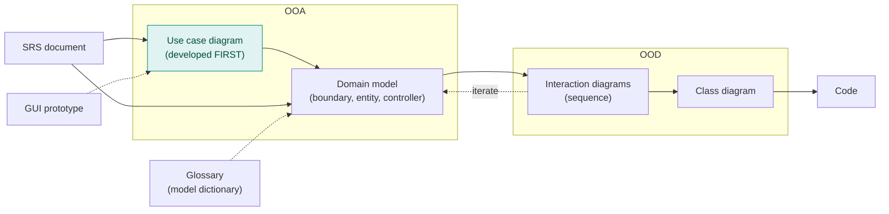

# 12. Object-Oriented Software Development: OOAD, Design Patterns & CRC Cards

> **Lecture:** L9B (30-10-2026 to 13-11-2026) · **Source:** `LECTURE 9B- Ch8-Object Oriented Design  &SW Development  pdf.pdf` (Rajib Mall, Ch. 8)

---

## 🎯 In one line

Start from the **use case model**, build a **domain model** of **boundary, entity and controller** objects, assign responsibilities through **interaction (sequence) diagrams** (using **CRC cards** and **design patterns** such as Expert, Creator, Controller, Facade and MVC), and refine everything into a **class diagram** that translates directly into code.

---

## 1. OOA vs OOD (slides 140, 162, 167) ⭐⭐

| | **Object-Oriented Analysis (OOA)** | **Object-Oriented Design (OOD)** |
|---|---|---|
| Produces | **Analysis model**: an initial model built from the SRS | **Design model**: refined from the analysis model |
| Implementation decisions? | **Avoided** (call sequences, hardware, database) | **Made** |
| Lifetime | Stays valid even if implementation choices change | Tied to the implementation |
| To code | **Hard** to translate into code | **Easy** to translate. CASE tools generate code templates |

**Example (trade-house automation, "display sales statistics"):** the analysis model shows the input data, output data and processing required. The design shows **exactly which classes and method interactions** compute the statistics.

| Procedural approach | Object-oriented approach |
|---|---|
| A **marked difference** between analysis (DFDs) and design (structure charts) | The transition from analysis to design is **gradual**, with no clear boundary |
| **Different notations** for each | **Identical notations** (UML) for both |

---

## 2. Design patterns (slides 141–156) ⭐⭐⭐

### What and why

- The **concept of patterns** originated in **architecture** (buildings designed with standard pattern solutions) and was carried into OO design as a **mechanism for design reuse**.
- **Design patterns are commonly accepted solutions to problems that recur during the design of different applications.**
- The basic idea: every complex problem has many **sub-problems**, and some of them **repeat across many problems**. Master the accepted solutions to those few, and you can **spot** them in new problems and reuse the solutions effortlessly.
- Patterns are not revolutionary. They are **common sense** plus sound design principles. But while grappling with the nitty-gritty of complex designs, designers **forget common sense** and produce unnecessarily complex, inflexible and inefficient solutions. Patterns guard against that.
- Patterns are created and documented by people who **spot repeating themes** across designs. They **capture and transfer design knowledge** and form a **standard vocabulary** among professionals.

**A pattern's documentation has four parts:**
1. The **problem**.
2. The **context** in which the problem occurs.
3. The **solution**.
4. The **context in which the solution would and would not work**.

### Three types of patterns

| Type | Level | Description |
|---|---|---|
| **Architectural patterns** | **High-level** | Solutions to problems identifiable during **architectural design** (the overall structure of the system). Not directly translatable into code |
| **Design patterns** | **Medium** | A scheme for **structuring classes** and their required **interactions**, described in terms of classes, instances, roles and collaborations |
| **Idioms** | **Low-level** | **Language-specific** ways to implement a solution, e.g. the C idiom `for (i = 0; i < 100; i++) { … }` for walking an array |

> An English idiom ("raining cats and dogs") means something different from its words. A programming idiom similarly packs a standard meaning into a standard code shape.

| **Pattern** | **Idiom** |
|---|---|
| Describes a recurring problem and the **core** of its solution | Describes a recurring problem with a **more specific** solution and **fewer variations** |
| Can generate **many distinct designs** | Applies only to a **narrow context** (e.g. C++) |

### Patterns vs algorithms

Both give reusable solutions, **but**:
- **Algorithms** focus on **reducing time and/or space**.
- **Patterns** focus on **understandability, maintainability and ease of development**.

### Pros and cons of design patterns

| Advantages | Shortcomings |
|---|---|
| A **common vocabulary**, which improves communication | **No direct code reuse**: a pattern is tailored to circumstances, so no fixed code goes with it |
| Capture and disseminate **expert knowledge** | **No methodology** exists for choosing the right pattern at the right point |
| Designs that are **flexible, efficient and maintainable** | |
| Guide **correct design decisions**, improving quality | |
| **Fewer design iterations**, so higher productivity | |

### Antipatterns

If a pattern is **best practice**, an **antipattern** is a **lesson learned from bad design**. It helps you recognise solutions that look attractive at first but become a liability later. There are two types: those describing **bad solutions** that lead to bad situations, and those describing **how to avoid** bad solutions.

| Antipattern | Problem |
|---|---|
| **Input kludge** | No mechanism specified or implemented for **handling invalid inputs** |
| **Magic pushbutton** | Implementation logic coded **directly inside the UI code** instead of in separate classes |
| **Race hazard** | Failing to consider **all possible orderings of events** |

---

## 3. Some common design patterns (slides 156–161, 193–198) ⭐⭐⭐

The most popular are those of **Larman** and the **Gang of Four (GoF)**: Erich Gamma, Richard Helm, Ralph Johnson and John Vlissides.

### Expert

- **Problem:** when an activity must be performed, **which class should be responsible** for it?
- **Solution:** assign it to the **information expert**, the class that has **all or most of the information** needed. Objects should do things related to the data they store.
- **Example:** who computes the **total cost of a sale**? `SaleTransaction` (it knows its items) asks each `SaleItem` for its **subTotal**, and each `SaleItem` asks its `ItemSpecification` for the **price**.

```
 :SaleTransaction ──1: total──► (itself)
        │ 2: subTotal
        ▼
   :SaleItem ──3: price──► :ItemSpecification
```

### Creator

- **Problem:** which class should **create** new instances of a class C2?
- **Solution:** give class C1 the responsibility if **one or more** of these hold:
  - C1 is an **aggregator** of C2 objects;
  - C1 **contains** C2 objects;
  - C1 **closely uses** C2 objects;
  - C1 has the **data needed to initialise** C2 objects.
- **Why:** an aggregator must keep its components' addresses anyway, and other objects request component information through it.

### Controller

- **Problem:** who should handle **actor requests**?
- **Solution:** a **separate controller object for each use case**.

### Facade

- **Problem:** how should **client classes outside a package** request the services of a service package?
- **Context:** a package is a cohesive set of classes with strongly related responsibilities, e.g. an **RDBMS interface package**.
- **Solution:** create a separate class (e.g. **`DBFacade`**) that gives **one common interface** to the package's services.
- **Analogy:** if all students enter a lecture-hall complex through **one main entrance**, one notice there reaches everyone. If they enter through many doors and windows, notices must go everywhere. Clients that go through a facade are **shielded from changes** inside the package, because the facade absorbs them.

### Model–view separation

- **Problem:** how should **non-GUI (model / domain-layer)** classes communicate with **GUI (view / presentation-layer)** classes?
- **Solution:** depending on context, use **Observer**, **MVC** or **Publish–Subscribe**.

| Pattern | Problem it solves |
|---|---|
| **Observer** | A model object is accessed by **several view objects**. How should the interactions be structured? |
| **MVC (Model–View–Controller)** | How should GUI (boundary) objects interact with model objects? |
| **Publish–Subscribe** | A **more general** Observer. A model is accessed by **many** views and its state **changes asynchronously** |
| **Intermediary (Proxy)** | How should a **client** object invoke a **server** object's services? |

**MVC: two solutions** (slide 198):
1. **Pull from above:** the boundary object **invokes** other objects. This **doesn't work** when data must be displayed **asynchronously** (simulations, stock-market alerts, network monitors).
2. **Publish–subscribe:** boundary objects **register** with an **event manager**. Other objects notify the event manager when an event occurs, and it notifies the registered boundary objects by **callback**.

---

## 4. The OOAD methodology and the Unified Process (slides 168–172) ⭐⭐⭐



1. Build the **use case model** first (the **central** model; everything must conform to it).
2. Build the **domain model** by analysing the use cases and the SRS.
3. **Iteratively** refine the domain model into a **class diagram** using **interaction diagrams**.
4. Translate the class diagram into **code** (CASE tools generate skeletons).

The process is **iterative and incremental**. A **glossary** defines every concept name, improving communication and reducing risk.

**The Unified Process** (Jacobson, Booch and Rumbaugh, *The Unified Software Development Process*, 1999; Rational's version is called **RUP**) is an incremental, iterative, **extensible framework** to be customised per project. Its two main characteristics are:
1. **Use-case driven.**
2. **Iterative.**

---

## 5. Domain modelling: boundary, entity and controller objects (slides 173–181) ⭐⭐⭐

**Domain modelling** (also called **conceptual modelling**) captures the concepts (objects) in the problem domain and their relationships. There are **three types** of objects, shown with class **stereotypes**:

| Stereotype | Role | Responsibilities | How to identify |
|---|---|---|---|
| **`<<boundary>>`** (e.g. Cashier Interface) | Objects **actors interact with**: screens, menus, forms, dialogs (GUI) | Read input, **validate** input, **format** output, display results. **No processing** | One per actor–use case interaction |
| **`<<entity>>`** (e.g. Account, Book, BookRegister) | **Hold information**: data tables and files | Store and fetch data, plus elementary operations (search, sort, update). **"Dumb servers"**. **Outlive** use-case executions and are **the most stable** objects (they change least during operation) | **Nouns** in the problem description |
| **`<<control>>`** (e.g. Withdrawal) | **Coordinate** a use case | Coordinate entity objects, interface with boundary objects, **realise the use case**, embody **most of its logic** | **One per use case** (sometimes more) |

**Advantages of a controller:** it **decouples boundary and entity objects**, which reduces design complexity and makes the system **tolerant to changes** in the UI or processing logic.

```
 Actor ──► [Boundary 1] ──► [Controller] ──► [Entity 1]
                              │    │
            [Boundary 2] ◄────┘    ├───────► [Entity 2]
                                   └───────► [Entity 3]
     (use case realised by collaboration of boundary, controller and entity objects)
```

---

## 6. Interaction modelling and CRC cards (slides 182–187) ⭐⭐

**The goals of interaction modelling:**
1. To **allocate the responsibilities** of a use case among boundary, entity and controller objects. Each responsibility becomes an **operation** of a class.
2. To show the **detailed interactions over time** needed to complete each use case.

It is captured in **sequence** and **collaboration** diagrams. Collaboration diagrams can be obtained **mechanically** from sequence diagrams, **so developing the sequence diagrams alone is sufficient**.

### CRC (Class–Responsibility–Collaborator) cards

- Pioneered by **Ward Cunningham and Kent Beck**.
- Complex use cases involve many objects and are hard for one person to grasp, so a **team** assigns responsibilities using CRC cards.
- **One index card (4″ × 6″) per class** in the domain model. It records the **class name**, its **responsibilities** and its **collaborators** (the objects it needs to work with). The small size **limits** the number of responsibilities per class.
- Used in **small group sessions** where people **role-play** the classes. Each holds the cards of the classes they play. Use cases are taken one at a time, starting from the actor's request.
- A **responsibility** is a high-level description of the part a class plays in a use case. It usually becomes a single method, but may need several.

**Example: the `BookRegister` CRC card**

| **BookRegister** | |
|---|---|
| **Responsibility** | **Collaborator** |
| FindBook | Book |
| CreateBook | Book |
| ReserveBook | Book |

---

## 7. Worked example 1: Tic-tac-toe (slides 199–203) ⭐⭐

> A human player and the computer make alternate moves on a 3×3 board. The user enters 1–9 to mark an unmarked square. Whoever first gets three marks in a row, column or diagonal wins, and a message announces the winner. If the board fills with no winner, the game is drawn. The computer always tries to win.

- **Use case model:** one use case, **play move**, with actor **Player**.
- **Domain model:** initially just **Board** (entity). Refined to add **PlayMoveBoundary** and **PlayMoveController**.

**Sequence diagram for "play move":**

```
:PlayMoveBoundary          :PlayMoveController            :Board
   │ acceptMove                  │                            │
   │──── move ─────────────────►│ checkMoveValidity          │
   │                             │──────────────────────────►│
   │ [invalidMove]               │  [invalidMove]             │
   │◄─ announceInvalidMove ─────│◄─ announceInvalidMove ─────│
   │                             │ checkWinner                │
   │                             │──────────────────────────►│
   │◄─ [game over] announceResult│◄─ [game over] announceResult
   │                             │ playMove (computer)        │
   │                             │──────────────────────────►│
   │                             │ checkWinner                │
   │◄─ [game over] announceResult│◄─ [game over] announceResult
   │                             │ getBoardPositions          │
   │◄─ displayBoardPositions ───│◄───────────────────────────│
   │◄─ [game not over] promptNextMove                         │
```

**Class diagram:**

| Board | PlayMoveController | PlayMoveBoundary |
|---|---|---|
| `int position[9]` | | |
| checkMoveValidity · checkResult · playMove | announceInvalidMove · announceResult | announceInvalidMove · announceResult · displayBoard |

---

## 8. Worked example 2: Supermarket Prize Scheme (slides 204–213) ⭐⭐⭐

*(The problem statement is in [Ch. 11 §3](11-uml-diagrams.md).)*

**Use case model:** *register customer* (actor: Customer), *register sales* (Sales Clerk), *select winners* (Manager).

**Initial domain model (entity objects only):**

```
 SalesHistory 1 ◇────* SalesRecords
 CustomerRegister 1 ◇────* CustomerRecord
```

**Refined domain model:** add one **boundary** and one **controller** per use case:
- `RegisterCustomerBoundary` / `RegisterCustomerController`
- `RegisterSalesBoundary` / `RegisterSalesController`
- `SelectWinnersBoundary` / `SelectWinnersController`

**Sequence diagram: register customer**

```
:RegisterCustomerBoundary  :RegisterCustomerController  :CustomerRegister   :CustomerRecord
   │ register                    │                            │                    │
   │───────────────────────────►│ register                   │                    │
   │                             │──────────────────────────►│ checkDuplicate     │
   │                             │                            │── *match ────────►│
   │                             │      [duplicate] showError │                    │
   │◄──────── [duplicate] showError ─────────────────────────│                    │
   │                             │                            │ generateCIN        │
   │                             │                            │── create ────────►(new :CustomerRecord)
   │◄──────────────── displayCIN ────────────────────────────│                    │
```

**Sequence diagram: select winners.** `:SelectWinnerBoundary` → `selectWinners` → `:SelectWinnerController` → `selectWinners` → `:SalesHistory`, which calls `*computeSales` on every `:SalesRecord`. Then `[for each winner] findWinnerDetails` → `:CustomerRegister` → `[for each winner] browse` → `:CustomerRecord`. Finally `announces` returns to the boundary.

**Sequence diagram: register sales.** `:RegisterSalesBoundary` → `registerSales` → `:RegisterSalesController` → `registerSales` → `:SalesHistory`, which **creates** a new `:SalesRecord`. `confirm` returns back up. In the **refined** version the controller is dropped, because the use case is so simple that the boundary talks to `SalesHistory` directly.

**Final class diagram:**

| SalesHistory | SalesRecords | CustomerRegister | CustomerRecord |
|---|---|---|---|
| selectWinners · registerSales | computeSales · browse · create | findWinnerDetails · register | name · address · (salesDetails) · browse · checkDuplicate · create |

with `SalesHistory 1 ◇—* SalesRecords` and `CustomerRegister 1 ◇—* CustomerRecord`.

---

## 9. Common exam questions

1. **Differentiate OOA and OOD.** Analysis vs design model; gradual transition in OO (§1).
2. **What are design patterns? Why use them? Give the four parts of a pattern's documentation.** See §2.
3. **Differentiate architectural patterns, design patterns and idioms; patterns vs algorithms.** See §2.
4. **What are antipatterns? Give examples.** See §2.
5. **Explain the Expert / Creator / Controller / Facade / MVC (publish–subscribe) patterns.** See §3.
6. **Describe the OOAD methodology / the Unified Process.** See §4.
7. **Explain boundary, entity and controller objects. Why use a controller?** See §5.
8. **What are CRC cards? How are they used?** See §6.
9. **For the supermarket prize scheme / tic-tac-toe, draw the use case, domain model, sequence and class diagrams.** See §7–§8.

---

## ⚡ Quick revision

- **OOA → analysis model** (no implementation decisions). **OOD → design model** (codeable). In OO the transition is gradual, with the same notation.
- **Pattern** = a commonly accepted solution to a recurring problem. Its documentation: **problem · context · solution · where it works or doesn't**.
- **Architectural** (high) / **design** (classes) / **idiom** (language-specific).
- Patterns aim at **maintainability**; algorithms aim at **time and space**.
- Antipatterns: **input kludge**, **magic pushbutton**, **race hazard**.
- **Expert** (the class with the info does it) · **Creator** (the aggregator or initialising-data holder creates) · **Controller** (one per use case) · **Facade** (one entry to a package) · **MVC / publish–subscribe** (asynchronous views).
- OOAD: **use case → domain model (B/E/C) → sequence diagrams → class diagram → code**. Unified Process = **use-case driven + iterative**.
- **Boundary** = UI, validates. **Entity** = data, nouns, dumb servers. **Controller** = per use case, holds the logic and decouples.
- **CRC card** = Class, Responsibility, Collaborator; 4″ × 6″; role-play (Cunningham and Beck).

---

**Previous:** [← 11. UML Diagrams](11-uml-diagrams.md) · **Next:** [13. User Interface Design →](13-user-interface-design.md)
