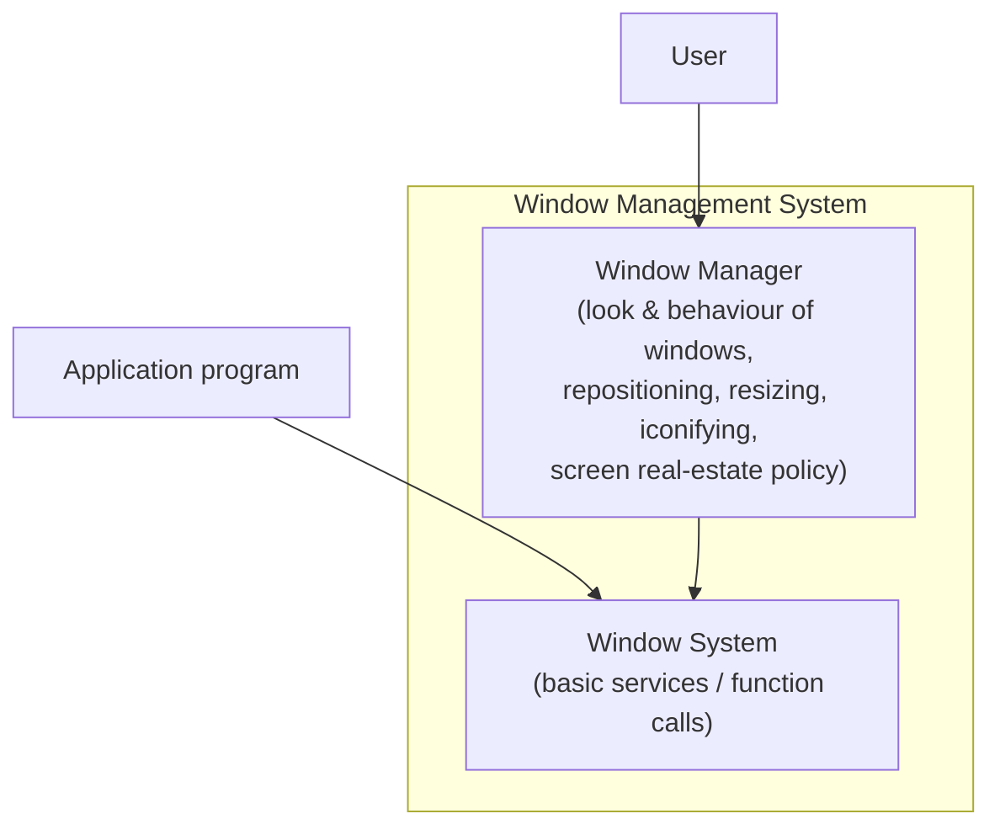

# 13. User Interface Design

> **Lecture:** L10 (13-11-2026) · **Source:** `LECTURE 10  Ch9- User Interface Design 141126.pdf` (Rajib Mall, Ch. 9)

---

## 🎯 In one line

A good user interface is **easy to learn, fast to use, hard to make mistakes with, consistent, attractive, and full of feedback and help**. Interfaces are **command-language**, **menu-based** or **direct-manipulation (iconic)**, and modern GUIs combine all three on top of a **window management system** built from **widgets**.

---

## 1. Why user interface design matters (slides 2–3)

- The UI is responsible for **all interaction with the user**, and almost every product is now highly interactive. (Early batch systems had no UI at all.)
- **Users judge a software product by its interface.** A hard-to-use interface leads to **more user errors** and **dissatisfaction**. Users get irritated when commands don't do what they intuitively expect.
- For many interactive applications, **up to 50 % of the total development effort** goes into the UI. If it isn't developed systematically, the effort rises tremendously.

---

## 2. Characteristics of a good user interface (slides 3–10) ⭐⭐⭐

| # | Characteristic | Explanation |
|---|---|---|
| 1 | **Speed of learning** | Simple to learn; **no memorising commands**. Helped by **consistency**, **metaphors** (day-to-day real-life concepts, e.g. *cut and paste* in an editor, like paper), **intuitive command names** and **symbolic** command issue |
| 2 | **Speed of use** | The time and effort to **initiate and execute** commands should be minimal. Bad examples: typing lengthy commands, or moving the mouse to widely separated parts of the screen |
| 3 | **Speed of recall** | Once learnt, how to use it should be easy to **recall**. Improved by metaphors, symbolic command issue and intuitive names |
| 4 | **Error prevention (low error rate)** | Minimise the scope for errors. Error rates can be **measured** by instrumenting the UI to record error frequency and type. Reduced by **consistent** names, procedures and behaviour, and **simple** command issue |
| 5 | **Attractiveness** | Catches attention. **Graphics-based** UIs have a definite advantage over text-based ones |
| 6 | **Consistency** | Lets users **generalise** knowledge from one part to another. It helps speed of learning, speed of recall **and** a lower error rate |
| 7 | **Feedback** | Constant feedback on actions. If a request takes more than a few seconds, say it's still **being processed**, and show **progress** if possible. Without feedback, novices panic and start recovery or shutdown |
| 8 | **Support for multiple skill levels** | **Novices** want usability and are put off by **cryptic names** and complex procedures. **Experts** want speed and are put off by elaborate commands, so they look for **hot-keys** and **macros** |
| 9 | **Error recovery (undo)** | Everyone makes mistakes, so let users **undo** them |
| 10 | **User guidance and on-line help** | Delivered through the **on-line help system** and through **guidance and error messages** |

### User guidance: help, guidance and error messages (slides 8–10) ⭐⭐

**On-line help** should be:
- **context-dependent** (track what the user is doing). **Generic help messages are not very useful.**
- tailored to the user's **experience level**;
- graphical, and **not just a copy of the user manual**.

**Guidance messages** should prompt the user about **next actions**, the **current status** and the **progress so far**. Offer different levels of sophistication, and let users **turn off detailed messages**.

**Error messages** should be:
- **polite**;
- **not accompanied by noise** (a beep that might embarrass the user);
- **suggest how to rectify** the error;
- **offer on-line help** about the error if appropriate.

> ❌ **Improper:** `File not found!`
> ✅ **Better:** `The file "report.doc" could not be found in C:\Reports. Check the name, or choose Browse to locate it. [Help]`

---

## 3. Mode-based vs modeless interfaces (slide 11) ⭐⭐

| | **Modeless** | **Mode-based** |
|---|---|---|
| Commands available | The **same set at all times** | **Different sets** depending on the **mode** (state), i.e. on the past sequence of commands |
| Representation | – | A **state-transition diagram**: each **node is a mode**, annotated with the commands meaningful there |
| Example | A simple text field | `vi` editor (insert vs command mode) |

---

## 4. GUI vs text-based interfaces (slides 11–12) ⭐⭐

| GUI | Text-based |
|---|---|
| **Several windows** with different information shown **simultaneously**, so the user can work with several items (even unrelated applications) at once | One screen of text |
| **Iconic** representation and **symbolic manipulation** (drag a file to the trash to delete it), which is intuitive and memorable | Typed commands |
| **Menu selection** with a **pointing device** (mouse, light pen) makes issuing commands simpler | Keyboard only |
| ✗ Needs **graphics terminals** and special input devices, which are more expensive | ✓ Runs on **cheap alphanumeric terminals** |

Cheap graphics, bit-mapped high-resolution displays and local processing power have made GUIs the norm.

---

## 5. The three types of user interface (slides 12–20) ⭐⭐⭐

> There are **no simple guidelines** for which part of an interface should use which type. It depends on the designer's experience. **Modern applications combine all three.**

### 5.1 Command language-based interface

Users **frame commands in a language** and type them. Sophisticated versions let users **compose** primitive commands into complex ones, like a programming language: `cat x.dat | grep 123`.

| Advantages | Disadvantages |
|---|---|
| **Easy to develop** (compiler-writing techniques are mature) | All interaction is through the **keyboard**, so it can't use a mouse |
| Runs on **cheap alphanumeric terminals** | **Unsuitable for casual or inexperienced users** |
| **Most efficient** of the three. Composition reduces the number of names to remember, keeps commands concise and allows fast interaction | **Hard to learn**: commands must be **memorised** |
| | Users make errors both **formulating** and **typing** commands |

**Design issues:**
- Choosing **mnemonics** that are meaningful yet concise.
- Whether users may **redefine command names** (useful, but adds complexity).
- Whether commands can be **composed**, with clear and unambiguous syntax and semantics. This is powerful for experts but unnecessary for novices.

### 5.2 Menu-based interface

| Advantages | Disadvantages |
|---|---|
| **No need to remember** exact command names | **Slower for experienced users** (they type fast and can compose commands) |
| **Minimal typing** (select with a pointing device), which suits occasional users | **Composition is not possible**: logical connectives (*and*, *or*, *all*) are awkward |
| | With **many choices** it is hard to design. **Structuring hundreds or thousands of choices** is the main problem |

**Structuring large menus:**

| Technique | How it works | When to use |
|---|---|---|
| **Scrolling menu** | Scroll through items that don't fit on one screen | Options are **highly related**, e.g. font-size selection |
| **Walking menu** | Selecting an item opens a **submenu adjacent** to it (cascading) | **Tens** (not hundreds) of choices, because each submenu takes screen space |
| **Hierarchical menu** | Selecting an item **replaces** the menu with a submenu, forming a **tree** | **Many** choices. But users face **navigational problems** and lose track of where they are |

> Walking menus are a form of hierarchical menu, practical when the tree is **shallow**.

### 5.3 Direct manipulation (iconic) interface

Information is presented as **visual models (objects, icons)**, and actions are performed **on the visual representations**, e.g. drag a file icon onto the trash icon to delete it.

| Advantages | Disadvantages |
|---|---|
| Icons are **recognised very easily** | **Too slow** for experienced users |
| Icons are **language-independent** | **Hard to form complex commands**: deleting all files in a directory means dragging each one, versus a single `delete *.*` in a command language |

### Comparison

| | Command language | Menu | Direct manipulation |
|---|---|---|---|
| Learning | Hard | Easy | Easiest |
| Speed for experts | **Fastest** | Slower | Slowest |
| Composition | **Yes** | No | No |
| Typing | Most | Little | None |
| Hardware | Cheapest | Pointing device helps | Graphics + mouse |

---

## 6. Windowing systems, WMS and widgets (slides 21–24) ⭐⭐

### Window

A **window** is a **rectangular area** on the screen. It is a **virtual screen** for independent activities (one for editing, another for drawing, …).

| Part | Contents | Controlled by |
|---|---|---|
| **Client area** | The whole window **except borders and scroll bars** | The **programmer** (application) |
| **Non-client area** | Borders, title bar, scroll bars | The **window manager** |

### Window Management System (WMS)

- A WMS is primarily a **resource manager**: it tracks **screen area** and allocates it to windows.
- More broadly it is a **User Interface Management System (UIMS)**. It gives windows their **basic behaviour** (move, resize, iconify) and provides **utility routines** to programmers (create and destroy windows, change attributes, draw text and lines).

| Component | Role |
|---|---|
| **Window manager** | The user interacts with it for window operations (repositioning, resizing, **iconification**). It controls the screen's **real-estate policy** and decides **how windows look and behave**. It is built **on top of** the window system, and several window managers can run on the same window system |
| **Window system** | Provides the basic services (function calls). Applications invoke it for UI functions. It has a **large number of routines**, which are cumbersome to use directly |

### Widgets

- **Widget** = **wi**ndow ob**ject**: the **building blocks** of GUI design (buttons, labels, text boxes, menus, scroll bars, …). Most WMSs provide widgets as a higher-level abstraction over the raw routines.
- Like any object, a widget has **data**: geometric attributes (size, location) and others (background and foreground colour). It also has **operations**: resize, move, draw.
- **The key advantage is consistency:** standard widgets make interfaces familiar across applications, so users carry knowledge over. That improves **productivity**, reduces **errors** and greatly **cuts learning time**.

---

## 7. Common exam questions

1. **Why is UI design important?** Users judge software by it; up to 50 % of effort goes into it (§1).
2. **List and explain the characteristics of a good user interface.** See §2.
3. **What makes a good error message / on-line help?** See §2.
4. **Differentiate mode-based and modeless interfaces.** See §3.
5. **Compare GUI and text-based interfaces.** See §4.
6. **Explain the three types of interface with their advantages and disadvantages.** See §5.
7. **How are large menus structured? Scrolling, walking, hierarchical.** See §5.2.
8. **What is a window? Client vs non-client area?** See §6.
9. **Explain the window management system: window manager vs window system.** See §6.
10. **What are widgets? Why use them?** Consistency (§6).

---

## ⚡ Quick revision

- Good UI: **speed of learning · speed of use · speed of recall · low error rate · attractiveness · consistency · feedback · multiple skill levels · undo · guidance and help**.
- **Consistency** helps learning, recall **and** error rate. **Metaphors** help learning.
- Error messages: **polite, no noise, suggest a fix, link to help**. `File not found!` is the class's bad example.
- **Modeless** = the same commands always. **Mode-based** = commands depend on state (a state-transition diagram).
- **Command language:** efficient, composable, cheap terminals, but hard to learn. **Menu:** no memorising, but slow for experts and not composable. **Iconic:** easy and language-independent, but slow and not composable.
- Menus: **scrolling** (related items) · **walking** (tens of items) · **hierarchical** (many items, navigation problems).
- WMS = **window manager** (look and behaviour, user-facing) + **window system** (services, app-facing). **Widgets** = window objects that give consistency.

---

**Previous:** [← 12. OO Design & Design Patterns](12-object-oriented-design-and-patterns.md) · **Next:** [14. Software Project Management →](14-software-project-management.md)
