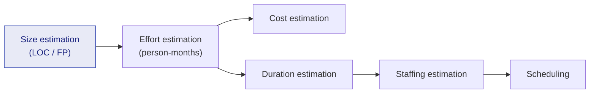

# 14. Software Project Management: Planning, Estimation (COCOMO), Staffing & Teams

> **Lecture:** L12 (22-11-2026) · **Source:** `Lecture 12-Software Project Management _Prahlad NIT 2026.pdf` (Rajib Mall, Ch. 3). All numerical examples were recomputed.

---

## 🎯 In one line

To plan a project, estimate **size** (LOC or function points), then **effort** (COCOMO: $E = a\,(\text{KLOC})^b$), then **duration** ($T = 2.5\,E^c$) and **cost**. Staff it following the **Rayleigh curve**, and remember that **compressing the schedule is extremely expensive** (Putnam: effort $\propto 1/t_d^4$).

---

## 1. Project management (slides 4–13)

**Many software projects fail because of faulty project management.** The goal is to enable a group of engineers to work efficiently towards successful completion.

**Responsibilities of a project manager:** project proposal writing, **cost estimation**, **scheduling**, **staffing**, project **monitoring and control**, **configuration management**, **risk management**, and managerial reports and presentations.

These fall into two groups: **project planning**, and **project monitoring and control**.

### Project planning activities (undertaken once the project is found feasible)

| Activity | Content |
|---|---|
| **Estimation** | Effort, cost, resources and duration |
| **Scheduling** | |
| **Staff organisation** | Staffing plans |
| **Risk handling** | Identification, analysis and abatement |
| **Miscellaneous plans** | Quality assurance plan, configuration management plan, … |

Unrealistic estimates lead to **irritating delays, customer dissatisfaction, poor team morale and poor-quality work**, and ultimately to **project failure**.

**Sliding window planning:** plan in **stages** rather than all at once. This protects managers from making big commitments too early, and plans become more accurate as information arrives.

### The SPMP document

After planning, the plans are documented in the **Software Project Management Plan (SPMP)**:

| Section | Contents |
|---|---|
| 1. Introduction | Objectives, major functions, performance issues, management and technical constraints |
| 2. **Project estimates** | Historical data, estimation techniques, effort, cost and duration estimates |
| 3. **Resource plan** | People, hardware and software, special resources |
| 4. **Schedules** | Work breakdown structure, task network, **Gantt chart**, **PERT chart** |
| 5. **Risk management plan** | Risk analysis, identification, estimation, abatement |
| 6. Project tracking and control plan | |
| 7. Miscellaneous plans | Process tailoring, quality assurance |

---

## 2. The estimation sequence (slide 14) ⭐⭐⭐



**Size → effort → duration and cost.**

**Three approaches to estimation:**

| Approach | Idea | Examples |
|---|---|---|
| **Empirical** | An **educated guess** based on past experience | Expert judgement, Delphi |
| **Heuristic** | The quantity can be expressed as a **mathematical expression** of some characteristics | **COCOMO** |
| **Analytical** | Derive results starting from **simple assumptions** | **Halstead's software science** |

---

## 3. Size metrics (slides 17–22) ⭐⭐⭐

### Lines of code (LOC)

The **simplest and most widely used** metric. **Comments and blank lines are not counted.**

**Disadvantages of LOC:**
1. Size **varies with coding style**.
2. It focuses on **coding alone**, ignoring the other phases.
3. It **correlates poorly** with quality and efficiency.
4. It **penalises high-level languages and code reuse**, since less code looks like less work.
5. It measures only **lexical or textual complexity**, not structural or logical complexity.
6. **LOC is hard to estimate from the problem description**, so it is not useful for planning.

### Function point (FP) metric (Albrecht, early 1980s)

$$\boxed{FP = 4\times\#\text{inputs} + 5\times\#\text{outputs} + 4\times\#\text{inquiries} + 10\times\#\text{files} + 10\times\#\text{interfaces}}$$

| Parameter | What counts as one |
|---|---|
| **Input** | A **set of related inputs** is counted as **one** input |
| **Output** | A set of related outputs is counted as one output |
| **Inquiry** | Each **user query type** |
| **File** | **Logically related data**: data structures or physical files |
| **Interface** | Data transfer to **other systems** |

**Worked example 🆕.** A system has 30 inputs, 60 outputs, 24 inquiries, 8 files and 2 interfaces:
$$FP = 4(30) + 5(60) + 4(24) + 10(8) + 10(2) = 120 + 300 + 96 + 80 + 20 = \mathbf{616}$$

| FP: proponents say | FP: opponents say |
|---|---|
| **Language-independent** | **Subjective**: different people get different counts |
| Size can be derived **from the problem description** | |

**Major drawback:** the size of a function is assumed **independent of its complexity**. The **feature point metric** extends FP with an extra parameter, **algorithm complexity**.

---

## 4. Empirical estimation (slides 23–26) ⭐⭐

| Technique | How | Weakness / strength |
|---|---|---|
| **Expert judgement** | An expert divides the product into components (GUI, database, communication, billing, …), guesses each, and **adds** them up | "A euphemism for a **guess** made by an expert". Suffers from **individual bias** |
| **Delphi estimation** | A **team of experts and a coordinator**. Experts estimate **independently** with their rationale. The coordinator circulates any **extraordinary rationale**, experts **re-estimate**, and the rounds repeat. **Experts never meet** to discuss | Overcomes individual bias and avoids domination by senior or assertive members |

---

## 5. Heuristic estimation and COCOMO (slides 27–48) ⭐⭐⭐

**Single-variable model:** $\text{Parameter} = c_1 \times (\text{characteristic})^{d_1}$
**Multivariable model:** $\text{Parameter} = c_1\,e_1^{d_1} + c_2\,e_2^{d_2} + \cdots$, which is usually **more accurate**.

### COCOMO (COnstructive COst MOdel, Boehm)

**Three product classes:**

| Class | Team / product | Roughly corresponds to |
|---|---|---|
| **Organic** | Relatively **small** team developing a **well-understood** application | **Application** programs (data processing, scientific) |
| **Semi-detached** | A **mix of experienced and inexperienced** staff | **Utility** programs (compilers, linkers, editors) |
| **Embedded** | Strongly coupled to **complex hardware** or **real-time** systems | **System** programs (operating systems, real-time) |

Boehm derived his equations from **historical data on many real projects**. Estimation is done in three stages: **basic**, **intermediate** and **complete** COCOMO.

### Basic COCOMO ⭐⭐⭐

$$\boxed{\text{Effort} = a_1\,(\text{KLOC})^{a_2}\ \text{PM} \qquad T_{dev} = b_1\,(\text{Effort})^{b_2}\ \text{months}}$$

| Class | $a_1$ | $a_2$ | $b_1$ | $b_2$ |
|---|---|---|---|---|
| **Organic** | 2.4 | 1.05 | 2.5 | 0.38 |
| **Semi-detached** | 3.0 | 1.12 | 2.5 | 0.35 |
| **Embedded** | 3.6 | 1.20 | 2.5 | 0.32 |

**Effort** is in **person-months (PM)**. **Cost** = effort × salary per person-month. **Average staff** = effort ÷ $T_{dev}$.

**Class example (slide 40): organic, 32,000 LOC (32 KLOC)**
$$\text{Effort} = 2.4 \times 32^{1.05} = 2.4 \times 38.05 = \mathbf{91\ PM}$$
$$T_{dev} = 2.5 \times 91^{0.38} = 2.5 \times 5.56 = \mathbf{14\ months}$$
Average staff ≈ 91 / 14 ≈ **6.5 engineers**. At ₹1,00,000 per PM the cost ≈ **₹91 lakh**.

**The same 32 KLOC in all three classes 🆕 (verified):**

| Class | Effort (PM) | $T_{dev}$ (months) | Average staff |
|---|---|---|---|
| Organic | 91.3 | 13.9 | 6.6 |
| Semi-detached | 145.5 | 14.3 | 10.2 |
| Embedded | 230.4 | 14.3 | 16.2 |

**Observations (slides 36–39):**
- **Effort is super-linear** in size (the exponent is > 1): doubling the size **more than doubles** the effort (larger projects need more coordination).
- **Development time is sub-linear** in size: **doubling the size does not double the time**, because larger products have **more parallel activities** for more engineers.
- **Development time is roughly the same for all three classes.** A **60 KLOC** program takes about **18 months** whether organic, semi-detached or embedded (verified: 17.9 / 18.3 / 18.1 months), and 30 KLOC takes about 14 months. Embedded projects need **more effort**, but they get it by using **more people in parallel**.

### Intermediate COCOMO (slides 41–45)

Basic COCOMO assumes effort depends on **size alone**. In reality, reliability requirements, availability of **CASE tools**, data size and so on matter too. Intermediate COCOMO **refines** the basic estimate by multiplying it by **15 cost drivers**, each rated on a scale.
- **Modern programming practices** → scale **down**.
- **Stringent reliability** requirements → scale **up**.

| Cost-driver class | Examples |
|---|---|
| **Product** | Inherent complexity, required reliability |
| **Computer** | Execution-time and storage constraints |
| **Personnel** | Experience of the staff |
| **Development environment** | Sophistication of the tools |

**Shortcoming of basic and intermediate COCOMO:** both treat the product as **one homogeneous entity**, but large systems are made of sub-systems of different types and reliability needs.

### Complete COCOMO (slides 47–48)

Estimate **each sub-system separately** (each with its own class and drivers) and **add** the costs. This **reduces the margin of error**.

**Example:** a **Management Information System** for an organisation with offices across the country:
- **Database part**: semi-detached;
- **GUI part**: organic;
- **Communication part**: embedded.

Each is costed separately and summed.

---

## 6. Analytical estimation: Halstead's software science (slides 49–50)

An **analytical** technique to estimate **size, effort and development time**. It uses primitive program parameters, the **numbers of operators and operands**, and derives expressions for **program length, potential minimum volume, actual volume, language level, effort and development time**.

*(The standard formulas, for reference: vocabulary $\eta = \eta_1 + \eta_2$, length $N = N_1 + N_2$, volume $V = N\log_2\eta$, effort $E = V/L$, time $T = E/18$ seconds.)*

---

## 7. Staffing level estimation (slides 51–57) ⭐⭐⭐

### Norden and the Rayleigh curve

**Norden (1958)** studied many R&D projects and found that the number of **full-time staff** needed over time follows a **Rayleigh curve**. It is specified by two parameters: **$t_d$**, the time at which the curve **peaks**, and **$K$**, the **total area** (total effort).

```
 staff
   ▲          ___
   │        /     \
   │      /         \
   │    /             \___
   │  /                    \______
   └──┬─────────┬────────────────────► time
      start    t_d (peak ≈ system testing / release)
       ◄── 40 % of area ──►◄────── 60 % of area ──────►
```

- **Very few engineers at the start** (planning and specification).
- Numbers **rise** as detailed work begins and **peak** at $t_d$, which corresponds to **system testing and product release** (Putnam).
- After that, staff **fall** until installation and delivery.
- About **40 %** of the area lies to the **left** of $t_d$ and **60 %** to the right.

### Putnam's model (1976)

Putnam studied many army projects and found the Rayleigh–Norden curve relates **delivered code size** to **effort and time**:

$$\boxed{L = C_k\,K^{1/3}\,t_d^{4/3}}$$

$L$ = size (KLOC), $K$ = total effort, $t_d$ = development time, $C_k$ = **state-of-technology constant** (programmer productivity):

| $C_k$ | Environment |
|---|---|
| **2** | **Poor**: no methodology, poor documentation and reviews |
| **8** | **Good**: software engineering principles used |
| **11** | **Excellent** |

### Effect of schedule compression on cost ⭐⭐⭐

Rearranging Putnam's equation for a fixed product size gives:
$$K = \frac{L^3}{C_k^3\,t_d^4} = \frac{C_1}{t_d^4} \qquad\Longrightarrow\qquad \boxed{\frac{K_1}{K_2} = \frac{t_{d2}^{\,4}}{t_{d1}^{\,4}}}$$

**Example (slide 55):** a product estimated at **1 year** must be delivered in **6 months**:
$$\frac{K_{new}}{K_{old}} = \left(\frac{12}{6}\right)^4 = \mathbf{16}$$
So **halving the schedule multiplies effort and cost by 16**. The relation is **highly non-linear**: a small compression gives a big penalty, and stretching the schedule (fewer people for longer) gives a big reward.

**Limits:**
- Putnam's model works for **very large** systems but **overestimates** the effort for small and medium ones.
- **Boehm:** *"There is a limit beyond which the schedule of a software project cannot be reduced by buying any more personnel or equipment."* That limit is about **75 % of the nominal time**. Compressing by **more than 25 %** is very unlikely to succeed, because parallelism is limited and sequential activities can't be sped up by adding people (they'd sit idle).
- *(Check: compressing to 75 % under Putnam would already need $(1/0.75)^4 \approx 3.2\times$ the effort.)*

### Jensen model

Similar to Putnam, but it **softens** the effect of compression and so suits **small and medium** projects:
$$L = C_{te}\,t_d\,K^{1/2}$$
where $C_{te}$ is the **effective technology constant**.

---

## 8. Organisation and team structure (slides 58–65) ⭐⭐⭐

### Organisation structure

| | **Functional organisation** | **Project organisation** |
|---|---|---|
| How | Engineers are grouped by **function** (specification, design, coding, testing, maintenance) and lent to projects | Engineers are assigned to **one project for its whole duration** and do all phases |
| Advantages | **Specialisation**, **ease of staffing**, **good documentation** (each phase is handed to another team), **errors caught earlier** | Engineers **save time** learning project details; **job rotation** |

### Team structures

| Team | Description | Suitable for | Problems |
|---|---|---|---|
| **Chief programmer** | A **senior engineer** gives technical leadership, **partitions** the task, and **verifies and integrates** the members' work | Well-understood tasks within one person's grasp, where **early completion** outweighs morale and personal development. Routine work | **Single point of failure**: too much responsibility and authority on the chief |
| **Democratic** | A manager gives **administrative** leadership. **Technical leadership rotates** among members | **Small** projects (fewer than 5–6 engineers), **research-oriented** or less-understood problems | Time wasted **arguing about trivial points** (no authority) |
| **Mixed control** | Draws on both. **Communication is limited** to the small groups most likely to benefit | **Large** organisations and projects | |

**Democratic teams give higher morale and job satisfaction**, so there is less turnover, and a group can invent better solutions than one individual.

```
 Chief programmer:          Democratic:              Mixed:
        Chief                  ●───●                    Manager
      /  |  \                  │ ╳ │                 /         \
     ●   ●   ●                 ●───●           Sr. eng.      Sr. eng.
  (communicate via chief)  (everyone talks)    /  |  \       /  |  \
                                               ● ─ ● ─ ●     ● ─ ● ─ ●
```

---

## 9. Common exam questions

1. **What are the responsibilities of a project manager? List the project planning activities.** See §1.
2. **What is sliding window planning? Give the organisation of the SPMP document.** See §1.
3. **Compare LOC and FP metrics; disadvantages of LOC.** See §3.
4. **Compute FP for the given counts.** See §3.
5. **Explain expert judgement and Delphi estimation.** See §4.
6. **Explain basic, intermediate and complete COCOMO.** See §5.
7. **Estimate effort and time for an X-KLOC organic / semi-detached / embedded product** (the 32 KLOC organic example: 91 PM, 14 months). See §5.
8. **Why is development time roughly the same for all three classes? Why is it sub-linear?** See §5.
9. **Explain the Rayleigh curve and Putnam's model. What is the effect of schedule compression?** (1 year → 6 months = 16×) See §7.
10. **Compare chief-programmer, democratic and mixed teams; functional vs project organisation.** See §8.

---

## ⚡ Quick revision

- **Size → effort → duration and cost → staffing → schedule.**
- Estimation: **empirical** (expert, Delphi) · **heuristic** (COCOMO) · **analytical** (Halstead).
- LOC: simple but style-dependent, penalises high-level languages, hard to estimate early.
- **FP = 4·in + 5·out + 4·inq + 10·files + 10·interfaces**. Language-independent but subjective. Feature points add algorithm complexity.
- **COCOMO:** organic **2.4/1.05**, semi-detached **3.0/1.12**, embedded **3.6/1.20**. Time = **2.5 E^0.38 / 0.35 / 0.32**.
- 32 KLOC organic = **91 PM, 14 months**. 60 KLOC is about **18 months for any class**.
- Effort is **super-linear**; time is **sub-linear**. Intermediate COCOMO = **15 cost drivers**. Complete COCOMO = **sum over sub-systems**.
- **Rayleigh:** peak at $t_d$ (system testing), 40 % before and 60 % after. **Putnam** $L = C_k K^{1/3} t_d^{4/3}$, $C_k$ = 2 / 8 / 11.
- **$K \propto 1/t_d^4$**: halving the time costs **16×**. Boehm: you can't compress below about **75 %**.
- Teams: **chief programmer** (routine, single point of failure) · **democratic** (small or R&D, morale) · **mixed** (large).

---

**Previous:** [← 13. User Interface Design](13-user-interface-design.md) · **Next:** [15. Testing & Debugging →](15-testing-and-debugging.md)
