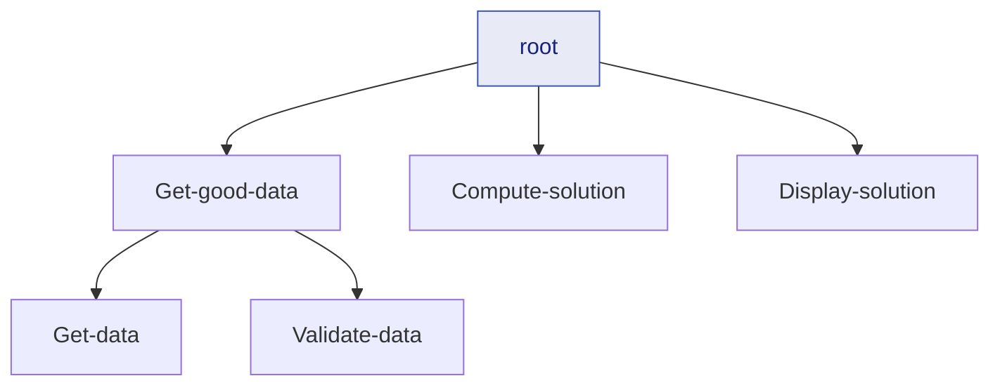

# 15. Testing & Debugging

> **Lecture:** "Lecture 11/13" (17-11-2026) · **Source:** `Lecture 13 Testing & Debugging 171126.pdf` (Rajib Mall, Ch. 10). White-box testing is explicitly **excluded** in class ("In this unit we will not study white-box testing").

---

## 🎯 In one line

Testing runs **carefully designed test cases** (not random ones) to expose failures. **Black-box** cases come from the specification via **equivalence partitioning** and **boundary value analysis**. **Debugging** then locates and fixes the error. Testing happens at **unit → integration → system** level, and **error seeding** estimates how many bugs remain.

---

## 1. Overview of testing activities (slides 2–3)

1. **Test suite design.**
2. **Run** the test cases and observe the results to **detect failures**.
3. **Debug** to **locate** the errors.
4. **Correct** the errors.

**How to test a program:** input test data and observe the output. If the program doesn't behave as expected, note the conditions under which it failed, then debug and correct it later.

---

## 2. Basic terminology (slides 4–6) ⭐⭐⭐

| Term | Meaning |
|---|---|
| **Error** (also called **defect** or **bug**) | A mistake in the program. *Its mere presence may not cause a failure* |
| **Fault** | An **incorrect state** entered during execution, e.g. a variable holds the wrong value. *It may or may not lead to a failure* |
| **Failure** | A **manifestation** of an error: observable wrong behaviour |
| **Test case** | A triplet **[I, S, O]**: **I** = input data, **S** = system **state** when the data is input, **O** = **expected output** |
| **Test suite** | The **set of all test cases** |

### Verification vs validation ⭐⭐⭐

| **Verification** | **Validation** |
|---|---|
| Does the output of **one phase conform to the previous phase**? | Does the **fully developed system conform to the SRS**? |
| *"Are we building the product right?"* | *"Are we building the right product?"* |
| Aim: **phase containment of errors** | Aim: the **final product is error-free** |
| During development (reviews, inspections) | At the end (system testing) |

---

## 3. Designing test cases (slides 7–9) ⭐⭐⭐

- **Exhaustive testing** of any non-trivial system is **impractical**, because the input domain is huge.
- So design an **optimal test suite**: of **reasonable size**, yet uncovering **as many errors as possible**.
- **Random test cases don't work well.** Many add nothing, because they detect only errors already caught by other cases. **The number of test cases is no indication of effectiveness.**

**Class example (slide 8): find the maximum of `x` and `y`.**

```c
if (x > y) max = x;
else       max = x;      // BUG: should be max = y
```

| Test suite | Size | Detects the bug? |
|---|---|---|
| {(x=3, y=2); **(x=2, y=3)**} | 2 | ✅ **Yes**: (2, 3) returns 2 instead of 3 |
| {(x=3, y=2); (x=4, y=3); (x=5, y=1)} | 3 | ❌ **No**: every case has x > y, so the `else` branch never runs |

**The larger suite is worse.** Each test case should detect a **different** error, which needs a **systematic** approach.

### Two approaches

| **Black-box testing** (functional testing) | **White-box testing** (glass-box, structural testing) |
|---|---|
| Test cases designed from the **functional specification (SRS)** only | Needs knowledge of the **internal structure** (design and code) |
| **No knowledge** of design or code | Statement, branch and path coverage, … |
| Techniques: **equivalence class partitioning**, **boundary value analysis** | *Not studied in this unit* |

---

## 4. Equivalence class partitioning (slides 13–19) ⭐⭐⭐

Partition the input values into **equivalence classes** such that the program **behaves similarly for every value in a class**. Then **one representative from each class** is as good as any other value from it.

**Guidelines:**

| Input specified as | Equivalence classes |
|---|---|
| A **range** of values (e.g. 1 to 5000) | **One valid** class + **two invalid** classes (below and above the range) |
| An **enumerated set** (e.g. {a, b, c}) | **One valid** class (members of the set) + **one invalid** class (non-members) |

**Class example (slides 17–19).** A program reads an integer in **[1, 5000]** and computes its **square root**.

```
   invalid (< 1)      │       valid [1, 5000]        │     invalid (> 5000)
 ─────────────────────1──────────────────────────────5000───────────────────►
        e.g. −5                    e.g. 500                    e.g. 6000
```

The three equivalence classes are: (1) negative integers (values < 1), (2) integers in 1–5000, (3) integers > 5000.

**Test suite:** {**−5, 500, 6000**}.

---

## 5. Boundary value analysis (slides 20–21) ⭐⭐⭐

- Many errors occur **at the boundaries** of equivalence classes. They may be purely psychological: programmers fail to see the special processing needed at boundaries, for example writing **`<` instead of `<=`**.
- **BVA:** select test cases **at the boundaries** of the equivalence classes.

**Same example:** for the square-root function on [1, 5000], the test cases must include **{0, 1, 5000, 5001}**.

> **In an exam, combine both:** ECP gives {−5, 500, 6000} and BVA gives {0, 1, 5000, 5001}, so the complete black-box suite is **{−5, 0, 1, 500, 5000, 5001, 6000}**.

---

## 6. Debugging (slides 22–33) ⭐⭐⭐

Once errors are detected, find their **precise location** and **fix** them. Each approach has its own place.

| Approach | How it works | Pros / cons |
|---|---|---|
| **1. Brute force** | Load the program with **print statements** for intermediate values and hope one reveals the error | The **most common** method, but the **least efficient** |
| **Symbolic debugger** | Makes brute force systematic: **inspect and modify** variables by name, **single-step**, set **breakpoints** and **watchpoints** | Named "symbolic" because early debuggers only showed **raw dumps**, and you had to work out which value was which variable |
| **2. Backtracking** | Start at the statement where the **symptom** appears and **trace the source backwards** until the error is found | Fairly common, but the number of backward paths becomes **unmanageable** for large programs |
| **3. Cause elimination** | List **all possible causes** of the symptom and run **tests to eliminate** each | Related: **software fault tree analysis** (identify errors from symptoms) |
| **4. Program slicing** | Like backtracking, but the search is limited to a **slice**: for a given **variable at a given statement**, the **preceding lines that can influence its value** | Much **smaller search space** |

**Class backtracking example (slide 27):**

```c
int main() {
    int i, j, s;
    i = 1;
    while (i <= 10) {
        s = s + i;        // ← s used before being initialised
        i++;  j = j++;    // ← j uninitialised; j = j++ is undefined behaviour
    }
    printf("%d", s);      // symptom: a garbage sum is printed
}
```

Backtracking from the wrong output of `printf("%d", s)` leads to `s = s + i` and then to the declaration: **`s` is never initialised**. (`j` is never used, so `j = j++` doesn't affect the output, but it is a bug in its own right.)

**Program slicing example (slide 31):**

```c
1  int main() {
2      int i, s;
3      i = 1; s = 1;
4      while (i <= 10) {
5          s = s + i;
6          i++; }
7      printf("%d", s);
8      printf("%d", i);
9  }
```

- **Slice for `i` at line 8:** lines 3 (`i = 1`), 4, 6 only. The lines updating `s` are irrelevant.
- **Slice for `s` at line 7:** lines 3, 4, 5, 6 (the loop control `i` influences how many times `s` is updated).

### Debugging guidelines (slide 32)

- Debugging needs a **thorough understanding of the design**, and may sometimes require a **full redesign**.
- A common novice mistake is to **fix the symptom instead of the error**.
- **An error correction may introduce new errors**, so after **every** round of fixes carry out **regression testing**.

---

## 7. Program analysis tools (slides 33–35) ⭐⭐

Automated tools that take **source code** and report on size, complexity, adequacy of commenting, adherence to standards, adequacy of test cases, etc.

| **Static analysis tools** | **Dynamic analysis tools** |
|---|---|
| Assess the program **without executing** it | **Execute** the program and **record** its behaviour |
| Check coding standards and **commenting** | Report the **adequacy of test cases** (coverage) |
| Find errors such as **uninitialised variables**, **mismatched actual and formal parameters**, **variables declared but never used** | |
| Code walkthroughs and inspections are also static methods, but the term usually means **automated** tools | |

---

## 8. Testing in the life cycle (slides 36–38)

- The aim is to identify **all** defects, but even thorough testing **can't guarantee** error-free software (the input domain is too large).
- Testing still **exposes many errors**, reduces defects and **increases user confidence**.
- Testing takes the **maximum effort** of all phases, and the **most engineers** are usually engaged in it.
- It is **wrong** to see testing as secondary or uninteresting. It is **as challenging as specification, design and coding**, and needs **creative thinking**.

**Three levels:** **unit testing → integration testing → system testing.**

---

## 9. Unit testing (slide 39)

Modules are tested **in isolation**. If all modules were tested together, it would be hard to tell which module has the error. Unit testing **reduces debugging effort several-fold**, and programmers do it **immediately after coding** each module.

*(In practice a unit under test needs a **driver**, which calls it, and **stubs**, which stand in for the modules it calls.)*

---

## 10. Integration testing (slides 40–46) ⭐⭐⭐

After unit testing, modules are integrated **in steps according to an integration plan**, and the partially integrated system is tested at each step. The plan is developed by **examining the structure chart** (e.g. the RMS example: `root` → `Get-good-data` (`Get-data`, `Validate-data`) / `Compute-solution` / `Display-solution`; see [Ch. 8](08-structured-design-examples-and-structure-charts.md)).

| Approach | How | Pros / cons |
|---|---|---|
| **Big bang** | **All modules are put together at once** and tested | Simplest; only for **very small** systems. An error could be in **any** module, so it is **very hard to localise** and **expensive to debug** |
| **Bottom-up** | Integrate and test the **lowest-level modules first**, then move up | Testing starts only once bottom-level modules are ready. If the system has **many small subsystems**, it degenerates towards **big bang** |
| **Top-down** | Start with the **main routine** and one or two subordinates. Once this **skeleton** is tested, add its **immediate subordinates** and so on downwards | Testing waits until **top-level modules** are coded and unit tested. Needs **stubs** for lower modules |
| **Mixed (sandwich)** | Uses **both** top-down and bottom-up | **Most common** approach; testing can start as soon as any modules are ready |



*Top-down tests `root` first (with stubs below it). Bottom-up tests `Get-data` and `Validate-data` first (with drivers above them).*

---

## 11. System testing (slides 47–48) ⭐⭐⭐

**Validates the fully developed system against its requirements (SRS).**

| Kind | Performed by | Purpose |
|---|---|---|
| **Alpha testing** | The **test team within the developing organisation** | In-house system testing |
| **Beta testing** | A **select group of friendly customers** | Real-world use before release |
| **Acceptance testing** | **The customer** | To decide whether to **accept or reject** the system |
| **Stress testing** (endurance testing) | The developer | Feed **abnormal input**: data **volume**, input **rate**, processing time and **memory use** pushed **beyond the designed capacity** |

> *The slide heading says "three main kinds" but lists four; stress testing is a performance test applied during system testing.*

---

## 12. How many errors remain? Error seeding (slides 49–51) ⭐⭐⭐

**Seed** the code with **known artificial errors** and see how many of them testing finds. Assume testing finds the same **proportion** of real errors as of seeded ones.

Let $N$ = total real errors, $n$ = real errors found, $S$ = seeded errors and $s$ = seeded errors found.

$$\frac{n}{N} = \frac{s}{S} \quad\Longrightarrow\quad \boxed{N = S\cdot\frac{n}{s}} \qquad \boxed{\text{Remaining} = N - n = n\cdot\frac{S - s}{s}}$$

**Class example (slide 51):** **100** errors are seeded, **90** of them are found, and **50** real errors are also found.
$$\text{Remaining} = 50 \times \frac{100 - 90}{90} = \frac{500}{90} = 5.6 \approx \mathbf{6}$$
*(Total real errors $N = 100 \times 50/90 \approx 55.6$, so about 6 are still latent.)*

**Caveats:** the seeded errors should **closely match the kinds of real errors**, but those are hard to predict. The **categories** of remaining errors can be estimated from **historical data** of similar projects.

---

## 13. Common exam questions

1. **Define error, fault and failure. What is a test case? A test suite?** See §2.
2. **Differentiate verification and validation.** See §2.
3. **Why is random testing inadequate? Explain with the max(x, y) example.** See §3.
4. **Differentiate black-box and white-box testing.** See §3.
5. **Explain equivalence class partitioning and boundary value analysis; design test cases for the square-root program [1, 5000].** See §4–§5.
6. **Explain the debugging approaches: brute force, backtracking, cause elimination, program slicing.** See §6.
7. **Give the debugging guidelines. What is regression testing?** See §6.
8. **Static vs dynamic analysis tools.** See §7.
9. **Explain the integration testing approaches.** See §10.
10. **Explain alpha, beta, acceptance and stress testing.** See §11.
11. **Estimate the remaining errors by error seeding.** See §12.

---

## ⚡ Quick revision

- **Error** (bug) → may cause a **fault** (bad state) → may cause a **failure** (visible). Test case = **[I, S, O]**.
- **Verification** = phase vs previous phase (building it right). **Validation** = system vs SRS (building the right thing).
- Random tests are bad: max(x, y) with {(3,2),(2,3)} finds the bug, but the bigger {(3,2),(4,3),(5,1)} doesn't.
- **Black-box** (spec only): **ECP** (range → 1 valid + 2 invalid; set → 1 valid + 1 invalid) and **BVA** (test at the edges). Square root [1, 5000]: ECP {−5, 500, 6000}, BVA {0, 1, 5000, 5001}.
- Debugging: **brute force** (prints) · **symbolic debugger** · **backtracking** · **cause elimination** (fault tree) · **program slicing**. Fix the **error**, not the symptom. **Regression test** after every fix.
- Static tools (no execution) vs dynamic tools (execution, test adequacy).
- Levels: **unit → integration** (big bang · bottom-up · top-down · **mixed, most common**) **→ system** (alpha · beta · acceptance · stress).
- **Error seeding:** remaining $= n(S - s)/s$. Class: $50 \times 10/90 \approx 6$.

---

**Previous:** [← 14. Software Project Management](14-software-project-management.md) · **Next:** [16. Software Quality Management →](16-software-quality-management.md)
