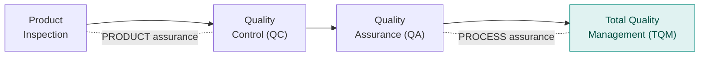
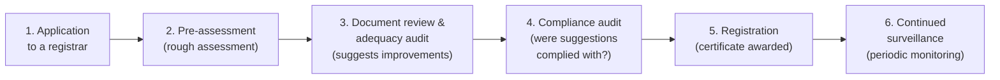

# 16. Software Quality Management: Quality Systems, ISO 9000, SEI CMM, PSP & Six Sigma

> **Lecture:** L17 (18-11-2026 to 20-11-2026) · **Source:** `LECTURE 17- Software Quality Management Prahlad NIT CS3501.pdf` (Rajib Mall, Ch. 11)

---

## 🎯 In one line

Software quality is more than "fitness of purpose": it is **correctness, reliability, efficiency, portability, usability, reusability and maintainability**. Quality systems have evolved from **inspection → QC → QA → TQM**, shifting from **product** to **process**. **ISO 9001** certifies that a documented process exists (≈ CMM level 3), and the **SEI CMM** grades process maturity in **five levels**.

---

## 1. What is software quality? (slides 4–12) ⭐⭐⭐

**Traditional definition:** *fitness of purpose*. A quality product does exactly what the users want. For software, that means satisfying the requirements in the SRS.

**Why that is not enough for software:**
- A product that is **functionally correct** but has an **almost unusable user interface** is not a quality product.
- A product that does everything users want but has **incomprehensible, unmaintainable code** is not a quality product either.

### The modern view: quality factors

| Factor | A product has it if… |
|---|---|
| **Correctness** | The requirements in the SRS are **correctly implemented** and results are **accurate** |
| **Reliability** | It works without failure over time |
| **Efficiency** | It uses resources (time, memory) economically |
| **Portability** | It can easily be made to work on **other operating systems, other machines, with other software** |
| **Usability** | **Both expert and novice** users can easily invoke its functions |
| **Reusability** | Its **modules can easily be reused** to develop new products |
| **Maintainability** | Errors are **easily corrected**, **new functions easily added**, and existing ones **easily modified** |

---

## 2. Quality management systems (slides 13–16) ⭐⭐

A **quality management system (quality system)** is the **principal methodology** an organisation uses to ensure its products have the desired quality. It consists of:
- a **managerial structure**, and
- **individual responsibilities**.

Quality is the **responsibility of the organisation as a whole**. Every quality-conscious organisation has an **independent quality department**, which needs **top-management support**; without it, employees won't take the quality system seriously.

**Quality system activities:**
1. **Auditing** of projects.
2. **Developing standards, procedures and guidelines.**
3. Producing **reports for top management** on the effectiveness of the quality system.
4. **Reviewing the quality system itself.**

A good quality system **must be well documented**. Without documentation, quality procedures become **ad hoc**, and product quality varies widely. An undocumented quality system also sends a clear message to staff about the organisation's attitude to quality. Standards such as **ISO 9000** guide how to organise one.

---

## 3. Evolution of quality systems (slides 17–25) ⭐⭐⭐

**Before World War II**, quality meant **inspecting finished products and eliminating the defective ones**. Since then there have been **four stages**, with many advances coming from **Japan** (they helped resurrect the Japanese economy).



| Stage | Idea |
|---|---|
| **1. Product inspection** | Inspect finished products and **reject defective ones** |
| **2. Quality control (QC)** | Detect and eliminate defective products **and determine the causes** of defects, aiming to **correct the causes**, not just reject. **Statistical QC (SQC)** infers output quality with **statistical sampling** instead of testing every product |
| **3. Quality assurance (QA)** | **If an organisation's processes are good and followed rigorously, the products are bound to be good.** Guidance for recognising, defining, analysing and **improving the production process** |
| **4. Total quality management (TQM)** | **Continuous process improvement through process measurement.** Goes beyond documenting processes to **optimising them through redesign** |
| *(Related)* **Business process re-engineering (BPR)** | Goes a step further: re-engineers **the way business is done** in the whole organisation, not just the software process |

> ⭐ **The quality paradigm has shifted from product assurance to process assurance.**

### Process improvement

**Process improvement** means introducing process changes to **improve product quality, reduce costs and accelerate schedules**. Most work so far has focused on **defect reduction**.

**The process improvement cycle: Measure → Analyse → Change** (and repeat).
- **Measure:** measure process attributes to form a **baseline**.
- **Analyse:** assess the process and identify **bottlenecks and weaknesses**.
- **Change:** introduce the identified changes.

**Process vs product quality:** for **manufactured goods**, the process is the **principal** quality determinant. For **design-based activity** such as software, other factors also matter, such as **the capabilities of the designers**.

### Product metrics vs process metrics ⭐⭐

| **Product metrics**: characteristics of the product | **Process metrics**: how the process is performing |
|---|---|
| **LOC**, **function points** (size) | **Review effectiveness** |
| **Person-months** (effort) | Average **defects found per hour of inspection** |
| **Months** (development time) | Average **defect correction time** |
| Time complexity of algorithms | **Productivity** |
| | Failures detected in testing per LOC |
| | **Latent defects** per line of code |

### Process attributes (slide 27)

| Attribute | Question |
|---|---|
| **Understandability** | Is the process explicitly defined and easy to understand? |
| **Visibility** | Do activities produce clear results, so progress is visible externally? |
| **Supportability** | Can **CASE tools** support the activities? |
| **Acceptability** | Is it acceptable to and usable by the engineers? |
| **Reliability** | Are process errors avoided or trapped before they become product errors? |
| **Robustness** | Can it continue despite unexpected problems? |
| **Maintainability** | Can it evolve with changing needs and improvements? |
| **Rapidity** | How fast can a system be delivered from a specification? |

---

## 4. ISO 9000 (slides 31–50) ⭐⭐⭐

**ISO** (International Standards Organisation) is a consortium of **63 countries**. It published the **ISO 9000 series in 1987**.

**What it is:**
- A set of **guidelines for maintaining a quality system** (repeatable, high-quality development), including organisational aspects: responsibilities, reporting, procedures, processes and resources.
- It serves as a **reference for contracts** between independent parties.
- It concerns the **production process**, **not the product itself**. The premise is that **if a proper process is followed, good-quality products are bound to follow**.

### The three standards

| Standard | Applies to | For software? |
|---|---|---|
| **ISO 9001** | Organisations engaged in **design, development, production and servicing** | ✅ **Applicable to software development organisations** |
| **ISO 9002** | Organisations that **only produce** and don't design (steel, car plants that buy designs) | ❌ |
| **ISO 9003** | Organisations involved **only in installation and testing** | ❌ |

### Why ISO 9000 is hard to apply to software

- It is a **generic** standard (from steel mills to service companies), and its terminology is hard to interpret for software.
- **Software is intangible**, so it is hard to control: you can't see and feel its progress, unlike a car on an assembly line.
- Software consumes **no raw material except data**, so the many **raw-material-control clauses** are irrelevant.
- **ISO 9000 Part 3 (1991)** was released to help interpret the standard for software, but official guidance is still inadequate.
- **ISO 9001:2000** **merged 9001, 9002 and 9003** into one. Design procedures are required only if the company actually designs. It **highlighted process management**, introduced **process performance metrics**, and made **continual improvement and customer satisfaction** explicit.

### Why get certified?

1. **Customer confidence** increases, especially internationally. **Many international contracts insist on it.**
2. It requires a **well-documented production process**, which contributes to **repeatable, higher-quality** software.
3. It makes development **focused, efficient and cost-effective**.
4. It **points out weaknesses** and recommends remedies.
5. It **sets the framework** for an optimal process and **TQM**.

### How to get certified: the registration stages ⭐⭐



> ⚠️ An ISO-certified organisation **may use the certificate in corporate advertisements** but **not to advertise its products**, because ISO 9000 certifies the **process**, not any product. Doing so **risks withdrawal** of the certificate.

### Summary of ISO 9001 requirements (clause numbers)

| Clause | Requirement |
|---|---|
| **4.1 Management responsibility** | An effective **quality policy**. The responsibilities of everyone affecting quality **defined and documented**. The quality system **independent** of development, so it is unbiased. **Periodic audits** |
| **4.2 Quality system** | Maintained and **documented** |
| **4.3 Contract reviews** | Review every contract before entering it: is it understood, and do we have the capability? |
| **4.4 Design control** | Control design (and coding). A **configuration control** system. Design inputs and the design **verified**, output of required quality, **changes controlled** |
| **4.5 Document control** | Procedures for document approval, issue and removal. **Controlled changes** (configuration management tools) |
| **4.6 Purchasing** | Bought-in material and software **checked** against requirements |
| **4.7 Purchaser-supplied products** | **Client-provided software** properly managed and checked |
| **4.8 Product identification** | The product is identifiable at all stages, which for software means **configuration management** |
| **4.9 Process control** | Development properly managed. Quality requirements in a **quality plan** |
| **4.10 Inspection and testing** | **Unit, integration and system testing**, with **test records** kept |
| **4.11 Inspection, measuring and test equipment** | **Maintained and calibrated** |
| **4.13 Control of nonconforming product** | Keep **untested or faulty software out of releases** |
| **4.14 Corrective action** | Correct errors, **investigate why** they occurred, and **improve the process**. Recurrence means the quality system needs improving |
| **4.18 Training** | Identify and meet training needs |

**Salient features:** all documents properly managed, authorised and controlled; proper plans with **progress monitored**; important documents **independently reviewed**; the product **tested against its specification**; organisational aspects such as how the quality team reports to management. *Most of it is common sense.*

### Shortcomings of ISO 9001 certification ⭐⭐⭐

1. It requires a process to be **followed**, but **doesn't guarantee the process is good**, and gives **no guidance** on defining one.
2. The certification process is **not fool-proof**: there is **no international accreditation agency**, so norms **vary** among agencies and registrars.
3. Certified organisations tend to **downplay domain expertise**, believing that with a good process **any engineer is as good as any other**.
4. In manufacturing there is a clear link between process and product quality. **Software development is creative**, and individual skill and **domain expertise** matter a lot.
5. It **doesn't automatically lead to continuous improvement or TQM**.
6. It addresses mostly **management** aspects and **ignores software-specific techniques**: configuration management, reviews, release builds, problem notification systems, intranets.

---

## 5. SEI Capability Maturity Model (CMM) (slides 51–60) ⭐⭐⭐

- Developed by the **Software Engineering Institute (SEI)** of **Carnegie Mellon University** to help the **US Department of Defense (DoD)** in **software acquisition**: it made likely **contractor performance** a factor in awarding contracts.
- DoD contractors adopted CMM-based improvement to win contracts, found **real business benefits**, and other organisations followed.
- **In simple words:** CMM **appraises the software process maturity** of a contractor on a **scale of levels**, and so **predicts the likely outcome of its next project**.
- It is based on the pioneering work of **Philip Crosby**.

**Two uses:**

| Use | Purpose |
|---|---|
| **Capability evaluation** | **External**: assess a contractor's process capability, which helps in **selecting** a contractor |
| **Software process assessment** | **Internal**: assess the organisation's own process and **suggest improvements**. Purely for internal use |

### The five maturity levels ⭐⭐⭐

```
 Level 5  OPTIMIZING   ── continuous process improvement from measurements
     ▲
 Level 4  MANAGED      ── product & process quality MEASURED; quantitative goals
     ▲
 Level 3  DEFINED      ── process defined & documented org-wide   (≈ ISO 9001)
     ▲
 Level 2  REPEATABLE   ── basic project management; past successes repeatable
     ▲
 Level 1  INITIAL      ── ad hoc, chaotic; success depends on heroics
```

| Level | Characteristics | Key process areas (KPAs) needed to **reach** it |
|---|---|---|
| **1. Initial** | **No formalised process** or project plans. **Ad hoc, often chaotic**. Each engineer follows their own process. Success depends on **individual effort and heroics** | — |
| **2. Repeatable** | **Basic project management**: tracking **cost, schedule and functionality**. Size and cost estimation (**FP, COCOMO**). The process is still **ad hoc and undocumented** and may vary between projects, but **success on similar applications can be repeated** (e.g. a family of products) | **Software project planning** (size, cost, schedule, monitoring) · **configuration management** · **subcontract management** |
| **3. Defined** | Management and development activities **defined and documented**, with a **common organisation-wide understanding** of activities, roles and responsibilities. Process and product quality are **not yet measured**. **ISO 9001 aims at this level** | **Process definition and documentation** · **reviews** · **training programme** |
| **4. Managed** | **Quantitative quality goals** are set. Process and product quality are **measured**, and the measurements are used to **control product quality** and **evaluate project performance** (rather than to improve the process). About **100** organisations worldwide | **Quantitative measurements** · **process management** |
| **5. Optimizing** | Measurement statistics are **analysed** for **continuous process improvement**. Known defect types are **prevented** by tuning the process. Lessons from projects are fed into the process. Best practices and innovations (tools, methods) are **transferred** across the organisation. About **500** organisations worldwide | **Defect prevention** · **technology change management** · **process change management** |

> **KPA** = the areas an organisation at the **previous** level must focus on to reach this level. The levels are **ordered** so each provides the foundation for the next. Trying to implement a *defined* process before a *repeatable* one is **counterproductive**, because managers are overwhelmed by schedule and budget pressure.
>
> *(The slide's "about 500 organisations at level 5" and "about 100 at level 4" are as given. In reality more organisations are rated at level 4 than at level 5, so quote the slide's figures with caution.)*

### ISO 9001 vs SEI CMM ⭐⭐⭐

| ISO 9001 | SEI CMM |
|---|---|
| Awarded by an **international standards body**, so it **can be quoted** in official documents and communications | Assessment is **purely for internal use** |
| **Generic**, for all industries | Developed **specifically for the software industry** |
| Aims at **quality assurance**; corresponds roughly to **CMM level 3** | Goes **beyond QA**, aiming at **TQM** (level 5) |
| Pass/fail | Gives a **list of KPAs** for moving between levels, so **gradual improvement** over several stages |

### CMMI (CMM Integration)

The **successor of CMM**. CMM was developed from **1987 to 1997**. **CMMI v1.1 came in 2002** and **v1.2 in August 2006**. Its goal is to **integrate many different models into one framework**. It was created by industry, government and the SEI.

### Do small organisations need CMM? (slides 62–63)

A highly systematic, measured approach suits **negotiated** and **safety-critical** software. **Small organisations** (internet and e-commerce apps, no product range, no revenue base or past experience) may find CMM **incompatible**:
- They believe *"we are all competent, we can't afford training, we all communicate, osmosis works, we are all heroes, so rules don't apply to us"*.
- They often suffer from undocumented requirements, inexperienced managers, poor documentation, resource allocation, training and peer reviews.
- A **two-week CMM appraisal is probably excessive**. They must first **flourish** at lower maturity before they can mature.

---

## 6. Personal Software Process (PSP) (slides 64–68) ⭐⭐

- Based on the work of **Watts Humphrey**. A **scaled-down industrial process for individual use**. (Even CMM assumes engineers use effective personal practices.)
- A process is the set of steps for doing a job, and **an engineer's quality and productivity are largely determined by their process**.
- PSP helps engineers **measure and improve** how they work: personal skills, **estimating and planning**, and **tracking performance against plans**. It provides a **defined process** that individuals can fine-tune, recognising that a personal process differs from a team one.

**Time management:** track how you spend time. Boring activities **seem longer** and interesting ones shorter than they really are. Record the time spent designing, coding, compiling and testing.

**PSP phases:** **Planning → Design → Code → Compile → Test → Postmortem**, with **time logs** and a **project plan summary**.

| Phase | Activities |
|---|---|
| **Planning** | Define the problem. **Estimate max, min and total LOC**. Determine **minutes/LOC**. Calculate max, min and total development time. Enter the plan in the **project plan summary**. Record planning time in the **log** |
| **Design** | Design the program, record it in the specified format, log the design time |
| **Code** | Implement the design in a standard format and log the time |
| **Compile** | Compile, **fix all defects**, log the time |
| **Test** | Test, fix all defects, log the testing time |
| **Postmortem** | Complete the plan summary with **actual time and size**, and log the postmortem time |

**PSP levels:**

| Level | Focus |
|---|---|
| **PSP 0** | **Personal measurement**: basic size measures |
| **PSP 1** | **Personal planning**: time and schedule |
| **PSP 2** | **Personal quality management**: design and code reviews |
| **PSP 3** | **Personal process evolution** |

---

## 7. Six Sigma (slides 69–70) ⭐⭐

- A **quantitative approach to eliminating defects**, applicable to **all industries** (manufacturing, product development, services).
- Its statistical representation describes **how a process is performing**.
- **To achieve Six Sigma, a process must produce no more than 3.4 defects per million opportunities.**

| Sigma level | Defects per million |
|---|---|
| 4σ | 6,210 |
| 5σ | 230 |
| **6σ** | **3.4** |

**Methodologies:**

| Method | Steps | Used for |
|---|---|---|
| **DMAIC** | **D**efine, **M**easure, **A**nalyze, **I**mprove, **C**ontrol | **Improving an existing** process |
| **DMADV** | **D**efine, **M**easure, **A**nalyze, **D**esign, **V**erify | **Designing a new** process or product |

- They are implemented by **Green Belt** and **Black Belt** workers, supervised by a **Master Black Belt**.
- **Pareto chart:** a simple **bar chart of defect data** that identifies the problems occurring **most frequently** or costing **most**.

**Current trends:** many organisations have already tuned their process for budget, schedule and quality. Competition now pushes them to **reduce delivery time** and **adopt Six Sigma**.

---

## 8. Common exam questions

1. **Why is "fitness of purpose" inadequate for software? List the modern quality factors.** See §1.
2. **What is a quality system? What are its activities?** See §2.
3. **Describe the evolution of quality systems (inspection → QC → QA → TQM). What is the paradigm shift?** See §3.
4. **Differentiate product and process metrics, with examples.** See §3.
5. **What is ISO 9000? Differentiate ISO 9001, 9002 and 9003. Why is it hard to apply to software?** See §4.
6. **Why get ISO 9000 certification? Describe the certification stages.** See §4.
7. **Summarise the ISO 9001 requirements. What are its shortcomings?** See §4.
8. **Explain the five levels of the SEI CMM with their KPAs.** See §5.
9. **Compare ISO 9001 and SEI CMM.** See §5.
10. **What is PSP? What is Six Sigma (DMAIC / DMADV)?** See §6–§7.

---

## ⚡ Quick revision

- Quality ≠ just fitness of purpose. Factors: **correctness, reliability, efficiency, portability, usability, reusability, maintainability**.
- Quality system = management structure + responsibilities, with an **independent quality department** and **top-management support**; **documented**.
- Evolution: **inspection → QC (SQC) → QA → TQM** (+ BPR). The shift is from **product to process**. Improvement cycle: **measure → analyse → change**.
- **ISO 9000 (1987):** **9001** (design to service; software), **9002** (production only), **9003** (installation and testing). It certifies the **process**, not the product. **9001:2000** merges them. Stages: **application → pre-assessment → document review → compliance audit → registration → surveillance**.
- ISO weaknesses: a process ≠ a good process; no global accreditation; downplays expertise; no TQM; ignores software techniques.
- **CMM: Initial → Repeatable (project mgmt) → Defined (documented, ≈ ISO 9001) → Managed (measured) → Optimizing (continuous improvement).** Internal use; software-specific; aims at TQM.
- **PSP** (Humphrey): Plan → Design → Code → Compile → Test → Postmortem; levels PSP 0–3.
- **Six Sigma: ≤ 3.4 defects per million.** **DMAIC** (improve) / **DMADV** (design). Green, Black and Master Black Belts; **Pareto chart**.

---

**Previous:** [← 15. Testing & Debugging](15-testing-and-debugging.md) · **Back to:** [SE index](../README.md)
